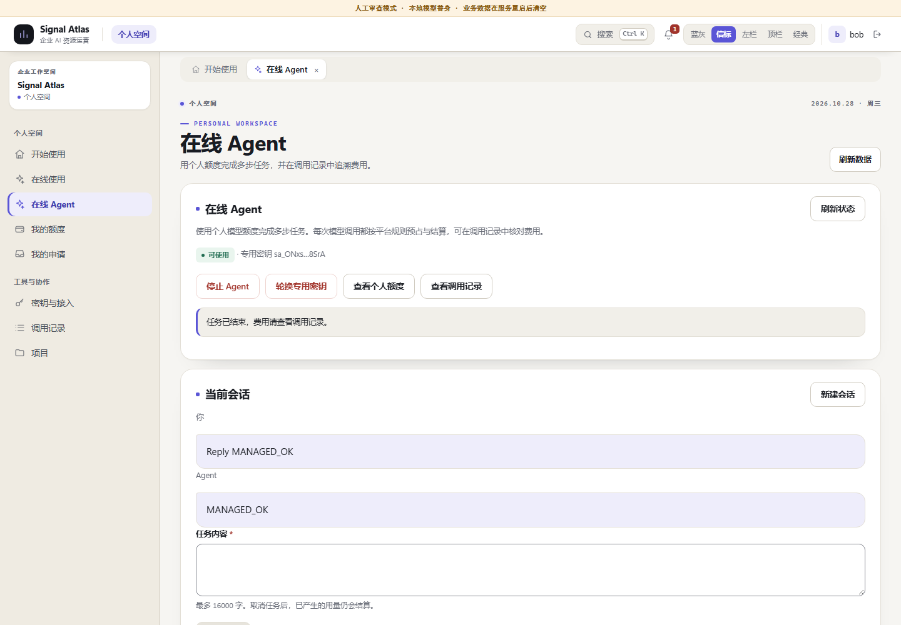

# 在线 Agent：平台入口与会话桥接

日期：2026-10-28。范围：本地开发环境，每用户独立 Octop 实例。

个人空间新增“在线 Agent”。用户登录平台后即可启动自己的实例、发起多轮流式聊天、取消任务、停止实例或轮换专用 Key，无需再输入 Octop 账号密码。平台服务端按当前 member ID 选择实例和会话；浏览器不持有 Octop 密码、JWT 或网关完整 Key。

这是平台会话到 Octop 的服务端桥接，尚未实现企业 OIDC 联邦登录，也未上线生产。沿用 [管理阶段](OCTOP-MANAGEMENT-2026-10-28.md) 的本地运行开关、源码固定版本、独立目录与实例生命周期规则。

## 用户路径

1. 登录平台，进入个人空间 → 在线 Agent。
2. 已具备个人模型权益和额度时，点击“启动 Agent”；失败可刷新状态后重新启动。已健康运行的实例直接复用。
3. 输入任务并发送。每次模型调用均经平台个人 Key 准入、预占和结算，可进入调用记录核对。
4. 当前页面支持继续同一会话或新建会话。切换页面标签保留输入和当前消息，关闭页面或刷新后开始新的页面会话。
5. 执行中可以取消；停止与轮换专用 Key 均先展示影响确认。重新启动会保留 Octop home，并签发所需的新专用 Key。Key 已吊销或过期时，不再把实例显示为可使用。

消息草稿与当前展示只保存在浏览器内存；Octop 自身仍在独立 home/SQLite 中持久化会话。当前入口没有提供历史会话列表、文件上传、工具审批、管理完整 Octop 控制台或项目用途选择。会话使用 `ask` 模式；UI 只展示一般工具执行提示，不转发原生工具参数与结果帧。

## 服务端约束

- `POST /api/v1/platform/agent-instances/self/chat` 受平台 SessionGuard 保护，只接受 `text` 和可选的 `threadId`。文本上限 16000 字，每实例同时一个任务，每次桥接最多 180 秒，不自动重试。
- 服务端根据平台会话确定实例；继续会话前向本人的 Agent 校验 thread 归属。请求不能指定 owner、Agent、目标 URL、Provider 或路径。
- 聊天、取消清理与实例生命周期共用本进程的实例锁。任务或取消清理未结束时，包括另一标签页/API 在内的启动、停止、轮换和过渡登录重置返回 409；等待任务完成或取消结束后重试。取消回调绑定原实例代次，已释放的回调不再生效，代次不匹配时不会吊销新 Key 或停止新运行器；迟到的 done 帧也不会提前释放清理中的锁。
- 浏览器通过携带平台 Cookie 的 POST 接收 SSE。返回事件仅有 `session`、`token`、`tool`、`error` 和 `done`，设置 `Cache-Control: no-store`。原生状态快照、Provider 配置、工具参数/结果和原生错误不转发；普通模型回复文本仍正常展示。
- 退出当前平台会话在事务提交后立即请求取消该会话的活跃任务。每秒重新校验平台会话、成员/组织有效性、实例代次与 Key 状态；账号停用、会话到期、实例停止或换 Key 后会取消当前任务。
- 浏览器取消、关页或断开连接都会明确发送 Octop `cancel` 帧；仅关闭 WebSocket 不足以取消原生任务。2.5 秒未收到完成确认时，吊销该实例专用 Key，并停止本执行器持有的对应进程树。不会按进程名称查杀。
- 交付失败补偿或取消吊销事务异常时，仍会尝试停止持有的运行器。交付补偿未提交时返回 503，并明确 Key 吊销尚待存储恢复，不声明已吊销；持久化的未完成操作保留，租约到期后由下一次启动按原中断恢复流程处理。停止进程本身失败仍需恢复后重试，不等同于已停止或已完成账务核对。
- 取消不代表免费。缺少完整用量的调用保留预占并进入待核对；本轮测试验证了各用户可用余额、已结算金额与待核对预占守恒。
- 原生 `/access` 凭据导出默认返回 409。只有显式设置 `OCTOP_LEGACY_LOGIN_ENABLED=true` 才开放旧诊断路径；平台 UI 不使用它。历史已导出的原生 JWT 不会因平台退出而撤销，必须保持该开关关闭，不能把原生 Octop 端口作为面向用户的外部入口。

接口契约见 [platform-api-v0.1.yaml](../contracts/platform-api-v0.1.yaml)。聊天正文与凭据不写入平台审计；沿用平台调用计费、个人额度和已有网关路由。

## 验证结果

2026-10-30 生命周期修复：控制面类型检查、构建及全部 191 项测试通过，其中聊天/生命周期定向测试 28 项。新增 6 项回归覆盖交付补偿存储失败后的停止与恢复、聊天/轮换互斥、旧取消回调失效、取消存储失败时的锁与停止、代次不匹配保护、迟到 done 帧及会话创建失败释放锁。仅使用内存仓库和模拟运行器，未启动真实 Octop、请求模型或操作 Codex 配置；不替代下面历史记录中的实际 Octop/PostgreSQL/浏览器验收。

| 检查 | 结果 |
| --- | --- |
| Workspace 类型检查与构建 | 通过；最终 Web 类型检查/生产构建与控制面构建再次通过 |
| 自动化测试 | contracts 18 + control-plane 152 + gateway 41 = 211 项通过；其中 Agent 定向 23 项 |
| 实际 Octop + 内存平台会话桥接 | 80 项通过 |
| 实际 Octop + 隔离 PostgreSQL + Chrome | 108 项通过，包括控制面重启后的映射和会话保留 |
| 浏览器 | Beacon / Azure / Sidebar / Next / Classic 五套壳层；1440×1000 与 390×844，无页面横向溢出 |
| 用户操作 | 登录后直接聊天、草稿随标签保留、取消、停止、重启、换 Key；弹窗 Tab / Shift+Tab、Escape 关闭与焦点返回 |
| 状态分支 | 实际空会话、回复、忙碌、停止；UI 注入禁用、读取中与 HTTP 503，分别验证说明、加载提示与重试入口 |
| 权限与会话 | 实际 API 验证跨用户会话拒绝、未登录/退出后 401、停用后 403，以及退出/停用/断连的原生取消确认 |
| 费用 | 两人独立计量、缓存 Token 定价、未知用量保留预占与资金守恒；0 次真实厂商模型调用 |

首次 PostgreSQL/浏览器运行通过功能操作后，在壳层矩阵中因测试错误地期待 `data-ui=sidebar` 而停止；实际侧栏共用 `data-ui=next`，通过 `data-layout=sidebar` 区分。修正测试选择器及失败诊断采集后，复跑 108 项通过。历史失败记录保留，不作为产品失败或完成证据。

运行态记录采集后，补充了失效 Key 的视图保护和默认禁用原生登录导出的定向单测；最终控制面 152 项和 Web 类型检查/构建均通过。运行态结果与当前源码摘要的对应范围见 [验证摘要](validation/octop-bridge-2026-10-28/summary.json)。

复跑均使用本地确定性模型替身，不消耗之前已用完的真实模型预算：

```powershell
pnpm check:octop:bridge
pnpm check:octop:web
# 构建后追加隔离 PostgreSQL 和重启验收：
node scripts/check-octop-managed.mjs --bridge --web --postgres
```

默认结果保存在 `.runtime/octop-results/`；可以用 `OCTOP_MANAGED_REPORT_PATH` 指定一个尚不存在的报告路径。浏览器截图写入本文的 validation 目录；测试结束清理本轮的 schema、home、浏览器 profile 和服务进程，不影响已有审查环境。



## 仍需完成

本地开发运行器保持默认关闭，并拒绝 production 或非回环控制面 HOST。尚未交付每用户独立执行身份/容器、工具文件与网络沙箱、外部入口 TLS、完整企业身份联邦、历史入口、组合备份恢复及长时负载验收。Windows 同一账户的不同进程/home 不能视为生产安全隔离。

下一阶段应先实现生产执行隔离与受控入口，再做云端部署验收；现有本地页面和会话桥接不构成直接上线依据。
