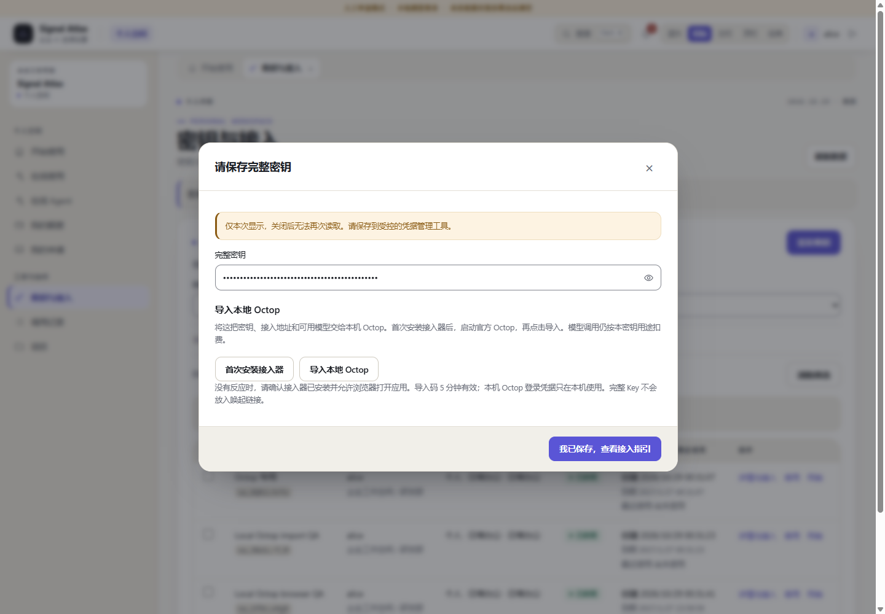

# 网页签发 API Key → 导入用户本机 Octop

日期：2026-10-29。首期范围：Windows 官方 Octop + 一次性安装的轻量本地接入器。

主流程已改为用户在平台网页签发自己的 API Key，再点击“导入本地 Octop”，由用户电脑上的接入器把平台地址、这把 Key 和可用模型导入官方 Octop。已有的平台托管实例/聊天桥接是另一条历史实现，本次本地接入不依赖它，也不要求先交付云端个人 Agent 实例。其他客户端适配留到后续。

## 使用路径

1. 在“密钥与接入”签发密钥，签发结果页出现“首次安装接入器”和“导入本地 Octop”。完整 Key 默认遮罩，可通过眼睛按钮查看。
2. 首次点击“首次安装接入器”，下载当前平台专用的 `安装-Octop-接入器.ps1`。在下载文件所在目录运行：

   ```powershell
   powershell.exe -NoProfile -ExecutionPolicy Bypass -File .\安装-Octop-接入器.ps1
   ```

   安装窗口会显示将连接的平台地址。确认后，仅为当前 Windows 用户注册 `signal-octop` 协议；保留官方 Octop 安装。当前首版交付的是 PowerShell 安装脚本，尚未制作签名 `.exe` 安装包。
3. 启动本机官方 Octop，回到网页点击“导入本地 Octop”。浏览器可能询问是否打开接入器，选择允许。
4. 本机窗口显示 Octop 地址、平台 API 地址、模型和配置影响。确认后，首次用有“模型服务”管理权限的本机 Octop 账号登录。该账号和密码仅发送到 `127.0.0.1`。
5. 导入成功后，可在 Octop 模型服务中选择平台模型。默认保留已有服务商和默认模型；勾选窗口里的选项才会更改全局默认模型，已有 Agent 的独立模型选择仍保留。

可勾选“记住本机登录”，将 Octop 登录令牌使用 Windows DPAPI 加密保存；不会保存明文密码。令牌过期或失效后，需要重新登录。网页只在接入器回报完成后显示“配置导入完成”，点击按钮本身只显示“已请求打开”。

导入服务商不绕过平台准入。Octop 的具体输出长度、工具上下文与请求仍需符合模型/用途的限制及剩余额度；配置导入成功不能解释为任意参数都能调用成功。

在“详情与接入”也能导入已签发密钥：用户需粘贴自己保存的完整值，平台不会恢复或读取历史明文 Key。普通用户不能导入其他人的 Key，运营也不能借这个入口导入他人的 Key。

## 实现边界

官方 `v1.0.3b1` Windows 安装脚本的 `wails.associateCustomProtocols` 为 `No custom protocols`，因此没有假设一个官方 `octop://import` 入口。接入器使用独立的 `signal-octop://import` 协议，通过 Octop 已有管理 API 创建/更新 Provider，不修改官方客户端代码。来源：[固定版本的 Windows 安装配置](https://github.com/TencentCloud/Octop/blob/890111b7879665840414ca28ab168b05b0db0921/desktop/src/build/windows/nsis/wails_tools.nsh)。

- 网页提交本人已有的 `keyId` 和完整 Key，服务端核对 Key 哈希、所有者、有效性、用途和模型。此操作不再签发一把新 Key，也不增加额度。
- 网关地址由控制面 `PUBLIC_GATEWAY_URL` 决定，请求不能指定目标地址；模型范围来自该 Key 当前授权。只导入文本 Chat Completions 模型，启用流式用量，不宣称支持 Responses、Messages、嵌入或多模态。
- 导入同时携带平台定义的模型上下文容量。实测本机 `1.0.2b7` 默认工具上下文保守估算约 34397 Token，超过 32K 测试模型声明容量时被网关正确拒绝；后续完整调用验收使用明确声明 128K 的本地替身。生产环境应选择足够容量的模型或减少工具上下文，不应通过扩大声明绕过真实限制。
- 唤起链接只包含 32 字节随机兑换码，不包含完整 Key。兑换码 5 分钟有效且仅可领取一次；重新发起同 Key 的导入会使旧记录失效。
- 本地接入器向安装时固定的平台地址 POST 兑换码，领取配置；领取前再次检查原平台会话、成员/组织、Key 状态和模型范围。退出登录、停用或吊销后，尚未领取的配置不会释放。
- 导入记录及短暂完整 Key 只存于有上限的控制面进程内存，不进入工作区、数据库、审计或幂等记录。领取后清除记录里的配置；超时/重启清除记录。首版适用于单控制面进程或有粘滞路由的环境，尚未交付多副本共享兑换存储。
- 接入器仅连接回环 Octop 地址，优先读取 `OCTOP_HOME` 或 `%USERPROFILE%\.octop` 下的 `desktop-port`，再读取桌面设置/config 的端口，最后回退 8088，不扫描其他主机或端口。
- 本机确认框说明同一 Octop 实例内其他账号可能看到/使用这把 Key；此路径适用于用户的个人实例，不提供 Octop 实例内部的每用户 Provider 隔离。
- 服务商名含稳定 Key ID，note 绑定平台与 Key ID。重复导入更新同一条受管服务商；同名但不属于接入器的服务商会报冲突，不覆盖。其他服务商保留。本机互斥锁避免同时运行两个导入窗口。
- 完成回执使用另一个一次性能力凭据。网页的“完成”是接入器自报导入完成，不等于完成了模型调用或费用验收，也不是设备证明。

接口契约见 [platform-api-v0.1.yaml](../contracts/platform-api-v0.1.yaml)。配置及兑换接口使用 POST 与 `Cache-Control: no-store`；反向代理也应保持请求/响应正文不进入访问日志。

## 部署配置

控制面配置：

```text
PUBLIC_GATEWAY_URL=https://api.example.com
```

可以包含 `/v1`，不包含时自动追加。生产模式必须明确配置；只允许 HTTPS 或本机开发用的回环 HTTP。该地址应能从用户电脑访问，并与 Web 构建的 `VITE_GATEWAY_URL` 保持一致。

Web 的 `VITE_CONTROL_PLANE_URL` 用于生成接入器固定的平台地址；公开部署使用 HTTPS。安装文件只包含平台地址与接入器代码，不含 API Key、用户密码或登录会话。反向代理需同时发布 Vite 的静态 `octop-connector.ps1` 文件。

接入器文件位于 `%LOCALAPPDATA%\SignalAtlas\OctopConnector`，仅当前用户有文件访问权限；登录缓存使用 DPAPI。安装器兼容从 PowerShell 7 启动，会转交 Windows PowerShell，并使用其系统模块路径；协议处理命令固定使用系统 Windows PowerShell，避免不同 PowerShell 版本混用。

如需卸载，只删除本接入器创建的 `HKCU:\Software\Classes\signal-octop` 注册项和上述接入器目录，保留 `.octop` 与官方客户端。应先核对协议注册命令确实指向本接入器；本次没有执行真实用户卸载或清理。

## 验证

已有结果：

- 控制面 162 项单测通过，包含新增 10 项兑换测试：归属、Key 匹配、登出/停用/吊销重查、并发单次领取、超时、结果回执与重启清理。
- Windows PowerShell 27 项检查通过，包括协议校验、端口发现、Provider 创建/更新、同名冲突保护、显式默认模型选项及 DPAPI。
- 实际 `v1.0.3b1` Octop + Windows PowerShell：领取现有个人 Key、创建/重复更新 Provider、保留其他 Provider、完成一次经平台准入/结算的模型调用。
- 浏览器 71 项综合回归通过，覆盖新 Key 直接导入、旧 Key 输入、安装器下载、实际下载脚本的语法校验、隔离 HKCU 测试协议注册、1440/390 截图、键盘与五套界面。浏览器完成回执为模拟；实际导入与模型调用由独立的 PowerShell/API 检查验证。
- 已从本机安装目录检测到 `1.0.2b7`，使用其真实 portable 内核和依赖，在独立测试 home 成功创建/更新 Provider，并通过导入 Key 完成模型调用。没有打开日常桌面客户端或连接它正在使用的数据库。最终 PostgreSQL + 已安装内核 + 浏览器综合回归 79 项通过。

测试过程修正了 Windows PowerShell 对 REST 数组的管道枚举差异，以及 PowerShell 7 环境变量影响 Windows PowerShell 系统模块加载的问题。前期失败报告保留，不能作为成功证据；测试自身曾重复写入 BOM，已修正。源码当前快照与最终通过报告见 [验证摘要](validation/octop-local-import-2026-10-29/summary.json)。

最终运行态采样后，仅补充了本机登录框的取消按钮，以及旧 Key 粘贴时清除首尾空格、密钥不匹配的明确错误文案；最终语法检查与构建覆盖这些变更。

复跑：

```powershell
pnpm check:octop:local-import
# 构建后追加隔离 PostgreSQL 验证：
node scripts/check-octop-managed.mjs --local-import --web --postgres
powershell.exe -NoProfile -ExecutionPolicy Bypass -File scripts/test-octop-connector.ps1
```

测试只使用本地确定性模型替身，真实厂商模型请求为 0。测试协议注册使用唯一的 `signal-octop-test-<UUID>`，结束即删除；没有注册当前用户的正式 `signal-octop` 入口。测试结束清理专属进程、schema、home、浏览器和安装器目录，保留用户已有环境。



## 尚未验收

还需在用户日常使用的官方 Octop 中完成首次安装、浏览器允许打开、本人本机登录、导入确认和一次真实使用。当前证据验证的是代码、隔离 Windows 注册与真实 Octop 内核，不冒充完成了这条日常桌面交互。

尚未上线公开网关域名/证书，未制作签名 Windows 安装包，未验证多副本兑换、企业策略限制或其他操作系统。平台托管运行器中的启动兼容补丁不会被接入器注入官方桌面进程；接入器只配置模型服务。用户本机的聊天、工具执行和文件由其本机 Octop 负责，平台继续负责 API 准入、额度、用量与计费。
