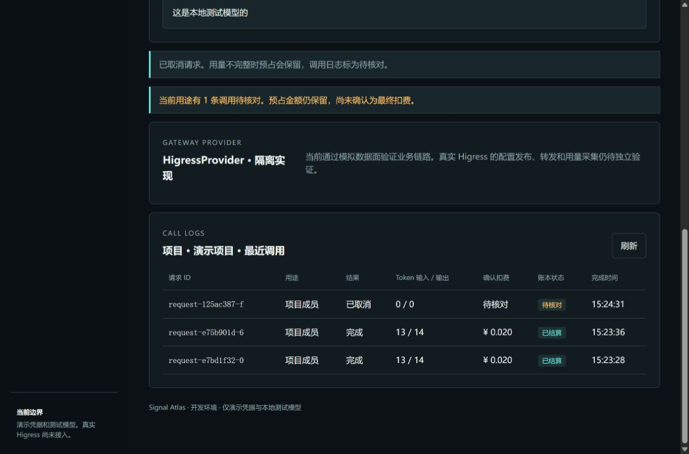

# 2026-10-18 开发验收

本轮继续原纵向切片，完成个人/项目成员额度隔离、故障账本行为、幂等保护和前端用途选择。以下结果均不代表真实 Higress 或生产验收。

## 已执行

| 层级 | 检查 | 结果与含义 |
| --- | --- | --- |
| 静态与构建 | `pnpm typecheck`、`pnpm build` | TypeScript 与前端打包通过 |
| 单元 | `pnpm test` | 控制面 6 个测试通过；其他包没有实际单元用例 |
| 本地 + Postman Mock | `SIMULATION_MODEL_URL` 指向本地 simulation，运行 `check:isolated` | 46 项断言通过，包含原纵向检查脚本；网关和控制面运行真实代码，只有模型 HTTP 服务为替身 |
| 开发数据库 + Postman Mock | `node scripts/check-isolated.mjs --postgres` | 52 项断言通过；真实 PostgreSQL 事务、并发、个人/项目隔离和重启持久化 |
| 浏览器 + 本地测试模型 | 页面用途切换、普通请求、流式请求和取消 | 个人余额保持 ¥10.000；项目完整请求各扣 ¥0.020；取消请求显示待核对并保留 ¥0.020 预占 |

Postman simulation 使用 CLI 1.74.0，`--no-history` 在本地运行，模型入口 `/model/v1/chat/completions`。已检查 simulation 的请求事件，实际网关请求经过替身。未访问外部模型厂商、未发布 Postman 工作区资源。

## 关键断言

- 已耗尽的项目成员额度不能从个人批次补扣；凭据不能切换组织、项目、用途或主体类型。
- 8 个同键并发授权只生成一个预占，只有一次响应拥有转发资格。
- 8 个并发失败结算只释放一次，所有重试保留原 `not_billable` 状态，只有一条调用日志。
- 不同请求不能共用结算键；负金额和修改结算用途被拒绝。
- ¥0.005 的实际结算及后续预占/释放保留六位账本精度。
- JSON/HTML 上游错误与不可达释放预占；超时、截断 SSE、缺失最终用量以及客户端取消进入待核对，保留预占。
- 已授权请求再次通过网关返回 `409`，不重复请求上游。
- PostgreSQL 重启执行可重复 SQL 与插入种子后，余额和调用日志保持一致。

## 隔离与清理

数据库检查只在本次生成的 `agp_check_<uuid>` schema 内建表、插入和测试。测试后删除该 schema，不修改共享演示批次；进程退出后停止临时服务。自动删除只接受本次生成且符合限定格式的 schema 名称。

## 浏览器证据

## 未验证或未实现

真实 Higress、真实模型、生产认证与租户数据访问控制、完整项目预算分配流程、核对补偿、预占过期回收、持久化结算事件队列和多实例容量压测。
