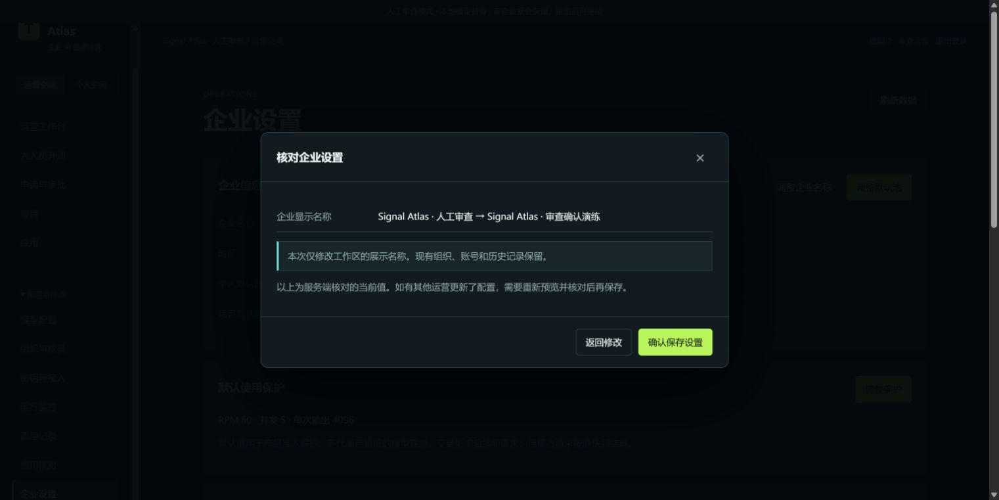
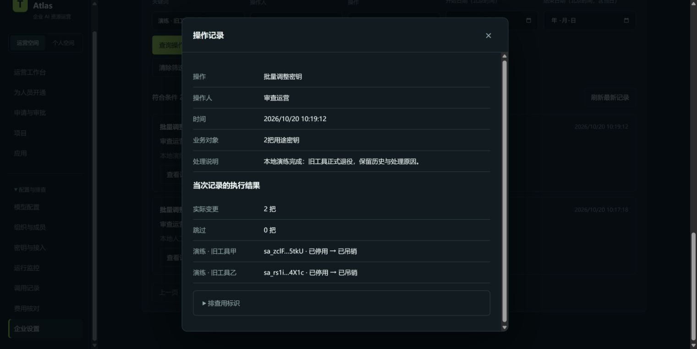
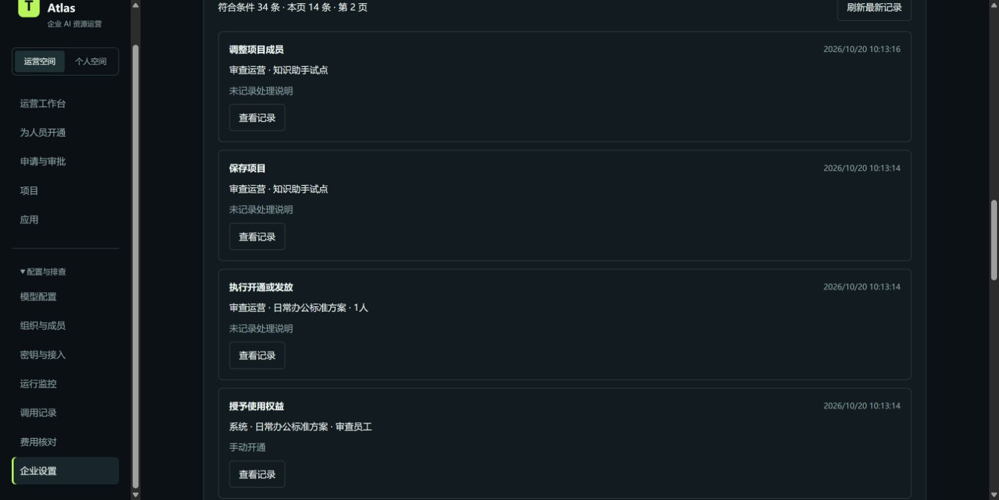

# 操作审计与企业设置验证

2026-10-20。当前外层人工审查入口为 http://localhost:5176/，启动/恢复使用 `pnpm review:postgres`，账号和短任务路径见 [人工审查清单](MANUAL-REVIEW.md)。本轮没有新增真实模型或 Higress 接入。

## 本轮行为

- 企业设置中的操作记录默认收起，按关键词、操作人、操作及北京时间日期检索全部保留历史。每页 20 条；详情显示可读名称、处理说明和脱敏结果，技术标识按需展开。
- 查询直接读取完整审计历史，不依赖工作空间快照最近 500 条。游标绑定筛选和本次历史范围；并列时间不会漏项或重复，翻页期间新增记录需要刷新后进入查询。
- 新记录保存操作者和对象名称快照；旧记录只能解析当前名称时明确标记来源。批量变更可按单把密钥名称检索。API 不返回任意原始 detail，不输出完整密钥、散列、密码或对话正文。
- 企业名称、默认池及保护设置经服务端统一准备、验证和签名确认。确认页显示服务端当前值，拒绝空名称、无效池、无签名和过时确认。返回编辑保留草稿，取消不保存；默认池变更不迁移已有批次或资金。
- 桌面长页面的左侧导航保持可见；审计翻页后焦点和滚动回到新页结果状态。390px 页面检查未出现横向溢出，导航恢复普通文档布局。

## 自动检查

控制面 86 项测试、18 个文件通过；包含 6 项审计/设置定向测试：615 条相同时间戳分页、超过 500 条历史、追加稳定性、筛选绑定、北京时间等价边界、脱敏字段、名称快照、当前操作者权限，以及设置签名/过时/空名称与服务端前后值。

本轮完整内存 HTTP 回归 **277 项通过**；最终完整隔离 PostgreSQL HTTP 回归 **328 项通过**，包括 21 项审计、22 项保留策略、并发拒绝记录及重启后余额/日志保持；进程退出码为 0，专属测试 schema 已清理，审查 schema 保留。Web 类型检查及构建通过。

数据库回归过程中出现过一批并发拒绝请求中单笔 HTTP 500，以及另一轮缺少预期调用日志。最终同等条件整轮通过，但这两次间歇失败的根因仍未确认，保留为后续可靠性排查项；不能从一次通过推导出该问题已经修复。检查脚本已增加状态与脱敏服务错误诊断，保留原 10 路并发、210 条样本和所有断言，未降低标准或修改共享数据。

## 浏览器与持久恢复

Chrome 已验证默认收起、组合筛选、无结果恢复、清除筛选、34 条记录的两页翻页、逐把脱敏详情及企业设置预览/返回/取消。更新后的页面重新加载，再次验证服务端名称前后值与取消保留原值、按单把名称检索两次批量变更。

当前资产为 `/assets/index-CHL3zRx9.js`，SHA-256 为 `d7d18ee8f6fca0a72e52e0ac474db3306cb7b3e4a0012d500106330f49059392`。恢复同一审查工作区后，企业设置、组织、成员、项目、应用、密钥、额度批次、项目预算、审批及调用汇总与升级前收据一致，差异字段为空。审计共 34 条，单把演练密钥检索到两次批量变更。运行收据位于该工作区的 `final-review-verified.json`，未保存登录 Cookie 或连接凭据。

## 集中人工审查范围

| 人的任务 | 已有证据 |
| --- | --- |
| 运营开通 → 员工直接在线使用 | [任务流程](VALIDATION-TASK-FLOWS-2026-10-19.md)；个人、项目、应用额度独立 |
| 审批 → 失败修复 → 生效 | [开通验证](VALIDATION-ONBOARDING-2026-10-19.md)、[审查验证](VALIDATION-REVIEW-2026-10-19.md) |
| 项目预算分配、应用独立接入 | 同上；权限变化见 [权限验证](VALIDATION-PERMISSIONS-2026-10-20.md) |
| 复杂配置往返、规则/导入、组织调整 | [配置流程](VALIDATION-CONFIG-FLOWS-2026-10-19.md)、[开通验证](VALIDATION-ONBOARDING-2026-10-19.md)、[组织验证](VALIDATION-ORGANIZATIONS-2026-10-19.md) |
| 密钥检索与批量处理、保留策略、操作追溯 | [密钥验证](VALIDATION-KEYS-2026-10-20.md)、[保留策略](VALIDATION-RETENTION-2026-10-20.md)、本文 |

这些是分项实现证据，不代表用户已经接受交互设计。集中人工审查可从上述任务开始，不再增加泛化优化作为入口前置条件。后续仍需隔离评估 Higress、决定数据面方案，并在真实模型、企业网络、正式 HTTPS、跨主机恢复及生产条件下分别验收。本地模型替身和隔离数据库证据不能替代这些验证。
