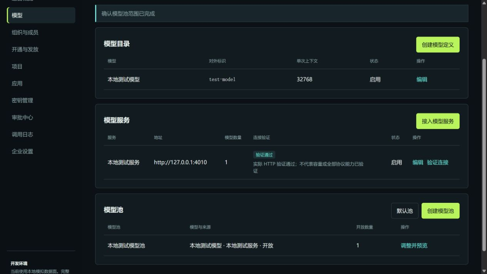

# 2026-10-18 业务平台接通记录

完整目标仍为进行中，范围见 `IMPLEMENTATION-STATUS.md`。本记录只证明以下实现和检查，不代表整个平台或生产环境完成。

## 当前实现

- 新增 `003_business_workspace.sql`：业务配置、组织、成员、模型资源、方案、权益、项目、应用、审批、密钥元数据、通知和审计持久化。管理操作与原 `quota_batches` 资金变更在同一 PostgreSQL 事务中提交。
- 项目总预算使用独立的未分配资金批次。向成员分配时原子扣减未分配金额并创建引用原批次、继承期限的成员额度；分配不是消费或再次充值。
- 密码加盐 scrypt，登录会话仅存 token 哈希，浏览器使用 HttpOnly / SameSite Cookie。旧全量日志接口改为服务令牌访问；业务页面按当前登录人及职责过滤。
- 新签发密钥只存 SHA-256 哈希，明文只出现在第一次成功响应中，幂等重试不返回明文。在线使用签发最多五分钟的内部临时身份，不要求用户先创建个人 Key。
- 成员停用与应用独立：个人身份失效，独立应用继续有效并等待交接。调用准入在事务内读取业务状态，避免配置变更与额度预占使用不同生效快照。
- Web 已有运营/个人空间、模型、组织成员、方案、项目预算/分配、应用、密钥、统一审批、来源额度、在线使用、日志、通知与审计页面；共享表单和原生 dialog，复用 Signal Atlas tokens。

## 已执行验证

| 检查 | 结果 |
| --- | --- |
| `pnpm typecheck` | 通过 |
| `pnpm test` | 控制面 13 个测试通过；其余包暂无实际单元用例 |
| `pnpm build` | 全部包与 Web 打包通过 |
| `node scripts/check-isolated.mjs` | 内存控制面 + 真实模拟网关 + 仓库 HTTP 模型替身，87 项断言通过 |
| `node scripts/check-isolated.mjs --postgres` | 真实开发 PostgreSQL 独立 schema + 本地模拟数据面，93 项断言通过；进程重启余额/日志保留 |
| 浏览器 | 首次初始化 → Cookie 登录 → 运营空间 → 本地模型实际 HTTP 验证 → 模型池范围确认 → 开放模型；主页面和原生 dialog 正常显示 |

业务 HTTP 检查位于 `scripts/check-business.mjs`，被隔离验收脚本调用。检查登录、固定职责、服务真实本地验证、审批金额调整、批准/生效分离、密钥一次展示及哈希解析、个人日志隔离、项目资金转移、失败回滚、在线临时身份与应用独立性。

数据库测试在本次生成的 `agp_check_<uuid>` schema 中进行，结束后删除该测试 schema，不消费或重置共享演示批次。浏览器使用独立内存环境和虚构测试账号，停止后丢弃。

## 当前明确缺口

- 模拟网关仍按全局测试地址转发、固定演示金额结算，尚未根据已登记服务动态路由、冻结价格依据并按 Token 计价。
- 持久化结算事件、失败自动补发、待核对补偿与过期在途处理未完成。
- 自动规则已有后端实现，每月去重发放已有事务逻辑；自动调度、规则页面、更多范围发放和逐人失败重试还需完成。
- 实时监控、告警规则和告警事件未完成。当前总览只是最近已记录调用的汇总，不是完整时间窗口监控。
- 跨对象就地创建/草稿返回、完整审批详情与执行参数修复、批量导入页面、项目成员详情、编程接入说明、全量筛选及窄屏/键盘验收待补齐。
- 正式交付模式必须关闭开发固定 Key、强制配置服务令牌、补齐远程首次初始化界面和运行交付。真实 Higress、真实模型和生产环境未验证。

后续工作不得将上述缺口移出目标；继续依据完整实现清单推进。
