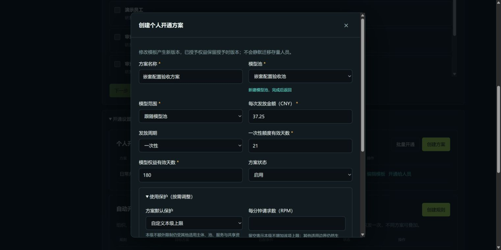
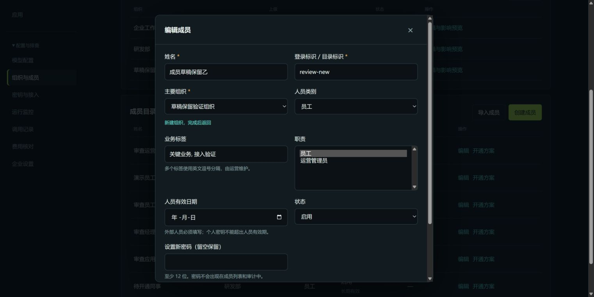

# 配置补齐与草稿返回验证

本轮针对用户指出的任务被配置打断、页面堆叠功能问题，补齐就地创建和逐层返回。验证实例为 `http://localhost:5174`，使用独立内存控制面 4101、模拟网关 4100、本地模型替身 4110。此前 `http://127.0.0.1:5173` 审查实例的页面资产仍为 `index-BduEO0HB.js`，未替换或重启。

## 实际浏览器路径

1. 在开通设置创建“嵌套配置验收方案”，填写 37.25 元、一次性额度 21 天、模型权益 180 天，以及自定义并发 3、最大输出 512。
2. 从方案就地新建模型池，再从池新建服务，从服务新建模型定义。保存模型定义后，原服务名称、地址和已有模型价格保留，新定义自动加入选择。
3. 服务先使用未监听的 `http://localhost:4111/v1`，保存后执行连接验证，界面显示失败恢复入口。修改同一已保存服务，保留两个模型映射及价格，将地址改为 `http://localhost:4110/v1`，重新保存并验证通过。
4. 返回模型池时新服务已选中；明确选择开放后保存池。返回方案时名称、金额、两个有效天数和自定义保护均保留，新模型池已选中。逐层保存均经过影响预览确认。
5. 独立 HTTP 读取控制面状态，确认方案、池、服务各只有一个；方案字段及引用正确，服务两个映射价格均为输入 2、输出 3、缓存输入 0.5 元/百万 Token；未给任何人员发放此方案权益。
6. 编辑“待开通同事”，填写姓名与标签，补建组织返回，新组织自动选中且草稿保留。再次修改姓名并打开另一个新建组织表单，取消子表单后仍保留最新姓名与标签；取消父表单后，控制面仍为原姓名，“应取消的组织”不存在。
7. 将已验证服务仅更名为“嵌套配置验收服务（更名）”，保存后直接结束，不出现重复验证步骤。控制面确认服务 ID 不变、配置版本仍为 2、验证仍为 passed；本地替身请求数前后均为 3，未额外发送模型请求。
8. 将成员类别切换为外部协作，实际界面显示内部责任人和人员有效日期均必填；账户职责、继承的使用保护保持折叠。取消此次检查，未保存成员变更。

## 检查与边界

- Web 类型检查和生产构建通过，资产为 `index-pxY4dyoG.js`。追加并行回归曾遇到 Windows 内存分配失败及测试工作进程启动失败；随后限制 Node 堆并改为串行检查。独立预览使用固定构建目录，构建失败未影响两个运行实例。
- 回归结果：控制面 49 项、导入解析 2 项、网关 7 项通过；控制面使用单工作进程复跑，网关单独运行通过。
- 本轮不涉及资金算法或持久化实现修改；未重复执行此前的隔离 PostgreSQL 215 项 HTTP 回归。Web 尚无自动化用例，本记录的交互证据来自实际浏览器操作与控制面读取断言。
- 保存的子对象在取消父表单后仍存在；取消父表单只放弃尚未提交的草稿，不回滚已明确保存的配置。
- 当前证据不代表真实模型、Higress、生产容量、跨重启草稿持久化或正式交付已验证。Higress 代码评估仍安排在外层人工审查之后。
