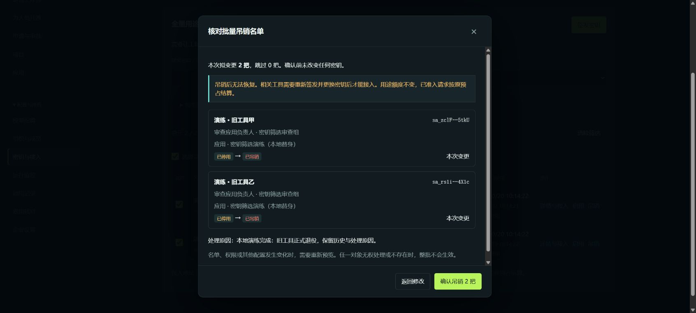
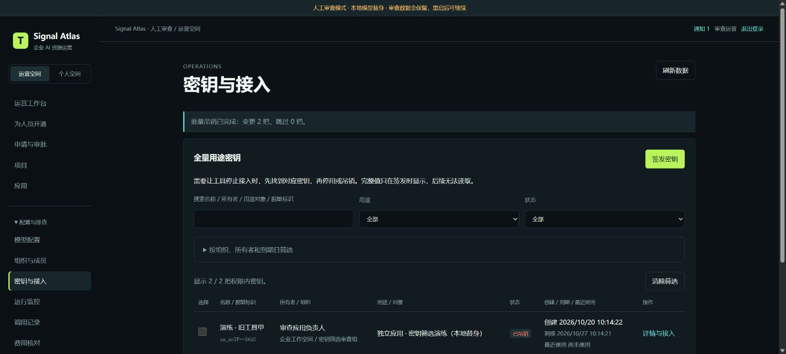

# 密钥管理与持久化审查入口验证

2026-10-20 当前版本补齐全量密钥管理与可恢复的人工审查入口；完整首版仍未完成，数据保留策略执行及其余页面验收继续列入实现清单。

## 用户可见行为

- 搜索、用途和状态保留在首屏；组织、所有者和到期日筛选按需展开。组织可含下级，应用密钥使用应用组织，个人/项目密钥使用人员组织；日期以北京时间比较。
- 当前结果内勾选最多 200 把后，填写原因，再逐项核对脱敏标识、所有者、用途对象及状态变化。更改筛选清空选择，避免隐藏对象继续入选。
- 批量停用可逐把恢复；吊销不可恢复。两者均不发放、回收或退还用途余额，已准入请求按原预占结算。
- 预览与执行均检查整份名单，任何无权限/不存在对象使整批拒绝。状态已经达成或已经吊销的对象明确跳过，不隐式恢复。事务提交同步更新准入凭据与逐把审计；幂等重试不会重复记录变更。
- 已补单把状态操作的具名影响预览，原来通用确认页只展示操作标题的问题一并修复。

## 当前自动检查

| 检查 | 结果与证明范围 |
| --- | --- |
| 控制面 Vitest | 75 项通过，新增 5 项覆盖名单权限/完整性、脱敏影响、幂等、当前交接职责、过期预览、跳过规则及批量输入限制 |
| 内存 HTTP | 258 项断言通过，包含真实 HTTP 预览/执行及网关拒绝已停用密钥 |
| 隔离 PostgreSQL HTTP | 285 项断言通过，包含相同批量行为、账本不变和重启保持；终端返回 0，专属测试 schema 已清理 |
| 持久化审查检查 | `pnpm check:review` 的 23 项断言通过，终端返回 0；验证中断初始化恢复不重复发款、手工修改/会话/密钥/调用保持、重复进程拒绝，以及 public/身份不符/正式模式/已丢失数据目标保护 |
| 构建与类型 | 全仓构建通过；最终 Web 布局、日期输入修复重新通过类型检查并构建至本次独立审查目录 |

## 浏览器与审查交付

Chrome 打开 localhost:5176 并以 review-ops 登录，顶部显示“审查数据会保留，重启后可继续”。在独立“密钥筛选演练（本地替身）”示例中，按应用所属组织和 2026-10-31 到期上限从两把密钥筛到一把；变更截止日期后恢复两把，原选择清空。原生日期控件的输入事件遗漏已修复并实际复核。

随后实际填写原因、核对两把密钥的影响并确认停用，页面显示“变更 2 把，跳过 0 把”，两条状态均为已停用。预览布局改为可换行的逐项卡片，避免在确认窗口横向滚动才能看全名单。

重载后两条仍为已停用，再从批量吊销入口核对逐项卡片与不可恢复提示，确认后页面显示“批量吊销已完成：变更 2 把，跳过 0 把”，两条均为已吊销且不再提供恢复入口。本次演练保留在具名示例应用中，原应用首次签发任务保留。

单把详情中的管理记录实际显示签发、批量停用与批量吊销的操作者和两次处理原因，示例应用余额保持 1 元。

最新入口默认 Web 5176、控制面 4301、网关 4300、模型替身 4310，启动命令与五账号见 [人工审查说明](MANUAL-REVIEW.md)。使用独立开发 PostgreSQL schema，不连接生产模型；5173 原内存实例保留。原有 5174 与新版同为 localhost，会共享主机 Cookie，不能仅靠端口隔离会话。

本次持久化工作区 `20bea9e2-970a-4e7d-98eb-12ca16e81692`，最终 Web 资产 `index-EMrJv7FX.js` 的 SHA-256 为 `ED6BB42D423B0E42A395A8588348D5091A77881680F49C06CFD78C38842353F8`。审查目录独立于普通 Web dist，后续构建不会替换其页面。

本次证明本机开发审查与受控模型替身路径，不作为真实 Higress、生产模型、企业网络、浏览器证书或生产容量的验收结论。
