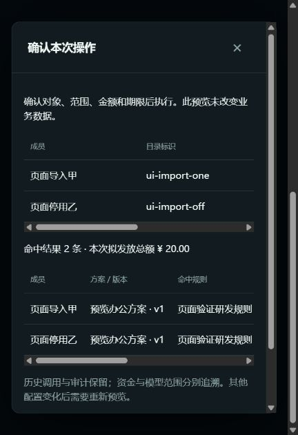
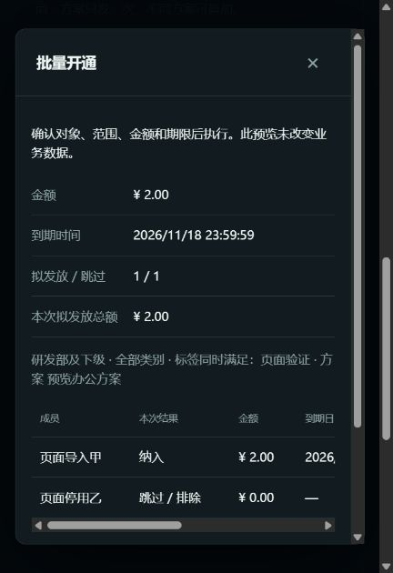
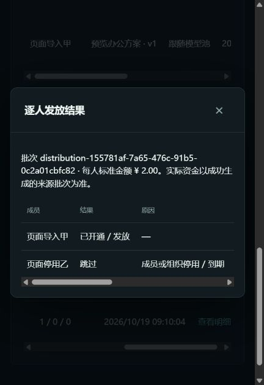
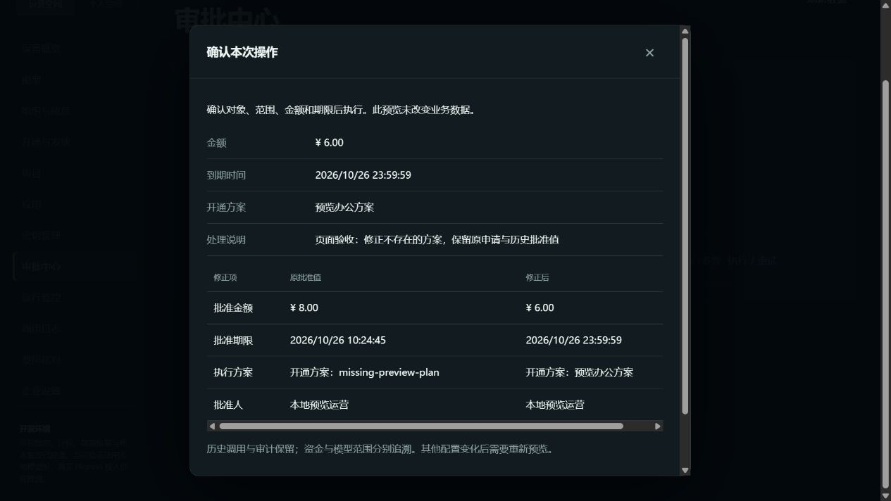
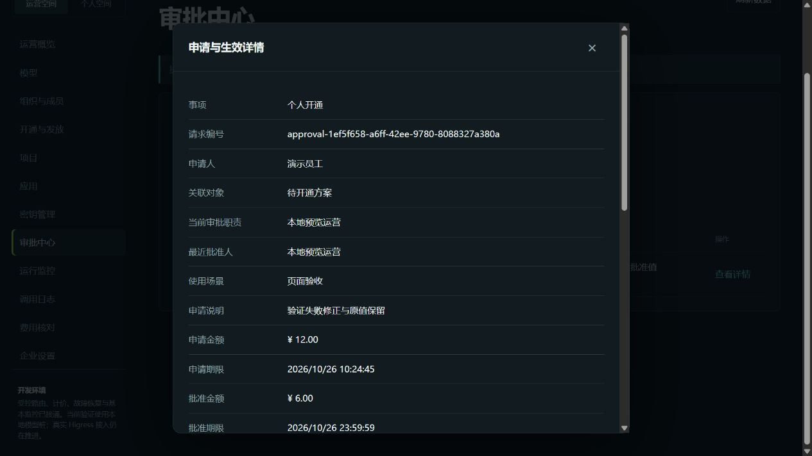
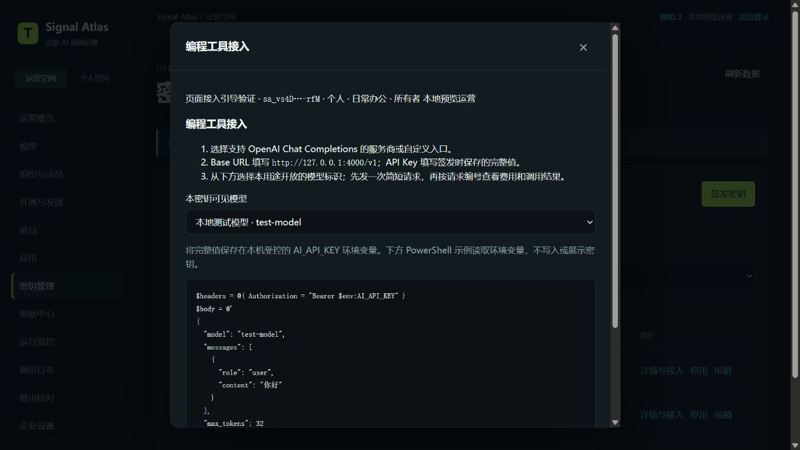

# 开通发放与观测链路验证 · 2026-10-19

## 本次新增

- 规则保存仅作用于后续人员事件；存量须显式预览应用。组织（可包含下级）、类别和全部标签按 AND 匹配。同方案规则合并、不同方案可叠加。
- 新建/更新/导入成员使用同一可信匹配链路。CSV/TSV 支持 UTF-8 BOM、带引号分隔符与多行内容，拒绝重复字段、未知字段、列错位和目录标识重复；按稳定目录标识更新，导入不接收密码/职责。
- 开通与追加分别呈现。范围支持名单、全部、组织/下级、类别、标签；预览保留逐人金额/期限/排除原因。追加要求既有有效权益，不隐式扩大模型访问。
- 失败匹配保留原因/规则条件/方案版本，可重试；停用/到期优先。同方案已发周期跨历史权益去重，撤销再开通不能重发当期金额。
- 待核对总数来自全部符合权限的历史记录；监控采样不改变业务 revision。
- 审批修复保留原申请与前后批准值，修正不发钱；当前责任人可显式接管，修正后单独执行，重复执行不重发。列表分区及完整对象审计详情已接通。
- 密钥按名称/主体/脱敏标识/用途检索，详情关联模型、来源、保护、全部历史汇总与最近调用。应用交接立即切换详情权限；签发一次展示关闭后进入接入指导，示例不含完整密钥。

## 当前证据

| 检查 | 本次结果 | 能证明的范围 |
| --- | --- | --- |
| `pnpm typecheck` | 通过 | 当前 TS 合同/控制面/网关/Web 类型 |
| `pnpm test` | 42 控制面 + 2 导入解析 + 6 网关恢复用例通过 | 资金状态机、权限边界、规则匹配/去重、解析失败、告警生命周期、审批修复、密钥交接、日志恢复 |
| `pnpm check:postgres` | 194 断言通过，schema 已清理 | 随机端口 + 一次性 PG schema + 仓库模型 HTTP 替身；含 14 项开通、15 项审批修复/密钥详情 HTTP 断言；并发导入/修复执行与重启持久化 |
| 浏览器操作 | 已完成 | 规则/导入/范围追加/逐人结果、失败审批修正并生效、密钥详情及签发后接入指导；仅内存隔离页面 |

HTTP 回归中告警事件相关断言受是否已跨完整分钟边界影响，因此总断言数可能略变；单元测试对触发/知晓/恢复提供确定性覆盖。本次未运行 Postman simulation 进程，而是同一仓库 HTTP 替身。

## 页面证据

前一轮已取得运行告警知晓、分页日志和费用核对页面证据，见 `validation/2026-10-18-alert-acknowledged.png`、`2026-10-18-review-impact.png`、`2026-10-18-review-completed.png`。

## 证据限制与下一步

当前观测统计已识别且落入控制面的调用。未识别密钥、控制面不可达时未接收的请求、独立心跳与采集故障事件尚未全部覆盖。五分钟吞吐和有效预占数量不等同于实时推理容量。网关事件目录需要每实例独立持久卷；当前证明进程恢复，不承诺断电零丢失。

尚需完成项目结束与成员详情、组织全层级影响、跨表单创建返回、独立采集故障事件、隔离 Higress 和完整内网交付。完整目标继续 active；本记录不替代用户业务验收或生产部署验收。
