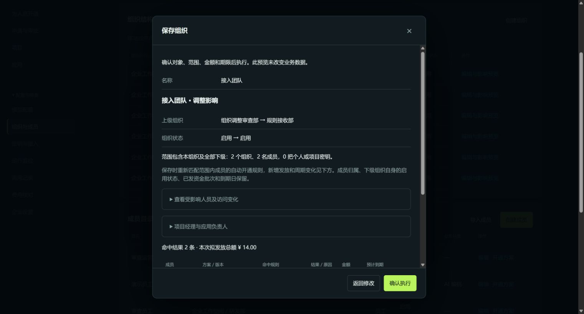
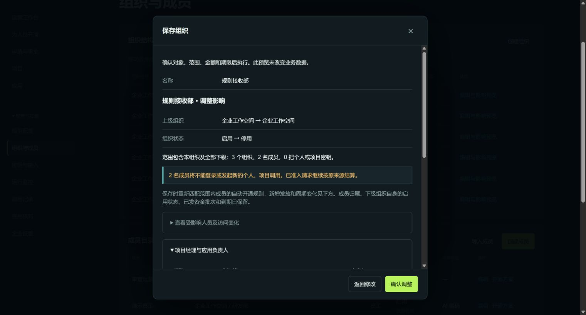

# 组织调整与弹窗操作验证

目标是让运营在确认前理解移动、停用及恢复组织的实际影响。范围依据产品 v1.3 第 4、5 节：包含所有下级，显示受影响范围；可信归属变更触发自动开通；已发资金保留原期限，人员停用立即阻止新调用。

## 实现

- 预览与执行共用组织变更计算，包含整个下级树、人员访问前后状态、个人/项目密钥数量、关联经理与应用负责人，以及新发放和月度周期停止/恢复名单。
- 移动或状态变更在同一事务重新匹配下级成员，沿用同方案/同周期去重；仅改名称不触发自动开通。未成功发款时，组织归属、权益及审计一同回滚。
- 不递归删除人员，不修改下级自身启用标志，不修改已发资金和到期日。组织停用后阻止相关人员登录、新个人及项目调用；应用独立运行，仍按应用状态、有效期和额度核对。负责人不可访问时提示由运营交接。
- 上级选项排除自身及全部下级；根组织仅可改名。预览阶段拒绝环路、缺失上级、停用根组织及所有运营管理员失去访问的变更。
- 组织和成员列表显示完整路径及受上级停用影响的有效状态。
- 长弹窗正文独立滚动，标题和底部操作栏保留；编辑提交按钮通过 HTML form 关联原表单，继续使用必填校验。会新增资金的组织调整明确显示“确认调整并发放”。

## 当前证据

- 控制面 54 项测试通过，新增 5 项覆盖多层移动、同方案多规则去重、未来月度停止、停用/恢复会话和密钥、独立应用保留、名称编辑不发款、环路/管理员保护、资金失败原子回滚及过期预览拒绝。
- 隔离 PostgreSQL HTTP 回归通过 233 项断言，新增 18 项组织断言。涵盖并发重复确认、精确新增金额、原批次金额/期限不变、已登录会话立即受限和恢复、持久化影响审计。控制面重启后余额与调用记录保留；测试 schema 已清理，共享演示余额未修改。
- Web 类型检查与构建通过。晚间最终审查构建为 `index-CIQuE_HU.js`、`index-Bs9HCO4l.css`，运行于 `http://127.0.0.1:5173`，本地内存、模拟数据面和模型替身。
- 实际浏览器将“接入团队”及其“协作小组”从原部门移到“规则接收部”。预览包含两名成员，新增总额 14 元、原月度方案停止未来发放；保存后组织路径更新。
- 再停用“规则接收部”，预览覆盖 3 个组织、2 名成员，显示不能登录/新调用及关联项目、应用负责人；保存后子组织和人员显示受上级停用影响。恢复预览为新增 0 元、恢复两个接收部方案周期；保存后成员恢复启用。
- 独立 HTTP 读取确认：两名人员共有四个原始批次，总额 22 元（原方案各 4 元、新方案各 7 元），停用/恢复未增款；原方案两条周期均不再匹配，新方案两条周期均 scheduled。
- 长模型服务表单实测正文 scrollTop 从 0 到 249.5，底部操作栏 top/bottom 始终为 704.05/782.75，视口高度 825，完整保留在可视范围。清空必填服务名称后点击表单外提交按钮，浏览器显示“请填写此字段”并聚焦空字段，未进入预览或写入；检查后取消草稿。组织编辑的表单外提交按钮已实际走通预览与保存。

## 运行说明与边界

早期独立回查使用 localhost:5175；暂停期间其进程及此前 5173/5174 实例均已停止。晚间确认无监听进程后启动新 5173 实例，未通过重启覆盖仍运行的审查实例。旧内存数据不保留，本次仅复建必要的虚拟组织场景；运行记录保存在 `.runtime/review-4babb6b7-4a3e-4805-a7d6-ddcd8139f0c7`。

本轮未验证真实模型、Higress、生产容量、多实例负载或正式备份恢复；完整产品目标仍有待完成项，见 IMPLEMENTATION-STATUS.md。
