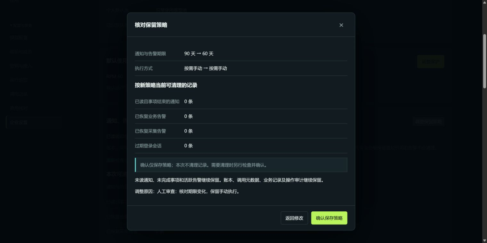

# 运行辅助记录保留与审查版本升级

2026-10-20 补齐企业设置中的必要数据保留能力。实现依据为 v1.1 企业设置的保留配置要求，并保留 v1.3 对调用、额度来源和业务历史追溯的约束。

## 实际处理范围

| 数据 | 本版处理方式 |
| --- | --- |
| 已读通知 | 创建时间和读取时间均早于保留截止时间，且关联审批/告警已结束时可清理；未读或关联事项未完成时继续保留 |
| 已恢复业务/采集告警 | 恢复、更新、知晓时间均已超过期限，且不再被任何保留通知引用时可清理；活跃事件继续保留 |
| 登录会话 | 已到期会话可清理；未到期或日期需核验的会话保留。当前登录不会因清理失效 |
| 调用元数据、账本、预占、结算、幂等、审批、开通、操作审计 | 继续保留；其中调用记录仍是当前计费与核对依据。本次策略不承诺按期删除这些数据 |
| 提示词与输出正文 | 当前路径不写入持久化数据，无正文归档或正文清理能力声明 |

保留天数为 1–3650 的整数，默认 90 天、手动执行。自动执行必须显式开启，下一次后台维护可以执行，随后按北京时间每天去重；手动执行也可满足当日检查。期限变化后按新期限再检查。后台辅助清理不推进业务 revision，避免使发放等未完成表单无故失效。

手动流程读取实际分类数量，填写原因后预览，最后单独确认。签名预览及清理计划指纹共同约束执行；即使辅助记录变化未推进业务 revision，旧计划也会拒绝，页面重新读取数量并保留原因。幂等重试返回同一回执，不重复清理或重复写入手动审计。API 不返回其他人员通知正文或会话散列。

## 验证结果

- 控制面 80 项测试通过，新增 5 项覆盖只读预览、保护条件、实际移除、幂等、当前权限、计划变化、期限输入及后台每日执行。
- 内存 HTTP 263 项断言通过，包含 7 项保留策略入口、权限、参数与签名确认检查。
- 隔离 PostgreSQL HTTP 307 项断言通过，包含 22 项保留策略检查：具名临时已读/未读通知、已恢复采集事件、过期会话；验证真实清理、未知正文/会话散列不泄露、辅助状态变化使旧计划失效、当前登录保持、一次审计、完整调用统计和原额度不变，以及每日执行去重。终端返回 0，测试 schema 已清理。
- 全仓构建通过，最终策略确认标题与明确动作按钮重新通过 Web 类型检查并构建至独立审查目录。

## 当前人工审查实例

同一持久化工作区 `20bea9e2-970a-4e7d-98eb-12ca16e81692` 已升级并恢复至 localhost:5176。升级前网关 outbox 的 queued/blocked/active 均为 0，只停止了经过 PID、父子关系、命令行、目录和端口核对的该审查进程组；数据库、状态文件和日记保留。恢复后逐项比对成员、项目、应用、密钥、额度批次、项目预算、审批和调用记录，与升级前完全一致。原 5173 未重启。

升级比对回执：`.runtime/review-postgres-20bea9e2-970a-4e7d-98eb-12ca16e81692/retention-upgrade-verified.json`。当前策略仍为 90 天、自动关闭，无可清理记录；没有在人工审查数据上执行清理。

Chrome 已验证：实际读取数量为 0 时提示无需执行；打开策略编辑并将 90 改为 60 天，预览明确显示前后变化与“本次不清理记录”；返回后 60 天和原因草稿仍在；取消后仍为原 90 天、手动策略。下图是预览，未保存该草稿。

最终 Web `index-zrEbB1X7.js` SHA-256：`1BB190F9A613011C140A021D4AD7E857A880CC1D58CAB84A15D206F231AD5E9E`。

完整目标尚未完成：操作审计仍需可读动作/对象、检索与全部历史分页；其余管理页交互验收继续。真实模型、企业网络与正式数据面不由本次隔离验证替代。
