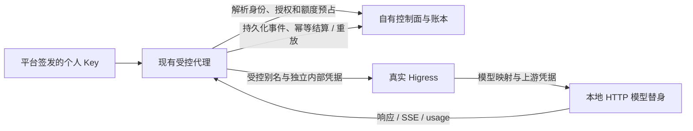

# Higress 隔离 PoC（2026-10-29）

状态：用户恢复授权后，在 `codex/higress-poc` 分支完成第一阶段隔离验证。真实 Higress + 真实平台控制面/网关 + 本地确定性 HTTP 模型替身，**54 项检查通过**。配置发布器另有 3 项单元检查，原网关 41 项回归通过。本轮没有调用厂商模型，没有切换日常开发环境，也不代表已完成生产数据面替换。

## 结论与实现边界

建议继续采用“自有准入和账本 + Higress 模型代理”的分工。现有模型服务配置已经可以把上游地址指向 Higress，因此这轮无需改写业务授权、额度、价格或结算代码。



`scripts/check-higress.mjs` 创建独立内存控制面、受控代理、两个容器和内部网络。模型服务的 `baseUrl` 指向本次 Higress；`credentialRef` 引用随机生成的内部测试凭据。平台用户 Key 不转交给 Higress，Higress 使用另一把随机测试凭据访问模型替身。所有测试结束后删除本次进程、隧道、容器、网络和临时配置。

`scripts/higress/file-publisher.mjs` 是 **PoC 专用文件配置发布器**：复制资源后先保持 pending，只有数据面返回期望版本且上游可用时才 applied。它没有接入控制面 `/internal/v1/gateway-sync`。现有 `apps/control-plane/src/gateway/higress.provider.ts` 仍是早期内存替身，不能把其返回值当作本轮真实下发证据。

## 固定对象

| 对象 | 本轮实际对象 |
| --- | --- |
| Higress | 官方 Linux amd64 `all-in-one:2.2.5`，摘要 `sha256:e650ae5244bb89e95a7cbe5188b9c0c9caf7a165aa5e4c89364e37a1e3efbb24` |
| Higress 源码参考 | 本地保留的 `4deae1dd3b4cb2707273748985e55bef28e747d1` / `v2.2.5`，本轮未修改和编译 Higress 核心 |
| 镜像内插件 | `key-auth/2.0.0`、`ai-proxy/2.0.3`；均从镜像内 HTTP 插件服务加载，`FAIL_CLOSE` |
| 模型替身运行时 | `node` 镜像，摘要 `sha256:0a7108bf6c7bf5de370ffb1a3ed6be93d405b43ff159f681a8d18c0e2bc2e402` |
| 权威业务实现 | 本工作区当前构建的控制面与网关；不是测试脚本模拟的授权/扣费服务 |
| 存储 | 独立内存业务状态 + 独立文件结算日记；未访问已有 PostgreSQL 工作区 |

镜像摘要只固定本次实验，不是对其生产安全性或正式版本选型的承诺。报告保存实际镜像 ID、平台、关键脚本与构建产物哈希，见 [原始结果](../validation/higress-2026-10-29/result.json)。

## 已验证的行为

- 平台签发的哈希存储 Key 经真实控制面授权，额度不足、无效 Key、服务停用和服务并发占用均在模型推理前拒绝。
- 控制面指定 `poc-model` 后，Higress `ai-proxy` 将其映射为 `physical-model`，使用独立上游凭据；客户端仍看到逻辑模型 `test-model`。
- 非流式、SSE、中文 UTF-8 分片、工具参数增量、工具结果和 reasoning 历史可往返；SSE 首段先于延迟的最终 usage 到达。
- 输入 13、输出 14、缓存输入 4 Token 按控制面冻结价格结算；重复请求不再次转发。缺失最终 usage、取消、超时和进程中断保留原预占，进入待核对。
- 客户端取消可传到模型连接；上游 500 只产生一次模型调用。Higress 的路由重试、AI 插件重试和 failover 均显式关闭。
- 真实配置经历 `v1 applied → v2 applied → v3 rejected（观察到 v3，但后端不可用）→ v2 applied`。保存“最后确认可用版本”和“实际观察版本”，不用文件复制成功代替运行态确认。
- 结算暂不可达时先持久排队，强制重启网关后补交；控制面已扣费但结算响应丢失时，重放仍只保留一条账目。流式请求期间强制退出网关后恢复为 unknown / pending_review。
- 资金守恒核对覆盖本轮出资批次：总额 = 剩余可用 + 已确认消费 + 待核对预占；诊断验证不扣用户额度。
- 只开放回环访问；容器内部网络没有外部路由。Higress 管理端口不对宿主机发布。日志只记录关联 ID、响应码和路由名称，不记录正文或凭据。

## 发现并处理的接入问题

1. **插件模板与实际镜像有差异**。此前独立运行版模板使用插件 `1.0.0` 路径，但固定镜像实际为 `key-auth/2.0.0`、`ai-proxy/2.0.3`。本轮直接检查镜像资源并使用其中版本，没有临时拉取其他插件来掩盖差异。
2. **DNS 注册名需要完整域名**。Higress 的 DNS 注册校验不接受单标签 `model`；改为仅在隔离网络解析的 `model.poc.test`。
3. **默认请求 ID 会被改写**。首次真实调用已完成结算，但模型侧 ID 与平台 ID 不同。本轮添加私有代理跳点的 EnvoyFilter：`preserve_external_request_id=true`，并设置 `pack_trace_reason=false`，避免 UUID 的采样位改写。UUID 和非 UUID 的平台 ID 均实测保留。此设置使请求 ID 不再编码采样决策，后续追踪需单独设计。参考 [HCM 配置](https://www.envoyproxy.io/docs/envoy/latest/api-v3/extensions/filters/network/http_connection_manager/v3/http_connection_manager.proto)、[UUID 扩展](https://www.envoyproxy.io/docs/envoy/latest/api-v3/extensions/request_id/uuid/v3/uuid.proto)。
4. **本机 Podman 自动转发不可用**。容器和虚拟机内的服务正常，但宿主机无法访问发布端口。Windows + Podman 路径采用本次测试专属的 SSH 隧道，只绑定 `127.0.0.1`，结束后关闭；不修改 Podman 全局网络设置。其他运行时使用回环端口发布。

早期启动失败和首次 ID 追溯失败的本地报告保留在 `.runtime/higress-results/`；最终通过证据单独保存在版本库中。

## 验证入口

前置：现有 Node / pnpm 依赖已安装，容器运行时已启动，本机已缓存上表两个摘要固定的镜像。检查脚本使用 `--pull never`，不会启动容器引擎、自动升级镜像或读取用户 `.env`。

Windows 默认使用 Podman：

```powershell
podman machine start podman-machine-default
pnpm check:higress
```

使用 Docker 时：

```powershell
$env:HIGRESS_CONTAINER_CLI='docker'
pnpm check:higress
```

缺少镜像时，按 `scripts/higress/poc-config.mjs` 中的完整摘要显式拉取。默认报告写入 `.runtime/higress-results/<uuid>.json`；`HIGRESS_REPORT_PATH` 可指定新报告位置。本轮命令为：

```powershell
$env:HIGRESS_REPORT_PATH='docs/validation/higress-2026-10-29/result.json'
pnpm check:higress
pnpm --filter @ai-gateway/gateway-sim test
```

日常开发仍使用根目录 `pnpm dev`。本入口属于独立 `check:*`，不是另一个日常启动器。独立运行模式的正式部署边界仍需评估，见 [官方说明](https://higress.ai/en/docs/latest/ops/deploy-by-docker-compose/)。

## 原 P01–P14 的覆盖边界

| 项目 | 本轮结果 | 仍需验证 |
| --- | --- | --- |
| P01 非流式 | PASS | 多个真实厂商协议及实际客户端 |
| P02 流式事件 | PASS | 本轮事件由现有代理落盘，未证明 Higress 原生插件可独立完成可靠结算 |
| P03 请求前授权 | PARTIAL | 个人用途已跑通；项目、应用用途在 Higress 链路中未逐项执行 |
| P04 额度不足 | PASS | 本地内存工作区，不能外推生产数据库表现 |
| P05 并发预占 | PARTIAL | 已验证重复请求和服务并发拒绝；多用户并发争抢资金与 PostgreSQL 还需专测 |
| P06 上游失败 | PARTIAL | 已验证 500、首字节超时；厂商 401、模型不存在等仍需逐项执行 |
| P07 客户端取消 | PASS | 实际厂商是否继续生成及计费仍需真实环境证据 |
| P08 用量字段 | PARTIAL | 标准 usage、缓存输入、上游 ID 和未知用量已验；多厂商字段和估算规则未验 |
| P09 配置与模型池 | PARTIAL | Higress 路由版本可观察；业务模型池变更与正式下发尚未联动 |
| P10 服务停用 | PASS | 已有授权/历史和资金保留，恢复后可继续调用 |
| P11 配置失败/回滚 | PARTIAL | PoC 文件发布已验；正式 Provider API、持久同步状态与并发发布未实现 |
| P12 安全边界 | PARTIAL | 内部凭据、私有管理端口、日志最小化已验；生产管理面认证和网络策略未验 |
| P13 性能 | PARTIAL | 各 8 次小样本往返记录；无吞吐、长期负载和生产 SLO 结论 |
| P14 可替换性 | PARTIAL | 同一业务代理可切换直连 / Higress；正式 GatewayProvider 合同接入待做 |

本轮小样本计时包含现有代理、控制面、日记和宿主机到容器的 SSH 隧道，不是 Higress 本身的纯转发延迟。具体数值以报告为准，不作性能提升或容量结论。

## 后续实施顺序

1. 把 PoC 的配置合同收敛为正式 Higress Provider：期望版本、观察版本、最后可用版本、失败与回滚持久化；先替换“直接 applied”的内存替身。
2. 完成受控路由与价格绑定。若启用 retry / fallback，必须记录每次实际尝试和费用归属，不能跨到未授权或价格不匹配的服务。
3. 使用独立 PostgreSQL schema 验证个人/项目/应用用途、并发资金争抢、配置期间的在途请求和恢复。现有数据与外呼开关保持不动。
4. 再安排指定真实模型的协议、长流、取消和持续负载；目标部署、TLS、升级和高可用单独验收。

当前批准结论是继续推进适配，不是锁定生产版本或删除现有受控代理。
