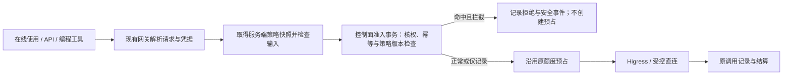

# 安全围栏 V0.1 实施方案（已认可并实施）

日期：2026-10-30。关联任务：[T10，优先队列第 1 项](../CORE-TODO-2026-10-27.md#2026-10-30-新增优先队列按用户指定顺序)。

**状态更新：用户以“做吧”认可本方案，T10 已完成实施与验收，见 [实际结果](safety-guardrail-v0.1-2026-10-30.md)。** 下文保留批准时的设计边界，接口和文件的实际状态以实施记录与源码为准。

## 1. 目标与产品边界

完成“运营配置规则 → 请求实际受检查 → 命中后拒绝外发或仅记录 → 用户理解结果 → 运营可追溯”的最小闭环。对外称为“基于规则的输入安全围栏”，用于企业敏感信息外发控制和自定义禁用内容控制。

| V0.1 纳入 | 明确后置 |
| --- | --- |
| 一份企业统一策略，选择全部模型或指定逻辑模型；覆盖个人、项目、应用 | 组织/用户组/租户策略继承、策略冲突编排 |
| 关闭、仅记录、拦截三种模式；所有命中规则采用当前策略的同一种动作 | 每条规则不同动作、自动脱敏/还原、任意脚本 |
| 自定义字面禁用词；预置中国大陆手机号、居民身份证号码、已知密钥格式的疑似识别 | 全语种内容合规、语义级提示词攻击/越狱识别、文件/图片/音频检测 |
| 文本请求检查，兼容非流式和流式请求的输入阶段 | 模型输出审核及流式输出跨片段拦截 |
| 策略变更审计、命中事件、调用关联、权限内查询与计数 | 独立安全运营中心、复杂报表、外部告警通道和自动封号 |

预置规则判断的是格式，不证明文本一定属于真实个人或真实可用密钥；页面和记录使用“疑似敏感信息”措辞。自定义禁用词只按约定的规范化文本匹配，不宣称理解语义或防住编码、谐音、分词等绕过。

## 2. 当前事实与实现选择

现有 `services/gateway-sim/src/server.ts` 已统一处理在线使用、API 和编程工具的 Chat Completions 请求：读取完整 JSON、解析凭据、请求控制面准入，再经 Higress 转发。控制面和 PostgreSQL 是身份、用途、价格、预占和结算的权威来源；当前没有内容安全策略、检查器或事件查询功能。

**推荐 V0.1 在现有准入网关执行检查，Higress 继续负责模型转发。** 这是在上一轮“优先复用 Higress 插件”的初步建议上，结合当前源码作出的收敛：

- 首版需要输入专用检查、仅记录模式、明确的安全错误与平台审计；放在已有请求入口更容易完整串联，且不新增独立检查服务。
- 可在创建额度预占前决定拒绝，从而直接证明没有外发、没有扣款，也不把安全拒绝当作上游失败。
- 日常直连回退仍经过同一个准入网关，因此不因从 Higress 切换为直连而绕过围栏。
- 规则只有一份权威配置，不在准入网关和 Higress 同时维护两套不同的检测结果。

Higress [AI 数据脱敏插件](https://higress.cn/docs/latest/plugins/ai/api-consumer/ai-data-masking/)具备词规则和正则处理能力，但官网能力不等于当前固定镜像已经验证了所需的输入专用、仅记录和审计语义；文档还提示流式跨片段处理可能泄露部分敏感内容。[AI 内容安全插件](https://higress.cn/docs/latest/plugins/ai/api-provider/ai-security-guard/)依赖外部内容安全服务凭据。这些能力留作后续评估，不作为首版前置依赖，也不据此扩大为输出安全承诺。

保护边界是平台入口。直接使用厂商凭据或绕过平台访问模型不在保护范围；客户端不能通过新增请求字段、请求头或选择个人/项目/应用用途关闭围栏。

## 3. 策略和规则

一份企业策略包含：`version`、`mode=off|observe|block`、模型范围、启用的预置规则、自定义禁用词，以及修改人、时间和原因。先不设计任意组合的策略引擎。

- 初次迁移为 `off`，保留默认工作区数据与外呼设置；不会自动对既有调用启用新规则。
- 模型范围使用稳定的逻辑模型 ID。模式、范围、规则任何变化都产生新版本；未选模型不检查，并在管理界面明确其未受保护状态。
- 预置规则内置在代码中，运营只能启停，首版不允许填写任意正则。手机号处理常见分隔符，身份证规则校验日期和校验位；密钥规则按已知前缀和长度识别，短占位符不冒充真实密钥命中。
- 自定义规则为字面短语，去重、去首尾空白、采用 Unicode NFC 规范化及明确的大小写策略；不修改真正发给模型的请求。
- 建议初始上限：200 条自定义短语，每条 2–128 字符，总计不超过 16KiB；沿用请求体 1MiB 限制，扫描深度设界限。超过支持边界明确拒绝，不跳过检查后继续外发。以上是工程上限提案，实施时依据本地测试校准并记录。

检测请求中所有可能外发的文本：所有角色的历史消息、文本数组、工具调用参数、工具结果和工具描述/Schema 中的文本；未知的可转发文本字段同样检查。不能只检查最后一条用户消息。按 JSON 结构处理文本与工具参数，不任意拼接两个字段制造一次命中；不可解析的工具参数至少检查原始字符串，并明确不保证识别所有编码形式。

HTTP 认证头中的平台 Key 不进入内容检测或事件正文。经过校验的模型 ID 等控制标识不作为用户内容匹配；检测器实现时为这些排除字段建立明确清单。

## 4. 请求与一致性契约



1. 复用受 Service Token 保护的凭据解析链路取得适用于目标逻辑模型的策略快照；原用户 Key 和正文不回显。无效凭据仍返回认证失败，不暴露规则。
2. 网关在内存中执行纯规则检查。结果只带策略版本、规则 ID、类别和动作，不把原始文本送入控制面或落盘。
3. 扩展内部准入请求，携带服务端检测结果。控制面先遵守现有身份、模型权限和幂等约束，再在创建预占的同一权威事务内核对策略版本；外部客户端提交的同名字段不被信任。
4. `block` 命中：在一个事务中持久化拒绝结果、安全事件和必要调用元数据，不创建额度预占、并发槽位或消费结算账目，不进入模型链路。`observe` 命中：记录事件并继续正常准入、调用和结算。
5. 检查期间策略改变：返回 `409 guardrail_policy_stale`，不创建新预占、不外发；客户端刷新后显式重试。不在网关自动重发模型请求。
6. 策略读取、检测或必要事件写入失败返回 `503 guardrail_unavailable`，不静默按通过处理。故障事件与规则命中分开统计；调用者和运营看到可恢复的失败信息。
7. 同幂等键重放遵守已有主体/请求指纹约束，返回原拒绝或原准入处理结果，不重复创建事件、预占或消费。策略变化不会把原已准入调用改成免费或取消其结算；要重新尝试需使用新的请求/幂等键。

配置只保存一个当前版本；首版不引入客户端缓存或多个长期策略副本。保存成功表示配置事务提交，新进入准入的请求使用新版本；已完成准入的请求沿用其原快照。并发修改使用现有预览/版本冲突机制。

### 拒绝响应（拟议）

输入拦截统一返回 HTTP 403、`application/json`，即使原请求 `stream=true` 也不伪造成功 SSE：

```json
{
  "error": {
    "type": "safety_policy_violation",
    "code": "sensitive_input",
    "message": "输入可能包含受限制的信息，已按企业安全策略阻止发送。请修改后重试。"
  },
  "requestId": "request-example"
}
```

对客户端只返回稳定原因类别，不返回命中文本、自定义禁用词、正则或密钥片段。普通模型拒答、认证失败、额度不足、检测故障与安全拦截分别表达。现有前端错误映射需按 `error.type/code` 展示安全错误，不能把全部 403 翻译为“无权操作”。

## 5. 数据、权限和页面

拟新增安全策略存储及 `safety_events` 表，事件包含事件 ID、请求 ID、幂等关联、主体/用途/项目/模型标识、策略版本、规则 ID/类别、动作和时间。默认不保存命中正文、提示词、回复、可还原片段或额外的敏感值哈希。沿用已有请求指纹契约，不为围栏另建正文存档。

拒绝调用通过现有调用日志展示 `rejected_before_upstream`、`forwarded=false`、`not_billable`、实际金额 0，并关联安全事件；`observe` 命中只是正常调用的安全元数据，不增加消费。策略变更进入现有操作审计，事件写入按请求和规则去重。事件保留期复用现有调用元数据保留口径；如新增清理类别，清理规则和检查器须一并接通，不直接借用短期通知的自动清理规则。

| 角色 / 页面 | 首版行为 |
| --- | --- |
| 运营 → 配置与排查 → 安全围栏 | 显示模式、检查范围、输入专用边界；编辑并预览影响后保存，填写原因；提供使用合成文本的“规则试测”，只内存匹配，不调用模型、不发放额度、不保存试测正文 |
| 运营 → 同页安全事件 | 按时间、模型、主体、命中类别、动作和请求编号检索、分页；展示拦截/观察事件数，首版不展示缺乏统一分母的“拦截率” |
| 员工 / 应用负责人 → 在线使用、调用详情 | 明确显示“被安全策略拦截”、零费用和请求编号；仅能看到原有权限允许的调用，不获得其他人的事件或企业规则内容 |

复用现有 `Field`、`MultiSelect`、`Modal`、`EditorDialog`、`Table`、`Status`、`DateField`、`DetailGroup` 和筛选/统计模式；使用 Beacon 当前主题，不新增 UI 壳或一套安全页面专属视觉体系。按项目要求补空、加载、失败、拒绝、禁用和忙碌状态，并回归其他四种外壳。

## 6. 实施顺序与文件范围（认可后执行）

| 步骤 | 主要文件范围 | 交付与依赖 |
| --- | --- | --- |
| G1 契约和纯检查器 | `packages/contracts/src/` 新增围栏类型/检查器；扩展 `index.ts` 的准入结果/拒绝原因；`contracts/gateway-control-plane-v0.1.yaml`、`contracts/platform-api-v0.1.yaml` | 先固定范围、结果、错误及规则边界，建立合成样本；不把规则类型枚举当成功能落地 |
| G2 存储与权限 | `apps/control-plane/src/platform/` 新增围栏管理/读取；`src/policy/`、`src/store/` 两种存储与拒绝日志；现有迁移目录新增下一顺序迁移 | 内存/PG 语义一致，版本/幂等/权限和事件事务完成；不得重置默认 schema |
| G3 网关执行 | `services/gateway-sim/src/server.ts` 及必要独立模块、现有 journal/准入恢复边界 | 在预占前接入；验证受保护请求不会绕过，错误不触发模型自动重试；无需新增 Higress 插件或修改管理中继 |
| G4 页面闭环 | `apps/web/src/` 新增安全围栏页，接入 `EnterpriseApp.tsx`/现有导航、`client.ts`、调用详情；必要时扩展共享组件契约 | 能配置、试测、查看事件和调用结果；只在 G1–G3 行为稳定后接界面 |
| G5 隔离验收与交付 | 新增 `scripts/check-guardrail.mjs`、专用 `check:guardrail` 命令及验证报告，更新任务/状态/README | 复用真实 Higress、内部确定性替身和独立 PG schema；可独立验证，不新增日常启动入口 |

具体文件以实施时源码为准；上述是职责边界，不要求为了目录形式拆分无必要模块。开始前再次检查已有未提交改动，保留其他工作；不盲目暂存整个仓库。

## 7. 必要验收

| 类别 | 必须证明的行为 |
| --- | --- |
| 模式与范围 | off 不改变行为；observe 命中留事件但正常计费；block 命中拒绝；受保护/未受保护模型可区分；三种用途均受同一规则约束 |
| 文本覆盖 | 非流式/流式输入、历史 system/developer/user/assistant/tool 文本、文本数组、工具参数/结果、分隔符、转义与边界长度；越界不静默放行 |
| 正向对照 | 正常工作文本、短占位符、普通数字、合法工具调用不被预置规则普遍误拦；含明确敏感号码的示例题仍按规则命中，统计时不包装成语义理解 |
| 端到端阻断 | 通过平台签发 Key 发起请求；明确 JSON 403；Higress/替身没有对应生成；PG 无预占和消费账目，余额前后不变；不能只凭页面提示或模型拒答判定成功 |
| 账务和恢复 | 通过和 observe 请求用量、价格和结算不变；block 重放无重复事件/扣款；策略并发修改、依赖中断、恢复、已准入请求不被追溯改账 |
| 权限与隐私 | 非运营不能修改/读全量规则或事件；本人只能按现有权限读调用；正文/密钥/命中片段不出现在响应、审计、日记或报告中 |
| 浏览器 | 配置、试测、仅记录、实际拦截、关闭恢复的完整路径；1440/390 截图、键盘焦点、无页面横向溢出；五种外壳基本回归 |
| 环境保护 | 默认工作区配置、资金、外呼设置和真实模型额度文件前后核对；只清理本轮创建并核实归属的隔离对象 |

运行与变更相称的 Contracts、网关、控制面测试和必要构建；新隔离检查以本地替身完成，不需要厂商账号或真实模型生成。既有 22 次 DeepSeek 授权已用完，本方案不追加或重置预算；如后续另做真实工具/模型补验，单独列出次数和费用后按授权执行。

## 8. 演示脚本与完成定义

1. 运营启用指定本地模型的仅记录模式，用合成号码试测；明确显示命中，试测不调用模型。
2. 员工从在线使用发起合成敏感输入：请求可执行，运营能看到观察事件，费用按实际替身用量结算。
3. 运营将同一策略切换为拦截；员工再次发送，页面显示安全拒绝和请求编号，模型没有收到输入，费用为 0。
4. 员工发送不含受限信息的正常请求，成功返回；运营按编号核对调用和对应事件。
5. 使用应用 Key 重复“拦截 + 正常”两种情况，证明不是前端按钮模拟；最后关闭策略并验证恢复。

只有配置管理、网关执行、事务与账务、事件权限以及上述隔离/浏览器验收全部通过，才把 T10 标为完成。交付声明必须注明“输入、规则型”；输出防护、语义检测和生产安全认证仍属后续范围。

## 9. 本轮评审点与停止点

请用户评审整体方案，重点为：**首版仅做输入规则围栏；在已有准入网关执行；企业统一策略、仅记录/拦截及元数据审计；输出/语义/自动脱敏后置。** 其余容量上限与内部拆分是实施默认选择，不要求逐项审批。

原方案的等待点已由用户“做吧”解除，仅授权本次 T10 实施。T11/T12 保持排队。
