# Signal Atlas 日光界面说明（左栏 + 标签页 / 顶栏）

日期：2026-10-20。状态：已实现并通过本地类型检查、生产构建和浏览器截图检查，等待产品评审。当前提供三种界面：**左栏 + 标签页（默认）**、**顶栏**、**经典**，可一键切换；筛选、统计、多选和人员选择等共享组件已统一，组件选型与样式以 [组件选型与样式契约](ui-component-contract-v1.md) 为准。

## 1. 背景与目标

用户反馈经典 Signal Atlas 对使用者不够友好、视觉呆板。v2 在不改变业务规则、数据口径和权限模型的前提下，重新设计壳层、导航、共享组件和关键页面的观感，目标是：

- 第一眼知道当前空间、当前页面和下一步动作。
- 运营配置与排查入口常驻可见，不再折叠在侧栏底部。
- 员工与运营共享同一套导航、状态语言和按钮语义。
- 保留额度批次、模型范围、审批影响、费用待核对和审计的可追溯性，不把严肃信息做成装饰。

## 2. 一键切换

- 四种界面（**蓝灰**、左栏 + 标签页、顶栏、经典）共用同一套 React 页面、业务 API、命令、预览、权限和状态语义，不是四套业务实现。
- **蓝灰**是 2026-10-21 新增的审核版：以左栏布局为基础重新设计的蓝灰浅色视觉与组件层，设计语言、组件清单和验收见 [Signal Atlas 蓝灰版审核界面](signal-atlas-v3-azure-review.md)。
- **左栏 + 标签页**是日光主题的默认界面：最上方平台切换条、左侧主菜单、右侧页面标签页。
- **顶栏**保留日光主题的双层顶部导航；**经典**保留原深色控制台。四版可随时切换。
- 登录页右上角、三种壳层的顶部操作区和移动端抽屉底部都显示“界面：蓝灰 / 左栏 / 顶栏 / 经典”分段控件。
- 选择写入浏览器 `localStorage` 的 `signal-atlas.ui`（`azure` / `sidebar` / `next` / `classic`），刷新后保持。旧版已保存的 `next` / `classic` 选择继续有效。
- `?ui=azure` / `?ui=sidebar` / `?ui=next` / `?ui=classic` 可用于临时对比；URL 参数优先于本地存储，但不写入存储。
- 经典壳层、主色和页面结构保留；新增切换入口，并在移动端登录页顶部为切换控件预留空间。筛选、统计、多选和人员选择等共享组件按统一规范改进，三种布局同时生效。

## 3. 设计方向

v2 的方向是「日光工作台」：把原来的深色控制台改成明亮的运营桌面，用深绿作为唯一的主动作颜色，用琥珀和陶红表达风险与待办，用等宽数字表达金额、额度和计数。产品语义里的“资源路径、批次、计量”通过刻度尺和来源行变成可感知的结构，而不是加装饰。

### 3.1 色彩

| 变量 | 值 | 用途 |
| --- | --- | --- |
| 画布 | `#F1F6F1` | 页面底色，略带青绿的纸感 |
| 纸面 | `#FFFFFF` | 面板、表格、弹窗 |
| 墨色 | `#14201B` | 正文和标题 |
| 次要文字 | `#5B6B63` | 说明、表头、时间 |
| 主动作 | `#0B6B58` | 主按钮、选中态、链接 |
| 主动作浅底 | `#E0F0E9` | 选中导航、状态标签、提示 |
| 琥珀 | `#8A5A10` / `#FBF0D9` | 提醒、待处理、审查模式 |
| 陶红 | `#B4433A` / `#FAE7E4` | 危险、失败、吊销 |
| 分隔线 | `#DBE5DC` / `#C6D4C8` | 面板和控件边界 |

### 3.2 字体与数字

- 界面文字：`Segoe UI Variable Text / Segoe UI / PingFang SC / Microsoft YaHei`。
- 数据、金额、时间、计数、表头与微标签：`Cascadia Code / SFMono-Regular / Consolas / ui-monospace`，统一 `tabular-nums`。
- 正文 14.5px；页面标题 30–38px；区域标题 17px；辅助文字 11–13px。
- 不引入外部字体 CDN，保证企业内网可用。

### 3.3 布局与签名元素

- **默认（左栏 + 标签页）**：最上方是全宽平台切换条（品牌、运营空间 / 个人空间、搜索、通知、界面切换、用户）；下方左侧是深绿色主菜单（企业上下文、主导航、“配置与排查 / 工具与协作”分组）；右侧内容区顶部是已打开页面的标签页，标签下方是当前页面。
- **顶栏**：双层顶部导航，第一层是品牌、主导航、搜索、通知、界面切换和用户；第二层是空间切换、企业名称和配置入口。
- 页头和内容统一使用 1280px 居中网格，桌面边距 32px，窄屏逐级收紧到 26 / 20 / 16px。
- 顶栏界面的页头底部有一条刻度尺带；顶栏界面的页面顶部有一条“来源行”（空间 / 页面 / 日期）；首屏 hero 右侧有一组纵向测量线。三者共同表达“资源路径和计量”的产品语义。
- 面板 18px 圆角、26px 内边距；按钮、输入和状态标签使用胶囊形；表格在面板内以细边界和等宽表头组织。

## 4. 导航与关键交互

- **平台切换**：默认界面的最上方是“运营空间 / 个人空间”平台切换条；管理员可直接切换，普通成员显示当前空间。切换空间会重置标签页并回到该空间的默认页。
- **左侧主菜单**：运营空间为运营工作台、为人员开通、申请与审批、项目、应用；个人空间为开始使用、在线使用、我的额度、申请与审批。模型配置、组织与成员、密钥与接入、运行监控、调用记录、费用核对、企业设置（运营）以及密钥、调用记录、项目、应用（个人）在“配置与排查 / 工具与协作”分组中常驻可见。当前页面以薄荷色底和左侧强调条标记。
- **右侧标签页**：从左侧菜单或页面内跳转会打开一个页面标签，同一页面只保留一个标签；空间默认页固定且不可关闭，其余标签可关闭。标签在本次会话内保留；刷新后从当前空间的默认页重新打开。标签只负责导航，不改变页面业务状态。
- **标签切换保留页面状态**：已打开页面在会话内保持挂载，切换标签只改变显隐，不重置筛选、步骤、草稿和滚动位置；关闭标签才结束该页面的临时状态。“为人员开通”的已选人员与方案额外写入 `sessionStorage`，重新挂载或刷新后恢复并提示已恢复；运行监控与调用记录只在活动标签内轮询。
- **顶栏布局**：保留原来的双层顶部导航和“配置与排查”第二行入口，作为另一种布局选择。
- **命令面板**：`Ctrl/Cmd+K` 或点击“搜索”打开；按页面名称、分组或 ID 模糊筛选；上下键选择，回车打开，Esc 关闭；焦点留在搜索框，Tab 不会逃出面板；页面变化后自动回到顶部。
- **通知**：铃铛显示未读数，通知页为空时给出下一步说明。
- **界面切换**：三版共用同一套数据和页面状态；切换时页面主体不重新挂载，避免丢失当前筛选。
- **移动端**：左栏收进抽屉，由平台切换条左侧的菜单按钮打开；抽屉内保留导航、空间上下文和界面切换；Esc、遮罩或关闭按钮可退出。抽屉打开时是 `role="dialog"` 模态层，焦点在抽屉内循环，背景主内容 `inert`，关闭后焦点回到菜单按钮。
- **登录页**：正常未登录访问不再显示红色的“请先登录”错误；只有连接失败、初始化失败或真实登录错误才显示红色提示。

## 5. 组件与状态

v2 复用 `Panel`、`Table`、`Status`、`Modal`、`EditorDialog`、`Tabs`、`Field` 等现有组件，只重写呈现：

- 主按钮一个任务区域最多一个；危险动作保持描边陶红，不伪装成主按钮。
- 状态标签使用圆点 + 文字 + 浅底，不仅靠颜色；成功 / 提醒 / 危险三档与文字标签并存。
- 表格支持横向滚动，长文本通过 `cell-help` 换行；金额、数量和时间使用等宽数字。
- 影响预览、密钥一次性展示、费用核对和待审批状态沿用原弹窗与字段，不新增或隐藏业务确认步骤。
- 空、错误、无权限、加载、待核对和采集失败状态继续由原组件表达；v2 只调整版式，不改变状态文案所代表的业务含义。

### 5.1 共享组件统一（2026-10-20 追加）

- **人员选择**：由大卡片改为紧凑行列表，支持全选当前结果、清空、已选计数、类别标签和列表内滚动；空结果有明确说明。
- **多选字段**：不再使用原生 `<select multiple>`，改为标准下拉多选：闭合态显示已选标签与清除入口，展开后提供搜索（选项超过 5 个）、复选行、已选计数、全选和清空；选择后面板保持打开，支持方向键、Space / Enter、Escape 和点击外部关闭。标签、帮助、必填和键盘焦点保持。
- **组件契约**：新增 [组件选型与样式契约](ui-component-contract-v1.md)，固定多选、人员选择、筛选、统计、表格、状态和弹窗的选型与样式，并作为后续 AI coding 的强制入口。
- **日期与时间字段**：人员有效日期、密钥到期日、方案与项目有效期、调用记录完成时间、操作记录日期范围不再使用浏览器原生 `date` / `datetime-local`，统一为 `DateField`：44px（筛选区 40px）触发器 + 288px 日历浮层，日期网格、今天描边、已选深绿、`清除 / 今天 / 确定` 动作行；`datetime` 才出现时间行。全产品只有这一种时间选择。规则见契约 3.2.2。
- **筛选区**：常用条件常驻，主体 / 服务 / 模型池 / 密钥 / 结果 / 计费状态收进“更多筛选”；查询和清除独立成底部动作行，条件计数在左侧。调用记录和费用核对共用同一结构。
- **统计条**：调用指标、监控汇总和项目汇总统一为分隔统计条，不再使用多层卡片；金额和计数使用等宽数字。
- **基础层**：滚动条收细并统一；禁用主按钮改为中性色；选择方案卡片收紧；按钮、输入、标签、空状态和焦点样式继续复用同一套 token。
- 筛选、多选和人员选择等共享结构同时作用于三种布局；统计条在日光主题（左栏 / 顶栏）中统一，经典壳层保留原有基础统计样式和主色。

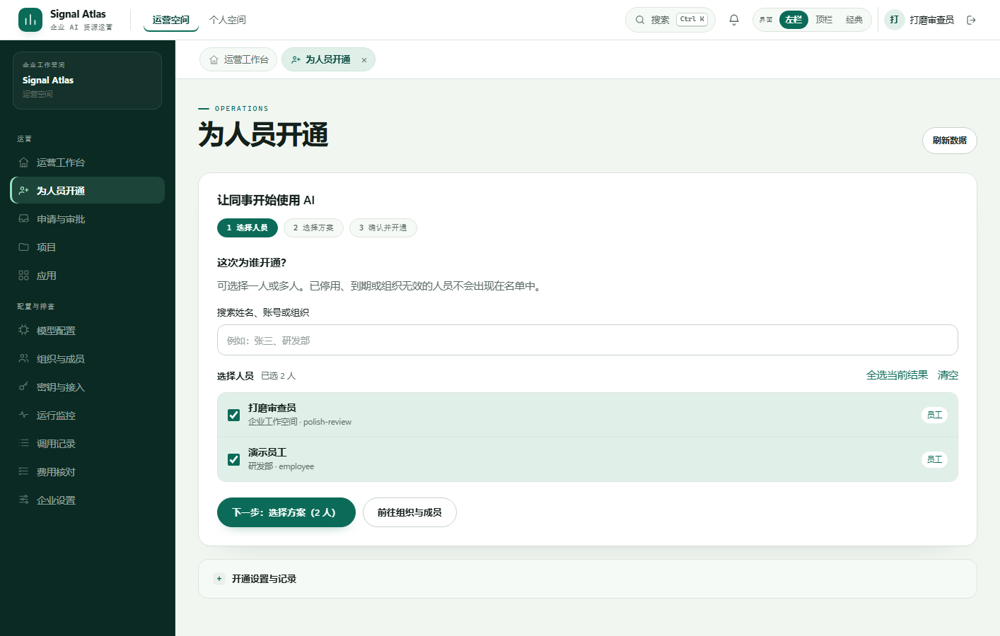

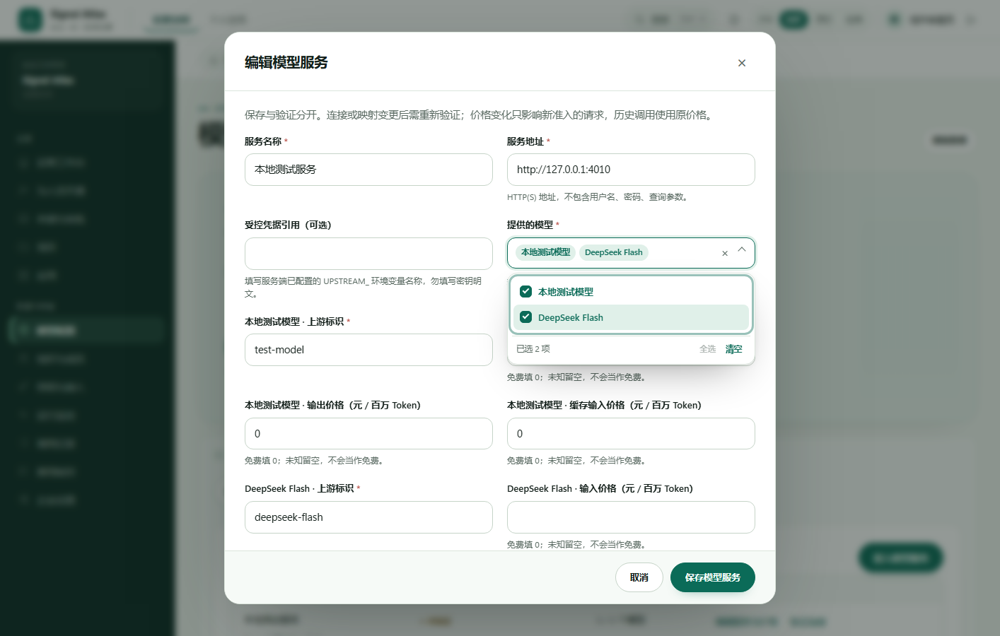

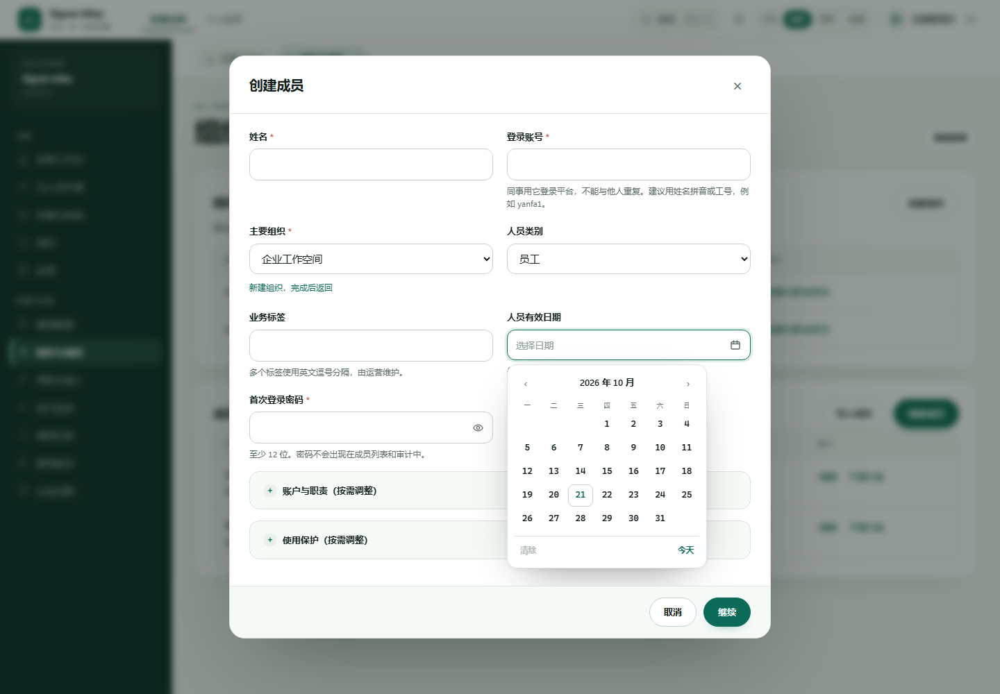

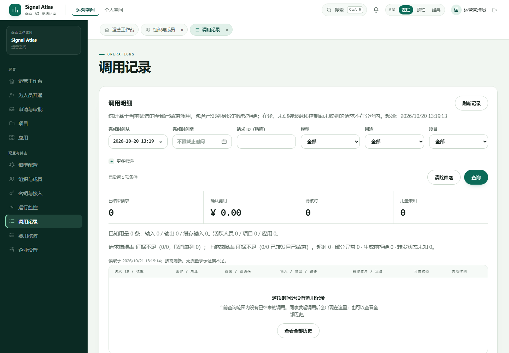

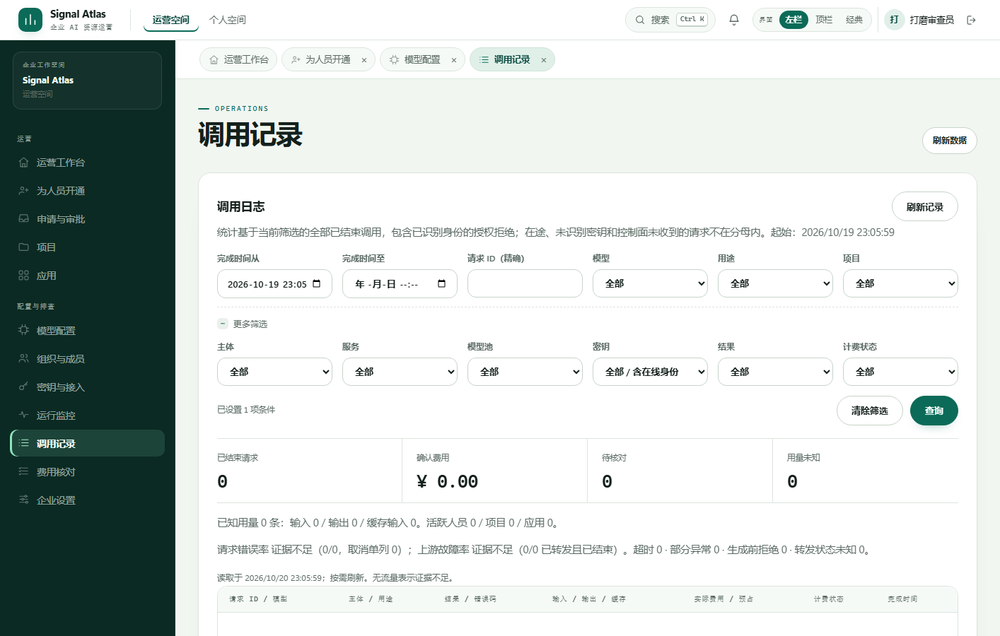

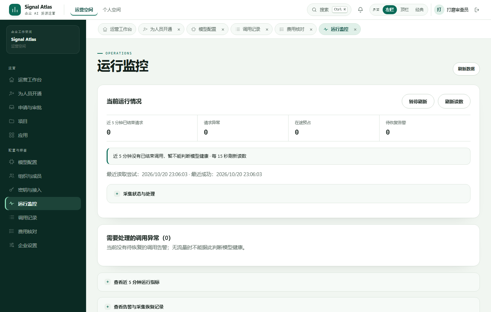

## 6. 响应式与可访问性

- 断点：1180px（收紧侧栏与顶部间距）、980px（顶栏布局主导航换行）、900px（左栏布局收进抽屉）、820px（登录页单列）、760px（移动页头、隐藏次要标签）、600px（平台切换条使用短标签）、520px（隐藏品牌文字、标签省略）、380 / 340px（窄屏顶部操作逐级精简）。
- 320px 宽度不出现页面级横向溢出；表格、平台切换条、页面标签和抽屉菜单在各自容器内滚动。
- 所有导航按钮、表单、标签页、弹窗和命令面板支持键盘焦点；焦点轮廓使用深绿色 3px 环。
- 命令面板使用 `role="dialog"`、`role="listbox"`、`role="option"` 和 `aria-activedescendant`；设计切换使用 `aria-pressed`；导航使用 `aria-current`。
- 尊重 `prefers-reduced-motion`：页面入场、命令面板和过渡动画会关闭。
- 触屏设备沿用项目的 44px 最小按钮高度和 16px 输入字号规则。

## 7. 实现位置

- `apps/web/src/design-v2.css`：日光主题与顶栏布局，全部业务样式限定在 `html[data-ui="next"]`，另含共享的界面切换和命令面板样式。
- `apps/web/src/design-v3.css`：左栏 + 标签页布局（平台条、深绿主菜单、页面标签、移动抽屉），限定在 `html[data-layout="sidebar"]`。
- `apps/web/src/v2.tsx`：图标、品牌标记、界面切换、顶栏导航和命令面板。
- `apps/web/src/v3.tsx`：平台切换条、左侧主菜单、页面标签栏。
- `apps/web/src/ui-mode.ts`：默认值、本地存储、URL 预览，以及 `data-ui`（主题）和 `data-layout`（布局）的应用。
- `apps/web/src/EnterpriseApp.tsx`：三种壳层分支、平台/空间与页面导航、打开页面标签状态、命令面板接线、登录页切换入口；已打开页面按标签保持挂载，抽屉打开时主内容 `inert` 并约束焦点。
- `apps/web/src/components.tsx`：`Field` 与标准下拉多选 `MultiSelect`；共享弹窗、表格和状态组件；`useNarrow` 窄屏断点钩子。
- `apps/web/src/date-field.tsx`：`DateField`（日期 / 日期时间触发器 + 日历浮层、键盘与错误态）；`Field type="date"` / `type="datetime"` 内部渲染该组件，筛选条直接引用。
- `apps/web/src/password-field.tsx`：`PasswordInput`（遮蔽 + 查看切换）。
- `apps/web/src/TaskHome.tsx`：人员开通的 `sessionStorage` 草稿（已选人员、方案、步骤、搜索词）与恢复提示。
- `apps/web/src/CallExplorer.tsx`：窄屏筛选折叠、统计口径 disclosure、三分类空状态；非活动标签暂停查询。
- `apps/web/src/main.tsx`、`apps/web/index.html`：样式加载和首屏防闪烁。
- [组件选型与样式契约](ui-component-contract-v1.md)、根目录 `AGENTS.md` / `CLAUDE.md`：后续页面和 AI coding 的组件选型、样式与验收入口。
- 共享小修：`TaskHome.tsx` 去掉对“左侧配置与排查”的过时提示；`WorkspacePages.tsx` 为通知页补充空状态；`EnterpriseApp.refresh` 不再把正常未登录访问显示成红色错误。
- 未改动：业务域、控制面、合同、权限、`docs/ui-kit` 下的经典 tokens 与样式。

## 8. 本地验证

| 检查 | 结果 |
| --- | --- |
| `pnpm --filter @ai-gateway/web typecheck` | 通过 |
| `pnpm --filter @ai-gateway/web build` | 通过；66 个模块，CSS 66.48 kB（gzip 12.62），JS 456.88 kB（gzip 141.11） |
| 1440 × 1000 桌面截图 | 默认左栏布局：平台条、主菜单、页面标签、总览、开通、审批、模型、成员、密钥；个人空间；顶栏布局；经典布局；登录页；命令面板 |
| 390 × 844 移动截图 | 平台条、页面标签、左栏抽屉、抽屉内导航与界面切换、窄屏页面 |
| 响应式溢出 | 320 / 360 / 736 / 1024 / 1440 下左栏布局均 `scrollWidth = innerWidth`，无页面级横向溢出 |
| 页面标签 | 首次加载固定默认标签；打开 6 个标签后关闭 1 个变为 5 个；固定标签无关闭按钮；切到个人空间后标签重置为“开始使用”；990px 以下 resize 后活动标签自动滚入可见区；无运行时异常 |
| 标签切换保留进度（2026-10-21） | 为人员开通选中 1 人进入第二步 → 切到模型配置 → 切回，仍停在第二步且人员保留；关闭标签再打开时从 `sessionStorage` 恢复并提示“已恢复上次未完成的进度”，“重新开始”清空草稿 |
| 首屏与刷新入口（2026-10-21） | 运营工作台“需要你处理”在 hero 之前；调用记录只保留页面自身的“刷新记录”，不再与全局“刷新数据”重复 |
| 移动筛选折叠（2026-10-21） | 390 下筛选默认收起，开关显示“筛选 · N 项条件”，展开可查询、查询后自动收起；统计口径与错误率收进 disclosure；390 下 `scrollWidth = innerWidth` |
| 空状态（2026-10-21） | 调用记录区分“尚无调用（查看全部历史）”“筛选无结果（清除筛选）”“没有待核对项”；不再只显示“暂无记录” |
| 抽屉焦点（2026-10-21） | 390 下打开抽屉：平台条与主内容 `inert`，Tab / Shift+Tab 连续循环仍在抽屉内，Escape 关闭后焦点回到菜单按钮、`inert` 解除 |
| 人员选择组件 | 行列表 2 人；全选当前结果后计数 2、下一步启用；禁用主按钮为中性色；无原生大卡片和横向滚动 |
| 多选组件 | 标准下拉多选替代原生 multiple select 和横排复选框网格；闭合态显示已选标签、清除和展开；展开态支持复选、搜索、全选、清空和计数；键盘切换、Escape 只关面板不关弹窗、点击外部关闭；6 个选项时搜索过滤和“全选结果”生效；浮层靠近底部自动向上展开并按可用高度收缩；快速连续点击不丢选择；无裁切、无控制台异常 |
| 日期字段（2026-10-21） | 成员、密钥、操作审计、调用记录全部改用 `DateField`，页面中已无原生 `input[type=date]` / `datetime-local`；打开后焦点落在当天，方向键移动、Enter 选中并回到触发器；Escape 只关日历不关弹窗；`datetime` 点日期不提交、点“确定”才写入；1440 与 390 下浮层均在弹窗正文内、无页面级横向溢出（390 下 `scrollWidth = innerWidth`）；窄筛选格有值时用清除 `×` 替换日历图标，日期值完整显示不压字 |
| 筛选与统计组件 | 调用/核对常用条件一行（1440），更多筛选可展开，查询/清除位于底部动作行；调用指标、监控汇总、项目汇总统一为分隔条；390 下筛选单列、活动标签可见、无页面级横向溢出 |
| 三版切换 | 左栏 → 顶栏 → 经典 → 左栏；登录页、顶栏、经典界面均出现“左栏 / 顶栏 / 经典”三个选项；经典界面在线使用页与改造前一致，仅新增切换入口 |
| 命令面板 | Ctrl+K 打开、输入筛选、上下键、Enter、Esc、焦点恢复；无运行时异常 |
| 浏览器 | 本地 Chrome headless + CDP；未覆盖 Safari / Firefox / 真实读屏软件 |

本地截图证据（Chrome headless，1440 × 1000 / 390 × 844）：

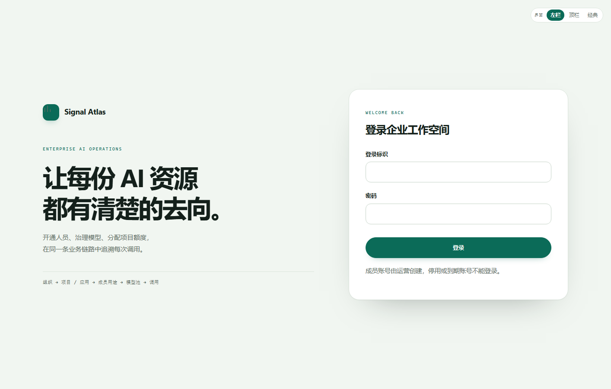

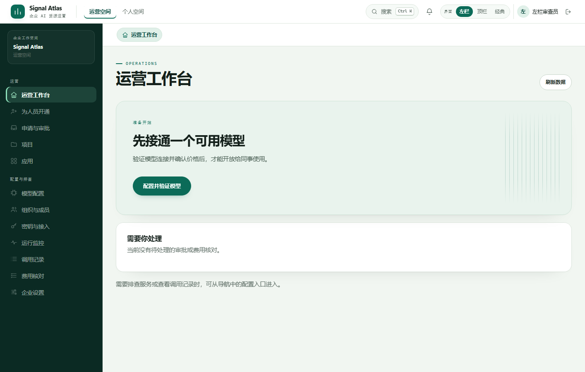

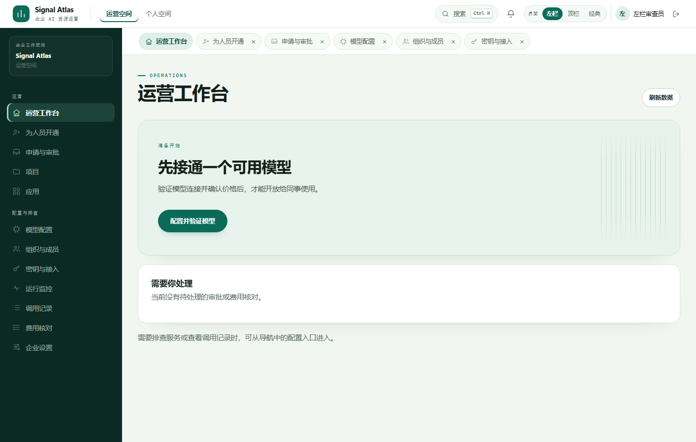

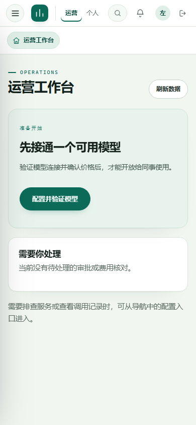

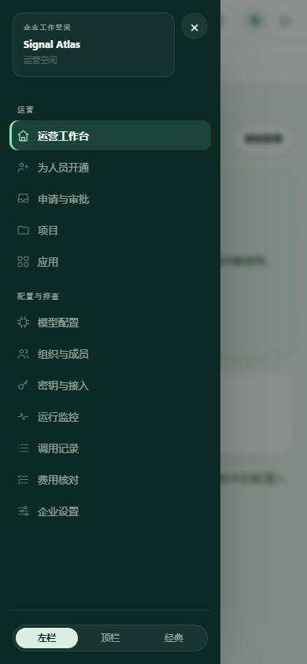

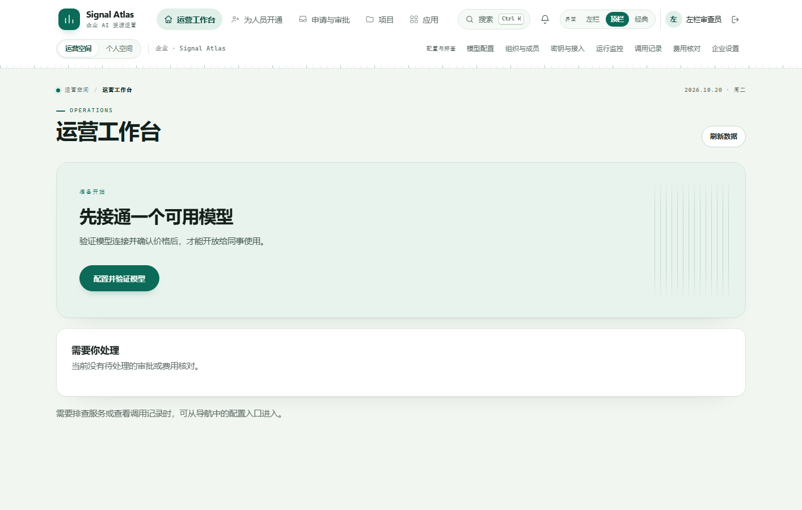

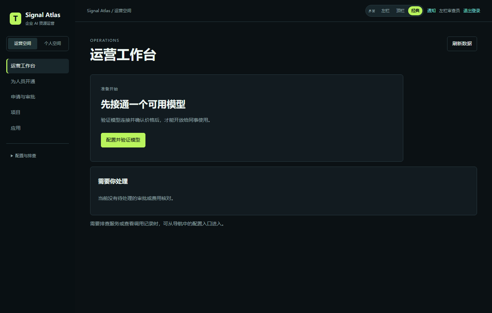

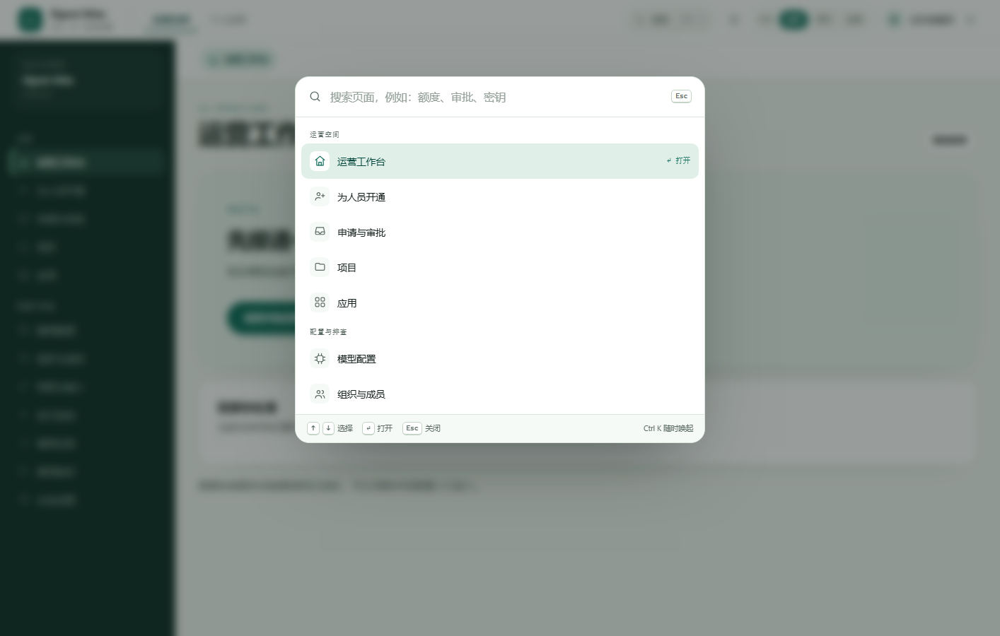

## 9. 边界与下一步

- 日光主题和三种布局都是呈现与交互层改造，不新增业务能力，不替代真实部署、认证、备份、监控和生产验收。
- 页面内容结构仍复用原组件；打开页面标签会保留各页面的筛选、步骤与草稿（页面在会话内保持挂载），但刷新后仍从默认页重建，只有“为人员开通”的临时草稿会通过 `sessionStorage` 恢复。更深入的内容标签重排、过滤条件行内对齐和移动端导航渐隐提示，可在用户评审后继续细化。
- 命令面板只导航现有页面，不执行命令，不绕过审批和权限。
- 云端模型、真实 Higress、正式域名和浏览器证书等边界不受本次改造影响。
- 建议下一步：由用户在实际业务页面上试用三种布局，确认平台切换、左栏分组、右侧标签页和登录第一印象，再决定左栏布局是否长期作为默认界面。
