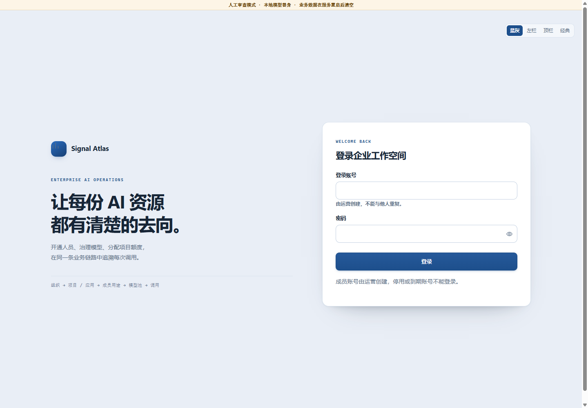
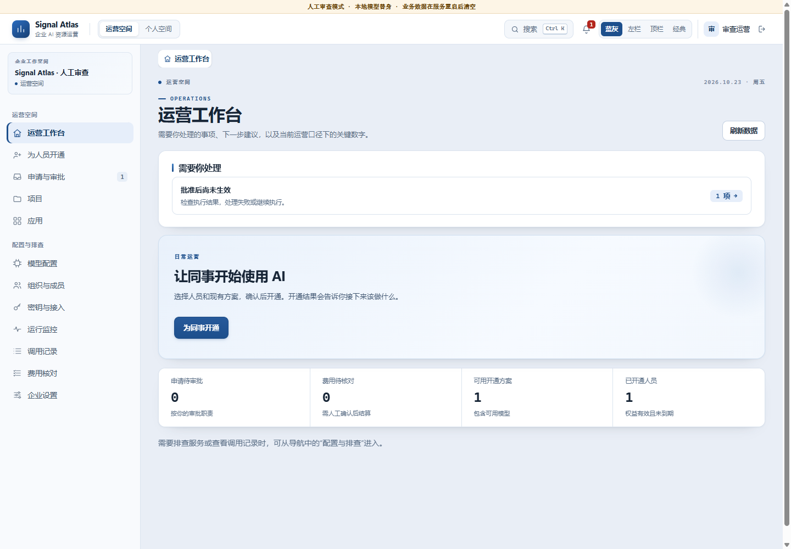
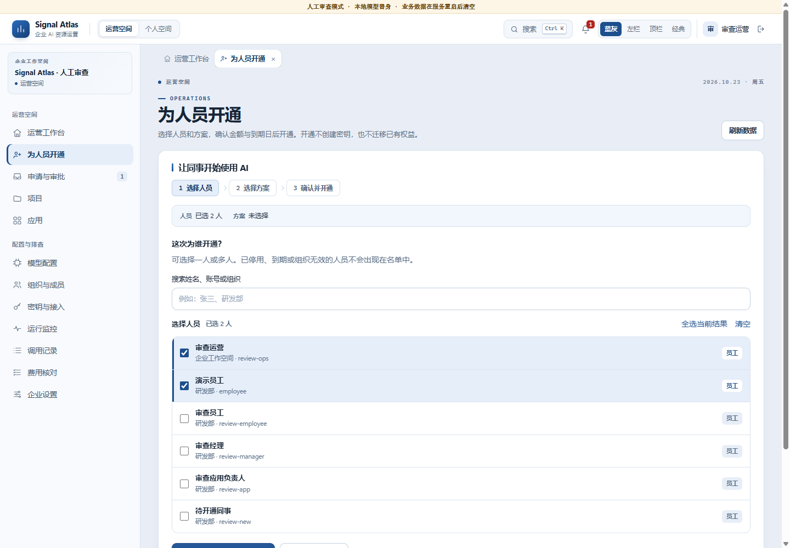
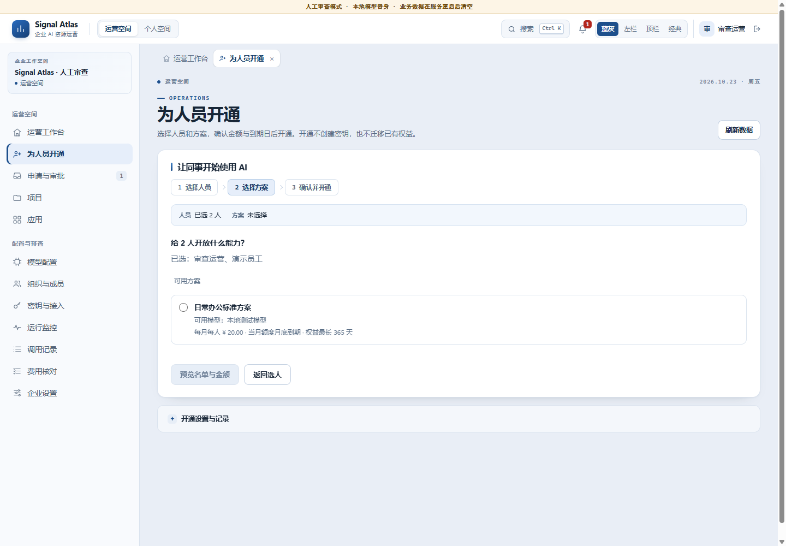
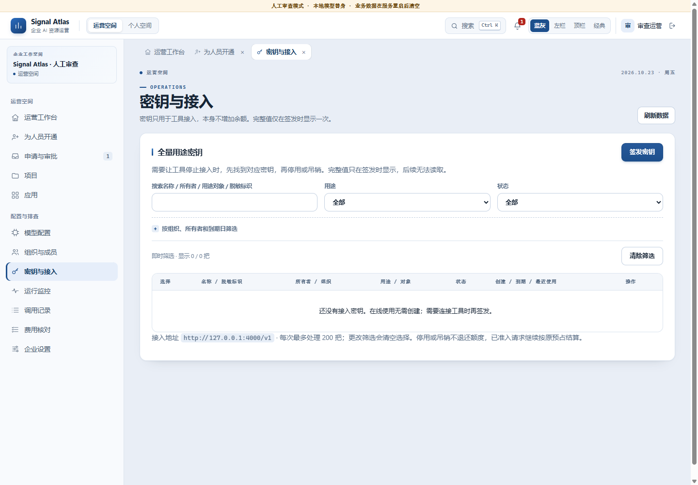
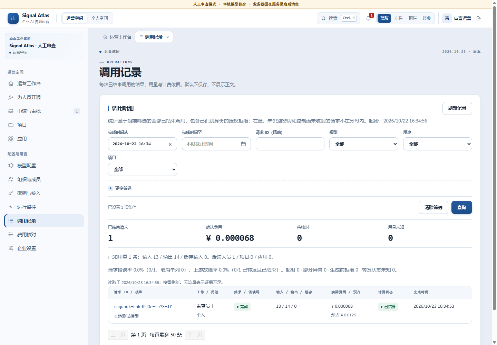
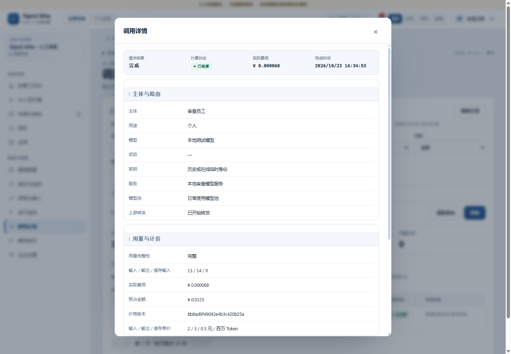
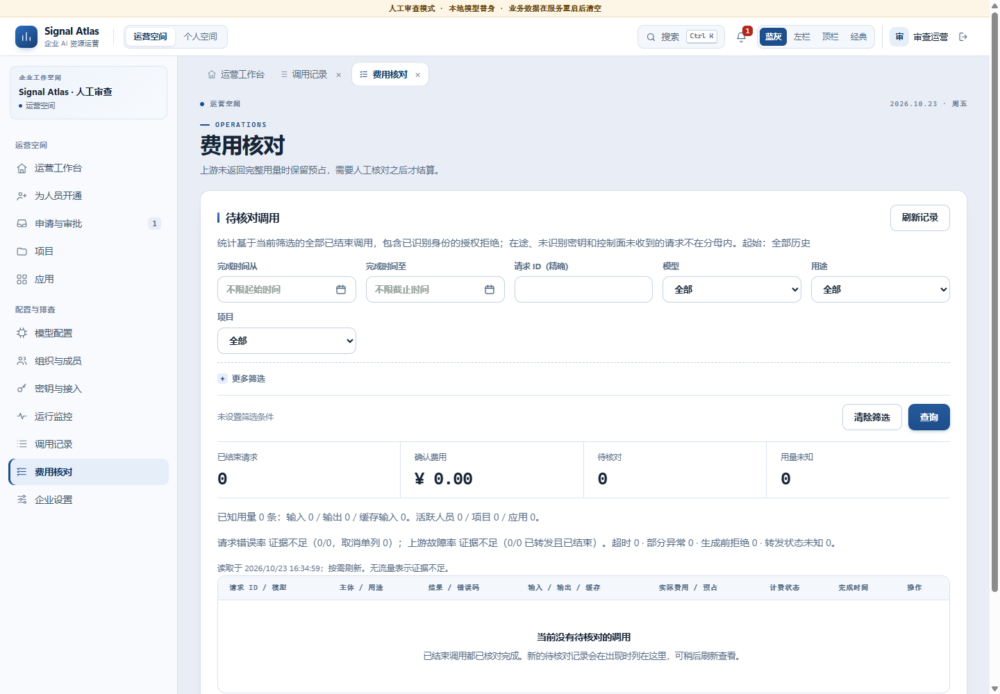
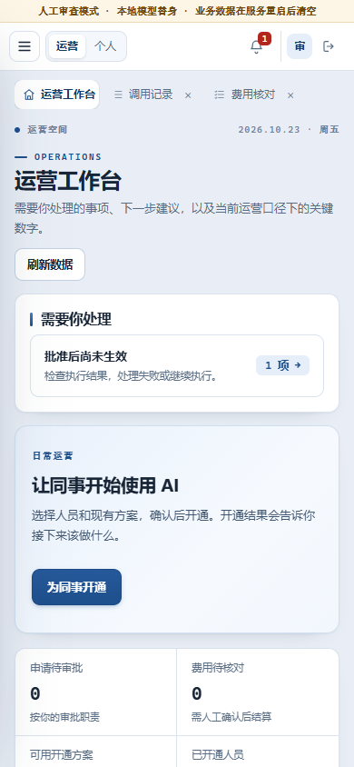
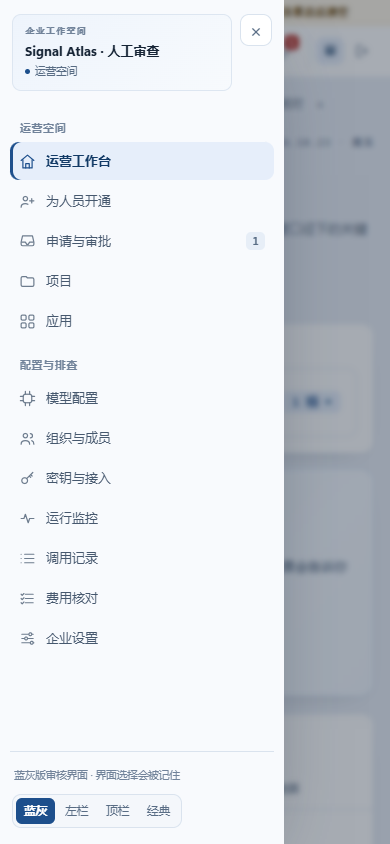

# Signal Atlas 蓝灰版审核界面（Atlas Blue）

日期：2026-10-21。状态：已实现，通过本地类型检查、生产构建和 1440 / 390 浏览器截图检查，等待产品评审。
适用范围：`apps/web`。组件选型与样式仍以 [组件选型与样式契约](ui-component-contract-v1.md) 为准，本文只记录这一版的设计语言、壳层和本次改造过的页面。

## 1. 背景与目标

现有界面有三套：左栏 + 标签页（默认）、顶栏、经典。左栏布局的信息架构可用，但视觉语言偏「浅绿纸面 + 胶囊按钮」，组件之间的层级差不够，长表单、筛选区和下钻详情需要读文字才能定位。

这一版以**现有左栏布局为基础**重新设计视觉与组件层，颜色取参考产品 unified-alarm-platform 的**蓝灰浅色**（azure light，canvas `#e9eef6`、paper `#ffffff`、深蓝主色 `#1d4f8c`、蓝灰分隔线 `#dae3ee`）。目标：

- 一屏之内先说清楚「这是什么页面、要做什么、现在什么状态」。
- 组件有统一的高度、圆角、层级和状态，不再靠文字解释。
- 下钻详情分组成块，不再是一列二十行键值对。
- 不改变任何业务规则、数据口径、命令、审批和权限。

## 2. 切换方式（审核入口）

- **右上角分段控件**：`界面` 分组 → `蓝灰` / `左栏` / `顶栏` / `经典`。选中项以深蓝实心表示，当前为`蓝灰`即本文这一版。
- 登录页右上角同样可见；窄屏（≤900px）时顶部栏只保留菜单、空间、通知和用户，切换控件在左侧抽屉底部。
- 选择写入 `localStorage` 的 `signal-atlas.ui`（`azure` / `sidebar` / `next` / `classic`），刷新后保持。
- `?ui=azure` 可用于临时对比，URL 参数优先于本地存储，但不写入存储。
- 首屏防闪烁：`index.html` 的内联脚本在 React 挂载前写入 `data-ui` 与 `data-layout`。
- 四种界面共用同一套 React 页面、业务 API、命令、预览和权限；切换只换视觉与壳层，页面主体不重新挂载，筛选和草稿不丢失。

> 2026-10-27 追加：设计新增第五套可选界面 `beacon`（信标，暖白画布 + 深墨主卡 + 紫强调），复用本文的 v4 壳层（左栏 + 页面标签）。机制与本文一致，取值与验证见 [信标版审核界面](signal-atlas-v5-beacon-review.md)。本文保持 2026-10-21 的写作时状态，不回溯修改。

## 3. 设计语言

### 3.1 色彩

| 变量 | 值 | 用途 |
| --- | --- | --- |
| 画布 | `#e9eef6` | 页面底色，蓝灰纸面 |
| 纸面 | `#ffffff` | 面板、表格、弹窗 |
| 次级纸面 | `#f4f7fb` / `#e7eef7` | 表头、说明块、禁用底 |
| 墨色 | `#172536` | 正文与标题 |
| 次要文字 | `#586c84` / `#71839a` | 说明、口径、时间 |
| 主色 | `#1d4f8c` | 主按钮、选中态、链接、表头强调条 |
| 主色浅底 | `#e6eefa` | 选中导航、已选标签、统计强调 |
| 深蓝文字 | `#123a66` | 当前页标题与选中项文字 |
| 提醒 | `#8a5a00` / `#fdf5e6` | 待处理、待核对 |
| 危险 | `#b3261e` / `#fbe9e6` | 吊销、失败、删除 |
| 成功 | `#176b4a` / `#e8f4ee` | 已生效、已结算 |
| 分隔线 | `#dae3ee` / `#c3d0e1` | 面板与控件边界 |

语义色三档（成功 / 提醒 / 危险）始终与文字同时出现，颜色不是唯一信息。

### 3.2 字体与数字

- 界面文字：`Segoe UI Variable Text / Segoe UI / PingFang SC / Microsoft YaHei`。
- 数据、金额、时间、计数、表头、步骤编号：`Cascadia Code / SFMono-Regular / Consolas / ui-monospace`，统一 `tabular-nums`。
- 页面标题 26–31px / 650；面板标题 15.5px / 650；正文 14px；辅助 11–12.5px。
- 不引入外部字体 CDN。

### 3.3 尺寸

- 控件最小高度 40px（筛选区 38px，触屏 44px），圆角 10px。
- 面板圆角 14px、内边距 20–24px、投影 `0 1px 2px rgba(23,37,54,.05), 0 12px 26px -22px rgba(23,37,54,.4)`。
- 标签圆角 6px；按钮圆角 9px；不使用胶囊按钮，避免与状态标签混淆。
- 顶栏 56px（窄屏 52px），左栏 256px（≤1180px 收窄到 232px，≤900px 收进抽屉）。

## 4. 壳层

```text
┌──────────────────────────────────────────────────────────────┐
│ 品牌  │ 运营空间 / 个人空间 │            搜索 通知 界面切换 用户 │  56px
├───────────────┬──────────────────────────────────────────────┤
│ 企业工作空间卡  │ 页面标签：运营工作台  为人员开通 ×  调用记录 × │
│ 运营空间       ├──────────────────────────────────────────────┤
│  运营工作台     │ ● 运营空间                              日期  │
│  ...          │ OPERATIONS                                    │
│ 配置与排查      │ 页面标题                                      │
│  ...          │ 一句口径说明                       刷新数据     │
│               │ 面板 / 筛选 / 表格 ...                         │
└───────────────┴──────────────────────────────────────────────┘
```

### 4.1 顶栏

- 品牌方标（深蓝渐变）+ 名称 + 一行副标题。
- 运营 / 个人空间分段控件：当前空间白底深蓝字，未选灰字。
- 页面身份只出现一次：顶栏不再重复面包屑，当前页面由页面标签和页面标题表达。
- 右侧：搜索（Ctrl K）、通知（未读角标）、界面切换、用户与退出。

### 4.2 左栏主菜单

- 近白底 `#f8fafd`，与画布形成层次而不是加深色栏。
- 顶部企业工作空间卡：平台标签、企业名称、当前空间（带小圆点）。
- 两组导航：当前空间主任务 + `配置与排查`（个人空间为 `工具与协作`）。
- 当前项：浅蓝底 + 左侧 3px 深蓝条 + 深蓝粗体。
- **待办角标**：`申请与审批` 显示本人有权处理的待审 + 待生效数，`费用核对` 显示待核对数（红色系）。角标只统计当前账号能处理的量，不显示他人待办。

### 4.3 页面标签

- 位于内容区顶部、页面之上，白底胶囊只用于当前标签，其余为透明文字标签。
- 同一页面只保留一个标签；空间默认页固定且不可关闭。
- 会话内保持挂载：切换标签只改显隐，不重置筛选、步骤、草稿和滚动位置。

### 4.4 页面头部

- 一行上下文：`● 运营空间` + 右侧日期，不再重复页面名。
- 大标题 + **一句口径说明**（`page-lede`）：说明这页做什么、数字代表什么。
- 右侧单一动作：`刷新数据`；页面自带刷新入口时（调用记录、费用核对、运行监控）不重复显示。

## 5. 组件规格

以下为蓝灰版实现；选型、禁止项和 a11y 细则仍以组件契约第 2、3 节为准。

### 5.1 Button

- `.primary`：深蓝渐变、白色文字、9px 圆角，一个任务区域最多一个。
- `.ghost`：白底 + 蓝灰描边；`.danger-button`：白底 + 陶红描边；`.link-button`：深蓝文字链接。
- 禁用：`.primary` 变中性底 + 中性文字（不是半透明绿），`.ghost` / `.danger-button` 降为中性描边。
- 行内操作（表格操作列、`.inline-actions`）统一为深蓝文字按钮，hover 加下划线。

### 5.2 Field / 表单

- 控件 40px、圆角 10px、白底、`#c3d0e1` 描边；hover 加深描边，focus 深蓝描边 + `0 0 0 3px #dce8f8` 浅蓝环。
- `label` 只在需要文字样式时才设样式，**不覆盖 `display`**：人员行、方案行等用 `<label>` 实现的组件必须保持各自的 `display: flex`。
- 密码字段继续使用 `PasswordInput`（默认遮蔽 + 小眼睛）；日期继续使用 `DateField`（触发器 + 日历浮层）。两者只调整尺寸、圆角与焦点环，不改变交互。

### 5.3 Table

- 外层 12px 圆角卡片，表头 `#f4f7fb` 底 + 10px 等宽大写字母。
- 行高 12px 内边距，行 hover 浅蓝底 + 首列左侧 3px 浅蓝条。
- 空状态区分「尚无数据 / 筛选无结果 / 当前无待处理项」，并给出下一步按钮。

### 5.4 StatStrip（统计条）

- 独立使用时是一张白底统计卡（4 列，列间竖线，25px 等宽数字）。
- 在面板内部时自动去掉卡片边框，改为上下分隔线 + 列间竖线，避免卡片套卡片。
- 每个指标下方有一行口径说明（例如「按你的审批职责」「需人工确认后结算」）。
- 需要关注的值以提醒色显示（`is-alert`），失败以危险色（`is-danger`）；未知显示「未知」而不是 0。

### 5.5 FilterBar（筛选区）

- 常用条件一行（`filter-primary`，列宽 ≥178px，保证 `YYYY-MM-DD HH:mm` 不被省略）。
- 低频条件收进 `filter-more`，已设置条件时自动展开并显示条件数。
- 底部动作行：左侧条件计数 + 筛选方式说明，右侧清除、查询。
- 立即生效的列表（密钥与接入）不放假「查询」按钮，改为在计数位置说明「即时筛选 · 显示 N / M 把」。

### 5.6 Status / Tag

- 6px 圆角、浅底 + 圆点 + 文字；成功绿、提醒琥珀、危险陶红、默认蓝灰。

### 5.7 步骤条与选择摘要

- `journey-steps`：浅底方角步骤块，当前步为浅蓝底深蓝字，步骤之间用 `›` 形箭头连接。
- `choice-summary`：把已做的决定固定在步骤下方（`人员 已选 2 人` / `方案 月度标准` / `每人额度 ¥ 20.00`），翻页不必回看。
- 人员选择仍是行列表（复选框 + 姓名 + 组织 · 账号 + 类别标签，选中行浅蓝底 + 左侧条），单个人员行 38–42px。
- 方案选择是可选行卡片，选中后左侧 3px 深蓝条 + 浅蓝底。

### 5.8 下钻详情（DetailGroup，新增）

长键值对列表不再一次性铺开，改为「先结论、再分组」：

```text
┌ 调用详情 ──────────────────────────────── × ┐
│ 请求结果   计费状态   实际费用   完成时间      │  ← detail-lead
│ 完成       已结算     ¥0.000068  2026/10/23  │
├─────────────────────────────────────────────┤
│ 主体与路由  主体 / 用途 / 模型 / 项目 / 密钥…  │
│ 用量与计价  用量完整性 / tokens / 单价 / 预占… │
│ 时序与追踪  请求 ID / 错误码 / 开始 / 完成…    │
└─────────────────────────────────────────────┘
```

- `.detail-lead`：4 列结论条（结果、计费状态、实际费用、完成时间），值可用 `Status`。
- `.detail-group`：分组卡片，标题行浅底 + 左侧 3px 强调条，内部是无法表格化的 `dl.detail-list`。
- 分组顺序固定：结论 → 身份与路由 → 用量与计价 → 时序与追踪。
- 表格内枚举值必须以中文出现（例如用途列显示「个人 / 项目成员 / 独立应用」，不显示 `personal`）。

## 6. 本次改造的核心链路

一条完整链路用来验证组件和页面：**运营工作台 → 为人员开通 → 密钥与接入 → 调用记录 / 费用核对**。

| 页面 | 改造点 |
| --- | --- |
| 运营工作台 | 待办行保持首屏；新增统计条（申请待审批 / 费用待核对 / 可用开通方案 / 已开通人员，各带口径说明）；hero 降为浅蓝渐变，保留唯一主动作 |
| 为人员开通 | 步骤条 + 已选摘要；人员行列表收紧；开通结果改为统计条（成功 / 跳过 / 失败 / 本次方案）+ 下一步说明 |
| 密钥与接入 | 筛选区改为标准 FilterBar：常用三条件 + 组织 / 所有者 / 到期日收进更多筛选 + 底部动作行（即时筛选说明 + 清除） |
| 调用记录 / 费用核对 | 筛选区、统计条、空状态、下钻详情沿用同一套组件；下钻改为结论条 + 三组详情 |
| 全部页面 | 标题下方新增一句口径说明；顶栏、左栏、页面标签、面板、表格、按钮、状态、弹窗统一为蓝灰语言 |

## 7. 响应式与可访问性

- 断点：1180px（左栏收窄）、1020px（搜索收起文字）、900px（左栏收进抽屉、隐藏顶栏界面切换）、760px（标签与字段单列收紧）、560px（隐藏搜索、空间控件缩写）、420px（隐藏品牌方标）。
- 320 / 360 / 736 / 1024 / 1440 下 `documentElement.scrollWidth ≤ clientWidth`，无页面级横向溢出；表格只在表格容器内滚动。
- 抽屉为 `role="dialog"` + `aria-modal`，打开后焦点移入，Tab / Shift+Tab 在抽屉内循环，背景 `inert`；Escape / 遮罩 / 关闭按钮都能关闭，关闭后焦点回到菜单按钮。
- 页面标签使用 `aria-label` + `aria-current="page"`（不声明 tablist / tab，因为没有对应的 tabpanel）；导航使用 `aria-current="page"`；界面切换使用 `aria-pressed`；待办角标带 `aria-label`。
- 尊重 `prefers-reduced-motion`；焦点环为深蓝 3px。

## 8. 实现位置

| 内容 | 位置 |
| --- | --- |
| 蓝灰主题、壳层与组件样式 | `apps/web/src/design-v4.css`（全部限定 `html[data-ui="azure"]`） |
| 顶栏 / 左栏 / 页面标签组件 | `apps/web/src/v4.tsx` |
| 界面模式、默认值与 `data-ui` / `data-layout` | `apps/web/src/ui-mode.ts` |
| 界面切换（当前五个选项；本文写作时为四个） | `apps/web/src/v2.tsx` 的 `DesignSwitch`，选项顺序由 `apps/web/src/ui-mode.ts` 的 `UI_DESIGNS` 决定 |
| 壳层接线、页面口径说明、待办角标 | `apps/web/src/EnterpriseApp.tsx` |
| 运营工作台、为人员开通 | `apps/web/src/TaskHome.tsx` |
| 调用记录与下钻分组 | `apps/web/src/CallExplorer.tsx` |
| 密钥与接入筛选条 | `apps/web/src/KeyManager.tsx` |
| 首屏防闪烁 | `apps/web/index.html` |

共享组件（`components.tsx`、`date-field.tsx`、`password-field.tsx`）未改行为，只通过 token 与少量尺寸覆盖适配蓝灰版。

## 9. 本地验证

| 检查 | 结果 |
| --- | --- |
| `pnpm --filter @ai-gateway/web typecheck` | 通过 |
| `pnpm --filter @ai-gateway/web build` | 通过；70 个模块，CSS 115.23 kB（gzip 20.53），JS 478.51 kB（gzip 146.58） |
| `pnpm review` + Chrome headless | 审查环境启动，`review-ops` / `review-employee` 登录、开通预览、在线调用、调用记录与下钻、筛选与清除均可用；无控制台异常 |
| 1440 × 1000 | 登录页、运营工作台、为人员开通（选人 / 选方案）、密钥与接入、调用记录、费用核对、调用详情下钻 |
| 390 × 844 | 平台条、页面标签、运营工作台、左栏抽屉与抽屉内界面切换 |
| 横向溢出 | 320 / 360 / 736 / 1024 / 1440 下 `scrollWidth = clientWidth` |
| 页面标签 | 打开 3 个标签后切换、关闭；当前标签自动滚入可见区 |
| 抽屉焦点 | 打开后焦点在关闭按钮，Tab 保持在抽屉内，Escape 关闭 |
| 其它三种界面 | 左栏、顶栏、经典在新增第四个切换项后仍正常；1440 下顶栏主导航不再出现滚动条 |

截图（Chrome headless，1440 × 1000 / 390 × 844）位于 `docs/product/screenshots/`：





















## 10. 边界与下一步

2026-10-23 追加：调用详情增加上游请求号、原调用关联与“查看关联调用”；模型配置增加连接验证运行明细/记录；为人员开通增加同一方案内的版本迁移预览与确认。三处均复用既有 `Panel`、`Table`、`Status`、`EditorDialog`、`Modal` 和 `DetailGroup`，未新增页面专属视觉组件；自动化浏览器检查见 `pnpm check:web`，截图在 `docs/validation/screenshots-2026-10-23/`。本轮未重启当前 5176 审查实例，其数据与端口保持不变。

- 这一版只改呈现与交互，不新增业务能力，不替代真实部署、认证、备份和监控验收。
- 已按契约复用组件，未替换 `Dialog` / `Field` / `MultiSelect` / `DateField` / `PasswordInput` 的行为；蓝灰版新增的只有 `DetailGroup` 与 `choice-summary` 两种陈列结构，已在组件契约登记。
- 编辑弹窗（模型服务、成员、项目、方案）、审批详情、监控、企业设置等页面已随共享组件获得新语言，但尚未逐页人工走查；建议评审确认核心链路后再逐页细化。
- 后续可选：筛选条最后一项换行时的对齐优化、调用记录表格列密度、深色模式（当前不支持）。
