# Signal Atlas 信标版审核界面（Beacon）

日期：2026-10-27。状态：已实现（P0 + P1 主题层、P2 hero 与额度带结构），通过本地类型检查、生产构建、Chrome 1440 / 390 走查、320–1440 横向溢出矩阵与五套壳层回归，等待产品评审。
适用范围：`apps/web`。组件选型与样式仍以 [组件选型与样式契约](ui-component-contract-v1.md) 为准；本文只记录这一版的设计语言、壳层和覆盖范围。

## 1. 背景与目标

现有四套界面：蓝灰（`azure`，审核界面）、左栏（`sidebar`，默认）、顶栏（`next`）、经典（`classic`）。蓝灰版解决了「层级差」和「先结论、再分组」，但整体仍是冷蓝纸面、紧凑圆角。

这一版新增第五套可选界面 `beacon`（信标），视觉取自参考件 `docs/design-reference/beacon/`（暖白画布 + 深墨主卡 + 紫色强调 + 大圆角）。目标：

- 在不改任何业务规则、数据口径、命令、审批与权限的前提下，多一种可对比的视觉语言。
- 只做**主题层**：复用现有 React 页面与 v4 壳层（左栏 + 页面标签），不重写页面结构，不搬参考件的 DOM，不使用 iframe，不新增组件或依赖。
- 参考件是只读副本：未修改 `docs/design-reference/**`，未从它 import 任何文件，未复用 `.bb-*` 类名。

## 2. 切换方式（审核入口）

- **右上角分段控件**：`界面` 分组 → `蓝灰` / `信标` / `左栏` / `顶栏` / `经典`。选中项以紫色实心表示；当前为`信标`即本文这一版。
- 登录页右上角同样可见；≤900px 时顶部栏只保留菜单、空间、通知和用户，切换控件在左侧抽屉底部（抽屉内注明「信标版审核界面」）。
- 选择写入 `localStorage` 的 `signal-atlas.ui`（`azure` / `beacon` / `sidebar` / `next` / `classic`），刷新后保持。
- `?ui=beacon` 用于临时对比或直达；URL 参数优先于本地存储，但不写入存储。
- 首屏防闪烁：`index.html` 的内联脚本在 React 挂载前写入 `data-ui="beacon"` 与 `data-layout="sidebar"`；`beacon` 必须走 `sidebar` 布局，否则 ≤900px 的抽屉逻辑失效。
- 五套界面共用同一套 React 页面、业务 API、命令、预览和权限；切换只换视觉与壳层，页面主体不重新挂载，筛选和草稿不丢失。

## 3. 设计语言

### 3.1 色彩

取值来自参考件 `themes/beacon/tokens.css`，通过产品既有变量名（`--bg`、`--surface`、`--action` 等）映射，未在产品里引入参考件的类名。

| 产品变量 | 取值 | 来源 token | 用途 |
| --- | --- | --- | --- |
| `--bg` | `#f6f5f2` | `--bb-canvas` | 暖白画布 |
| `--surface` | `#ffffff` | `--bb-surface-1` | 面板、表格、弹窗 |
| `--surface2` / `--surface3` | `#f1efe9` / `#e7e4dc` | `--bb-surface-2/3` | 表头、说明块、禁用底 |
| `--text` | `#191c22` | `--bb-text-primary` | 正文与标题 |
| `--muted` | `#666a75` | `--bb-text-muted` | 说明、口径、时间 |
| `--action` | `#5a55d6` | `--bb-accent` | 主按钮、选中态、焦点、链接 |
| `--tint` | `#eeedfb` | `--bb-accent-soft` | 选中导航、已选标签、强调浅底 |
| `--v2-primary-hover` / `--v2-primary-strong` | `#4b46c4` / `#403bb0` | `--bb-accent-hover/active` | 按压态与深紫文字 |
| `--warn` / `--v2-amber-soft` | `#8a5a12` / `#fdf3e2` | `--bb-warn-*` | 待处理、待核对 |
| `--danger` / `--v2-clay-soft` | `#a1332a` / `#fbecea` | `--bb-danger-*` | 吊销、失败、删除 |
| `--ok` / `--ok-soft` | `#1f6b50` / `#e9f5ee` | `--bb-ok-*` | 已生效、已结算 |
| `--blue` | `#2b5f8a` | `--bb-info-fg` | 信息（备用，本轮未新增图表） |
| `--line` / `--line-strong` | `#e3dfd6` / `#cfcabf` | `--bb-border-default/strong` | 发丝描边 |
| 控件描边 | `#83868f` | `--bb-border-control` | 输入、选择、日期触发器 |
| 深墨卡 | `#14161c` / `#1d2028` | `--bb-surface-inverse/2` | `.task-hero`、代码示例 |

语义色三档（成功 / 提醒 / 危险）始终与文字、圆点同时出现，颜色不是唯一信息。

**换品牌色只需改变量块**：强调色在 beacon 块里表达一次（`--action`），派生值全部由它推导——`--tint`（浅底）、`--v2-primary-hover` / `--v2-primary-strong`（按压与深色文字）、`--beacon-ring`（焦点外环）、`--beacon-glow`（hero 柔光）、`--beacon-ink-accent`（深墨卡上的浅色文字与图形）、`--beacon-accent-border`（浅紫描边）。组件层没有任何强调色字面量：已用计算样式逐个校验主按钮填充、`--tint`、hover / active、步骤条当前步描边、hero 柔光、顶栏方标图形与 hero eyebrow 共 9 个表面，取值与原字面量完全一致。若评审认为紫色与 Signal Atlas 的蓝灰气质冲突，只改这一段即可，不动任何组件规则。

对照度自查（不低于）：

| 组合 | 实测 | 底线 |
| --- | --- | --- |
| 正文 / 白底 | 17.2 | 17.07 |
| 次要文字 `#454a55` / 白底 | 8.85 | 8.88（同档） |
| 说明文字 `#666a75` / 画布 | 4.96 | 4.96 |
| 白字 / 紫底 | 5.67 | 5.67 |
| 提醒 / 提醒底 | 5.38 | 5.38 |
| 危险 / 危险底 | 6.06 | 6.05 |
| 成功 / 成功底 | 5.72 | 5.72 |
| 控件描边 / 白底 | 3.65 | 3.64（非文本 ≥3） |
| 焦点环（实心紫，3px）/ 白底、画布 | 5.67 / 5.20 | ≥3 |

### 3.2 字体与数字

- 界面文字：`Segoe UI Variable Text / Segoe UI / PingFang SC / Microsoft YaHei`；正文 15px。
- 数据、金额、时间、计数、表头、步骤编号：`Cascadia Code / SFMono-Regular / Consolas / ui-monospace`，统一 `tabular-nums`。
- 页面标题 `clamp(28px, 2.6vw, 34px)` / 650 / `-0.02em`；面板标题 18px / 650；区域小标题 15px / 600；说明 12.5px；微文案 11px。
- 表格保持 13.5px / 行高 1.5，不因正文 15px 而放大会导致 16 页密度回退。
- 不引入外部字体 CDN。

### 3.3 尺寸

- 控件最小高度 40px（触屏 44px），圆角 10px；按钮 40px、无渐变。
- 面板圆角 20px、内边距 20–24px、投影 `0 1px 2px rgba(25,28,34,.04), 0 20px 40px -36px rgba(25,28,34,.42)`。
- 标签圆角 6px；表格卡片 20px；hero 卡 26px；弹窗 20px。
- 余额大数字 48px / 650（≤760px 降为 40px）；统计条仍为 25px，表格 13.5px。
- 顶栏 56px（窄屏 52px）、页面标签条 56px（灰卡 40px / 标签 32px）、左栏 256px（≤1180px 收窄到 232px、≤900px 收进抽屉）、页面内边距 32px —— 均沿用 v4 几何，避免第五套界面改变操作习惯。

## 4. 壳层

与蓝灰版同一套壳层（`V4TopBar` / `V4Sidebar` / `V4PageTabs` 原样复用，`data-layout="sidebar"`）：

```text
┌──────────────────────────────────────────────────────────────┐
│ 深墨方标 品牌 │ 运营空间 / 个人空间 │      搜索 通知 界面切换 用户 │  56px
├───────────────┬──────────────────────────────────────────────┤
│ 工作空间卡      │ 页面标签：运营工作台  为人员开通 ×  调用记录 × │
│ 运营空间       ├──────────────────────────────────────────────┤
│  运营工作台     │ ● 运营空间                              日期  │
│  ...          │ OPERATIONS                                    │
│ 配置与排查      │ 页面标题                                      │
│  ...          │ 一句口径说明                       刷新数据     │
│               │ 面板 / 筛选 / 表格 ...                         │
└───────────────┴──────────────────────────────────────────────┘
```

### 4.1 顶栏

- 品牌方标改为**深墨方块**（`#14161c`）＋浅紫信号图形，与 hero 卡的墨色同源，不再使用蓝色渐变。
- 顶栏白底 + `--line-strong` 深线 + `0 6px 16px -14px` 轻投影：滚动时顶栏与暖白画布分开，而不是一条同色发丝线。
- 运营 / 个人空间分段控件：当前空间白底深紫字 + 1px 阴影，未选灰字。
- 右侧：搜索（Ctrl K）、通知（未读角标）、界面切换（5 项）、用户与退出。1440 下 5 项切换不溢出顶栏（有断言）。

### 4.2 左栏主菜单

- 暖灰 `#efebe2`（`--beacon-rail`，比画布 `#f6f5f2` 深一档），与白色内容区形成「暖灰骨架 + 白内容」三段明度，而不是把左栏做成近白同色面；悬停 `#e6e0d4`，右侧分隔用 `--line-strong`。
- 顶部工作空间卡：白底、14px 圆角、发丝描边；当前空间带紫色圆点。
- 待办角标用白底（在暖灰栏上才读得出），当前项的角标转白底深紫字。
- 运营三组导航：当前空间主任务 + `模型管理` + `配置与排查`；个人空间保留主任务 + `工具与协作`。模型管理提供模型目录、模型服务、模型池、容量与保护四个独立入口。
- 当前项：`--tint` 浅紫底 + 左侧 3px 紫条 + 深紫粗体。
- 待办角标：`申请与审批` 显示本人有权处理的待审 + 待生效数，`费用核对` 显示待核对数（陶红系）。只统计当前账号能处理的量。

### 4.3 页面标签

- 这些是「已打开的页面」而不是视图切换，语义上接近飞书的多标签，所以形态对齐飞书：与内容区**同宽的圆角浅灰标签条**（12px 圆角，`--surface2`），不再铺满整宽——铺满时暖灰背景会比 1320px 的内容区宽出一截，右侧多出一条灰带。
- 活动标签：`--surface` 白底 + 无描边 + 轻阴影（`0 1px 3px`）+ 深墨字 + 紫色页面图标；非活动标签透明底灰字（`#666a75` 在 `#f1efe9` 上 4.71），hover 变白。
- 标签条与内容区之间不加分隔线：灰卡自身已界定区域，多一条通宽横线会把标签条切成两截（飞书也没有）。
- 关闭按钮只在活动标签、hover 与键盘焦点下出现（飞书 / VS Code 行为）；非活动标签不挂 ×，避免一排叉号成为噪音（仍在 DOM 中且可键盘聚焦，聚焦时恢复可见）。
- 标签高 32px（条带 40px，含外边距共 56px）；≤760px 横向滚动；触屏（`pointer: coarse`）下 36px 且 × 常显。
- 内边距：文字左 10px、右 12px；带 × 的标签右侧收到 4px（20px 按钮 + 6px 外边距自行撑边）。
- 这条内边距曾经静默失效：`design-v4.css` 的 `.v4-tab.active .v4-tab-select` 未带作用域（3 个类），压过本文件的 2 类选择器，把没有 × 的活动标签压到 4px。现已把 v4 那三条“激活态子元素”规则收进 `html[data-ui="azure"]`，并在 v5 里显式写回 12px 作为第二道防线。
- 同一页面只保留一个标签；空间默认页固定且不可关闭。
- 会话内保持挂载：切换标签只改显隐，不重置筛选、步骤、草稿和滚动位置。

### 4.4 页面头部

- 一行上下文：`● 运营空间` + 右侧日期。
- 大标题 + 一句口径说明（`page-lede`）。
- 右侧单一动作：`刷新数据`；页面自带刷新入口时（调用记录、费用核对、运行监控）不重复显示。

## 5. 组件规格

选型、禁止项和 a11y 细则以组件契约第 2、3 节为准；这里是 Beacon 的外观取值。

### 5.1 Button

- `.primary`：实心紫 `#5a55d6`、白字、10px 圆角、40px 高、无渐变、无投影；hover `#4b46c4`、active `#403bb0`。一个任务区域最多一个。
- `.ghost`：白底 + `#cfcabf` 发丝边，hover 加深描边 + `--surface2`。
- `.danger-button`：白底 + 陶红边 `#eed3cf`，hover 陶红边 + `#fbecea` 底。
- 禁用：`.primary` 变中性底 `--surface3` + 中性字（不是半透明紫）；`.ghost` / `.danger-button` 降为中性描边。
- 行内操作（表格操作列、`.inline-actions`）为紫色文字按钮，hover 加下划线。
- **深墨 hero 卡内的主按钮改为白色描边按钮**，避免深色卡上出现一块紫；禁用态同步降为低对比白描边。

### 5.2 Field / 表单

- 控件 40px、圆角 10px、白底、`#83868f` 描边；hover 加深到 `#5c5f68`；focus 紫色描边 + `0 0 0 3px rgba(90,85,214,.18)` 外环。
- 占位文字 `#6f737c`（白底 4.75，避免浅灰不可读）。
- `label` 只在需要文字样式时才设样式，**不覆盖 `display`**：人员行、方案行等用 `<label>` 实现的组件保持各自的 `display`。
- 密码字段继续使用 `PasswordInput`（默认遮蔽 + 小眼睛）；日期继续使用 `DateField`（触发器 + 日历浮层）；多选继续使用 `Field type="multiple"` → `MultiSelect`。三者只调整尺寸、圆角、焦点环与浅紫 chip，**不改行为与 DOM**。

### 5.3 Table

- 外层 20px 圆角卡片（内部滚动，`max-width: 100%`），表头 `--surface2` + 11px 等宽大写，`#454a55`。
- 行内边距 13px / 12px、13.5px 字号；行 hover `--surface2` + 首列左侧 3px 紫条。
- 空状态区分「尚无数据 / 筛选无结果 / 当前无待处理项」，并给出下一步按钮（文案由页面提供，Beacon 只提供 `.empty` / `.empty-state` 皮肤）。

### 5.4 StatStrip（统计条）

- 独立使用时是白底统计卡（4 列、列间竖线、25px 等宽数字、12px 口径说明）。
- 在面板内部时自动去卡片边框，改为上下分隔线 + 列间竖线，避免卡片套卡片。
- 需要关注的值用提醒色（`is-alert`），失败用危险色（`is-danger`）；未知显示「未知」而不是 0。
- 带名称的单元格（如方案名）使用 `.is-text`，不套等宽数字。

### 5.5 FilterBar（筛选区）

- 常用条件一行（`filter-primary`，列宽 ≥178px），低频条件收进 `filter-more`（虚线分隔 + 方形加减号）。
- 底部动作行：左侧条件计数 / 即时筛选说明，右侧清除、查询。
- 立即生效的列表（密钥与接入）不放假「查询」按钮，只说明「即时筛选 · 显示 N / M 把」。

### 5.6 Status / Tag

- 6px 圆角、浅底 + 深色文字 + 圆点；成功 `#1f6b50/#e9f5ee`、提醒 `#8a5a12/#fdf3e2`、危险 `#a1332a/#fbecea`、默认 `--surface2/#454a55`。

### 5.7 步骤条与选择摘要

- `journey-steps`：白底方角步骤块，当前步浅紫底 + 深紫字，步骤间用 `›` 形箭头连接。
- `choice-summary`：把已做的决定固定在步骤下方（人员 / 方案 / 每人额度）。
- 人员行列表：复选框 + 姓名 + 组织 · 账号 + 类别标签；选中行浅紫底 + 左侧 3px 紫条，复选框 accent 紫。
- 方案行卡片：选中后浅紫底 + 3px 紫条 + 紫色描边。

### 5.8 下钻详情（DetailGroup）

```text
┌ 调用详情 ──────────────────────────────────── × ┐
│ 请求结果   计费状态   实际费用   完成时间         │  ← detail-lead（4 列）
│ 完成       已结算     ¥0.000068  2026/10/27 …   │
├────────────────────────────────────────────────┤
│ ▎主体与路由  主体 / 用途 / 模型 / 项目 / 密钥 …    │  ← 3px 紫条 + 等宽大写标题
│ ▎用量与计价  用量完整性 / tokens / 单价 / 预占 …   │
│ ▎时序与追踪  请求 ID / 上游请求号 / 错误码 / 延迟 … │
└────────────────────────────────────────────────┘
```

- `.detail-lead`：结论条（14px 圆角、`--surface2` 底）。
- `.detail-group`：14px 圆角分组卡，标题行 `--surface2` + 左侧 3px 紫条 + 11px 等宽大写。
- 分组顺序固定：结论 → 身份与路由 → 用量与计价 → 时序与追踪。

### 5.9 面板、弹窗与深墨卡

- `.panel`：白底、20px 圆角、`--azure-shadow-panel`、内边距 20–24px；面板内的面板去边框，改为 `--surface2` 安静卡。
- `.modal`：白底、20px 圆角、`--azure-shadow-float`；遮罩 `rgba(20,22,28,.45)` + 4px 模糊；页头 18px/650，页脚 `--surface2` 且随圆角收口。
- `.task-hero`：深墨 `#14161c` 卡、26px 圆角、反白文字，右上紫色柔光；正文 76% 不透明度，微文案 70%，链接用浅紫 `#b5b1f5`（墨底 9.17）。
- `.code-example`、`.reply`、`.notice`、评审横幅同步换色，不留蓝色或深蓝残留。

## 6. 覆盖范围（16 个页面）

只做皮肤，因此所有页面同时获得新语言；本轮逐页走查的清单：

| 页面 | 走查点 |
| --- | --- |
| 登录 / 初始化 | 暖白画布、白色登录卡、紫色主按钮、右上 5 项切换 |
| 运营工作台 | 待办行、深墨 hero（主数值 + 右侧 3 行 KV + 唯一主动作）、4 列统计条 |
| 为人员开通 | 步骤条 + 已选摘要、人员行选中态、方案卡、禁用主按钮 |
| 申请与审批 | 分段控件、评审列表选中态、陶红状态标签、浅紫提示块 |
| 项目 / 应用 | 面板、统计条、表格、空状态 |
| 模型管理 | 模型目录、服务连接与验证、模型池与开放范围、容量与保护四个独立页面；首次接入引导保留在模型服务页 |
| 组织与成员 | 成员表、机构筛选、编辑弹窗（文本框 / 选择 / 多选 / 日期 / 密码） |
| 密钥与接入 | 标准筛选条（更多筛选 + 动作行）、空表状态、签发弹窗（DateField 浮层） |
| 运行监控 | 4 指标条、提示块、折叠面板 |
| 调用记录 | 筛选条、统计条、13.5px 表格、下钻结论条 + 3 组详情 |
| 费用核对 | 待核对筛选、空状态「当前没有待核对的调用」 |
| 企业设置 | 三段面板、二级弹窗、保留策略计数 |
| 通知 | 列表与已读态 |
| 开始使用（个人） | 深墨 hero + 深色用途选择 + 余额主数值与侧栏 KV、浅紫链接、虚线引导块 |
| 我的额度 | 大盘余额、额度来源占比带、额度批次表格、来源说明 |
| 在线使用 | 表单、报价说明、折叠费用明细、回复块、紫色发送 |

## 7. 响应式与可访问性

- 断点沿用 1180 / 1020 / 900 / 760 / 560 / 520 / 420：1180 收窄左栏与统计条，1020 收起搜索文字，900 左栏进抽屉 + 隐藏顶栏切换 + 统计条两列，760 收紧标签与字段，560 隐藏搜索 / 空间后缀，420 隐藏品牌方标。
- **320 / 360 / 736 / 1024 / 1440 × 22 个页面位（运营 13 + 个人 9）全部 `scrollWidth === clientWidth`**，无页面级横向溢出；表格只在 `.tablewrap` 内滚动。
- 抽屉为 `role="dialog"` + `aria-modal`，打开后焦点移入关闭按钮，Tab / Shift+Tab 在抽屉内循环，背景 `inert`；Escape / 遮罩 / 关闭按钮都能关闭，关闭后焦点回到菜单按钮。
- 页面标签使用 `aria-current="page"`；导航同样；界面切换使用 `aria-pressed`（5 项中只有当前项为 true）；待办角标带 `aria-label`。
- 焦点环改为 3px 实心紫（白底 5.67、画布 5.20），不再使用低对比半透明蓝环。
- 尊重 `prefers-reduced-motion`：`html[data-ui="beacon"] *` 与抽屉 / 遮罩在开启该偏好时不播动画、不位移。

## 8. 实现位置

| 内容 | 位置 |
| --- | --- |
| Beacon 主题、壳层与组件样式（全部限定 `html[data-ui="beacon"]`） | `apps/web/src/design-v5.css`（新建） |
| 样式引入顺序（同权重覆盖 v4） | `apps/web/src/main.tsx` 在 `design-v4.css` 之后追加 `import './design-v5.css'` |
| 界面模式、`UI_DESIGNS`、`isDesign`、`data-ui` / `data-layout` | `apps/web/src/ui-mode.ts` |
| 首屏防闪烁 `known` 列表 | `apps/web/index.html` |
| 界面切换第五项（`信标`） | `apps/web/src/v2.tsx` 的 `DesignSwitch` |
| 壳层接线（`v4Shell = azure \|\| beacon`） | `apps/web/src/EnterpriseApp.tsx`：常量、抽屉查询、V4 顶栏 / 左栏、页面标签、页面上下文、口径说明、遮罩 |
| 抽屉底注按当前界面显示「信标版 / 蓝灰版审核界面」 | `apps/web/src/v4.tsx`（`mode` 派生一行文案；壳层结构未变） |
| 三条“激活态子元素”规则收进 azure 作用域 | `apps/web/src/design-v4.css`：`.v4-tab.active .v4-tab-select`、其 `svg`、`.v4-nav-item.active .v4-nav-badge`。这三处 beacon 都有等价规则；其余 v4 规则仍是两套壳层共享的基线 |

`design-v4.css` 的 22 个小节在 `design-v5.css` 中逐节重写（base → shell geometry → top bar → left menu → page tabs → page head → surfaces → actions → tags & status → notices → stat strip → tables → forms → filter bar → person list → disclosures/steps/section-tabs → task hero & inbox → drill-down detail groups → modal → loading & login → design switch & command palette → responsive），无缺节；v4 中出现的每一个 `--azure-*` / `--v2-*` 变量（12 个）与全部 `var(--…)`（28 个）都在 beacon 块中重新赋值，不依赖 v4 的取值；强调色的 7 个派生值同样集中在该块，组件层零强调色字面量。

未修改：`components.tsx`、`date-field.tsx`、`password-field.tsx`（行为与 DOM 不变，只通过 CSS 调整外观）、`docs/ui-kit/signal-atlas-tokens.css`、`docs/design-reference/**`。

## 9. 本地验证

| 检查 | 结果 |
| --- | --- |
| `pnpm --filter @ai-gateway/web typecheck` | 通过 |
| `pnpm --filter @ai-gateway/web build` | 通过；75 个模块，CSS 168.06 kB（gzip 28.73），JS 491.80 kB（gzip 150.81） |
| `pnpm review`（独立端口 5273，纯本地） | 启动成功，5 个种子账号可用 |
| 首屏 | `document.documentElement.dataset.ui === 'beacon'`、`dataset.layout === 'sidebar'`；`index.html` 的 `known` 已含 `beacon` |
| 切换器 | 登录页 / 顶栏 / 抽屉三处均为 5 项，`aria-pressed` 只在当前项为 true；1440 下顶栏不溢出 |
| 1440 走查 | 登录、运营工作台、为人员开通、密钥与接入、调用记录、调用详情、费用核对、我的额度、在线使用 |
| 390 走查 | 顶栏、页面标签、运营工作台、左栏抽屉、抽屉内 5 项切换（底注「信标版审核界面」） |
| 键盘 | 导航 / 按钮焦点环可见；抽屉焦点循环、Escape 关闭并回到菜单按钮 |
| 其它四套界面 | azure / sidebar / next / classic 均正常渲染、无横向溢出、无控制台异常 |
| `pnpm check:web` | **PASS 68 browser assertions**（蓝灰版回归用例全通过；壳层断言覆盖五套界面的 `data-ui` / `data-layout` / 五档切换器与 `aria-pressed`） |
| 浏览器走查（`.runtime/beacon-check.mjs`） | **PASS 82 assertions**：首屏 `data-ui=beacon` / `layout=sidebar`、`known` 已含 beacon、三处切换器 5 项且 `aria-pressed` 唯一、顶栏 1440 不溢出、hero 主数值 + 3 行侧栏、额度带可见、调用详情结论条 + 3 组、抽屉 `role=dialog` + 焦点循环 + Esc 回焦、焦点环可见、五套壳层渲染且新结构仅 beacon 可见、无未捕获异常 |
| 四套旧界面回归 | 在 azure 下 `.task-hero > p` 仍命中 v4 规则（`rgb(63, 85, 112)` / 13px），证明 hero 既有子元素未被包裹；`sidebar` / `next` / `classic` 下 hero 新块与额度带 `getClientRects()` 为 0 |
| 多来源额度带 | 注入 4 段临时验证（不入库）：1440 横向按权重分段、900 纵向堆叠、390 无横向溢出 |
| 横向溢出 | 320 / 360 / 736 / 1024 / 1440 × 22 个页面位 = 110 组合，全部无页面级溢出 |
| 强调色变量化 | 9 个强调色表面的计算样式与原字面量逐个一致（主按钮 `rgb(90,85,214)`、`--tint` `rgb(238,237,251)`、hover / active、步骤条描边 `rgb(207,203,243)`、hero 柔光 `rgba(90,85,214,.42)`、墨底浅紫 `rgb(181,177,245)`） |
| 骨架分层（辨识度） | 左栏 `#efebe2` / 画布 `#f6f5f2` / 白卡三档明度；对比度：导航文字 / 左栏 7.44、说明文字 / 左栏 4.54、搜索与顶栏按钮图标 / 白底 ≥3（非文本） |
| 浏览器走查（`.runtime/beacon-a11y.mjs`） | **PASS 13 assertions**：四组对比度实测（非活动标签 4.7、活动标签 17.07、分段控件未选 4.7 / 选中 8.5）、真实 Tab 键走查 26 个焦点元素全部有可见焦点环（outline 或 box-shadow）、focus-visible 下非活动标签的 × 自动显形（opacity 1）、焦点环对比度 4.93、空状态仍在 `td.empty` 内且无边框 |
| 分段控件语言统一 | `.section-tabs` 从 999px 胶囊改为 12px 轨道 + 8px 白卡选中段，与标签条、`.v4-space` 同一半径族（10/12 轨道、7/8 段） |
| v4 作用域收紧回归 | 把 `design-v4.css` 三条“激活态子元素”规则收进 `html[data-ui="azure"]` 后，`pnpm check:web` **PASS 68**（蓝灰版未受影响），beacon 82 断言、110 溢出组合均不变 |

截图（Chrome headless，1440 × 1000 / 390 × 844）位于 `docs/product/screenshots/`：

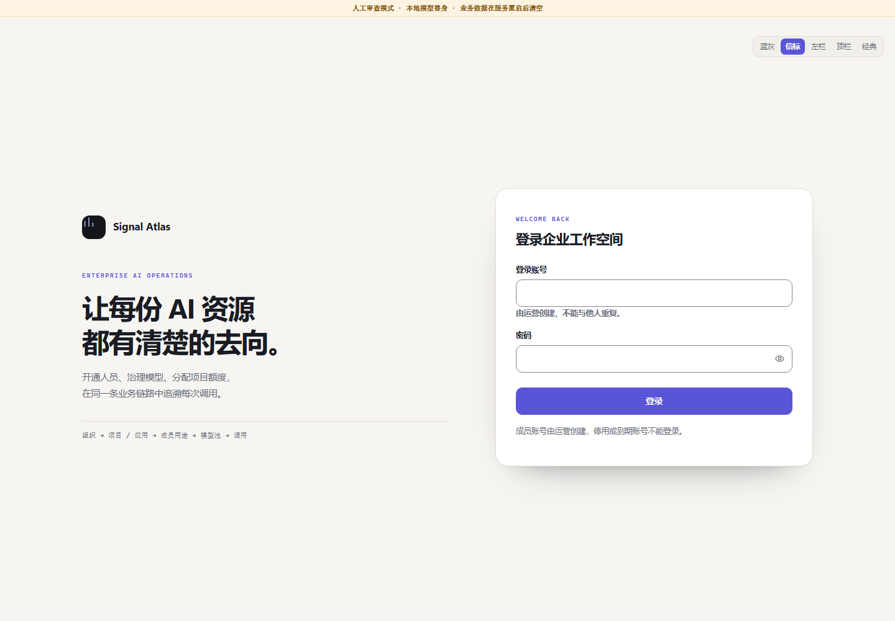

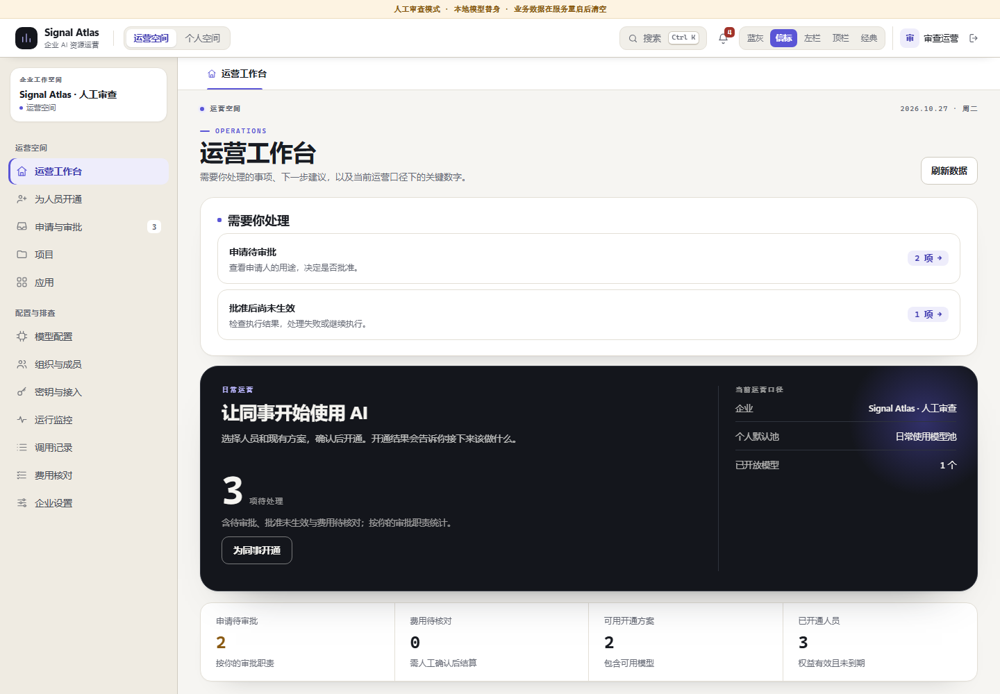


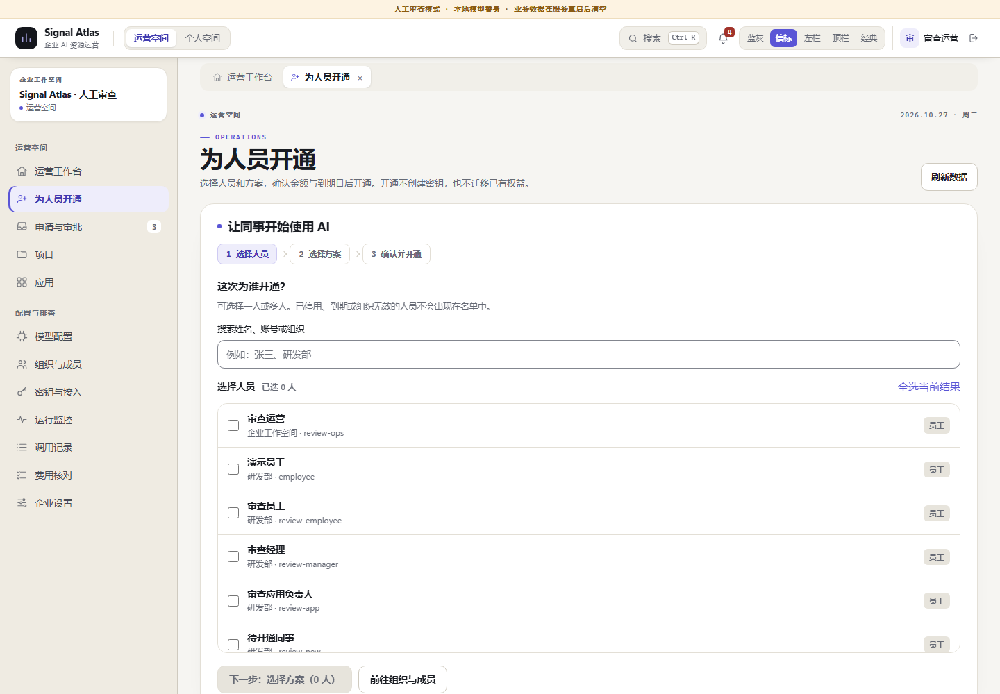

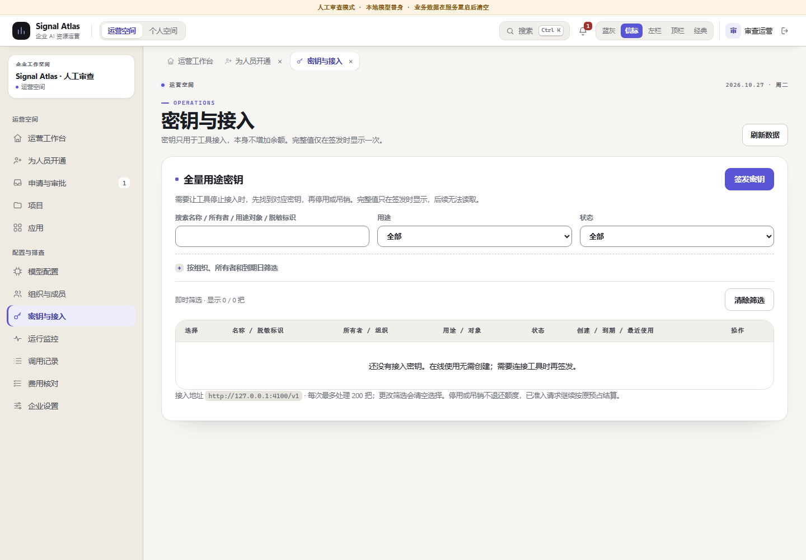

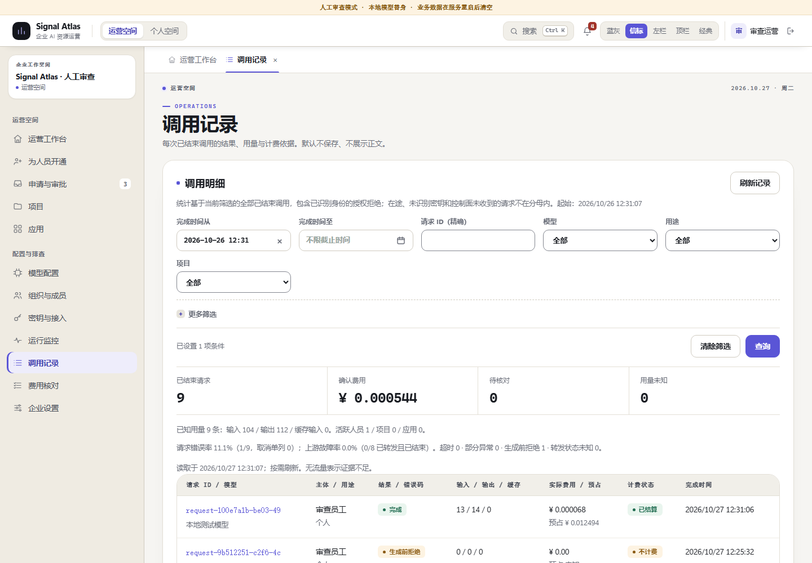

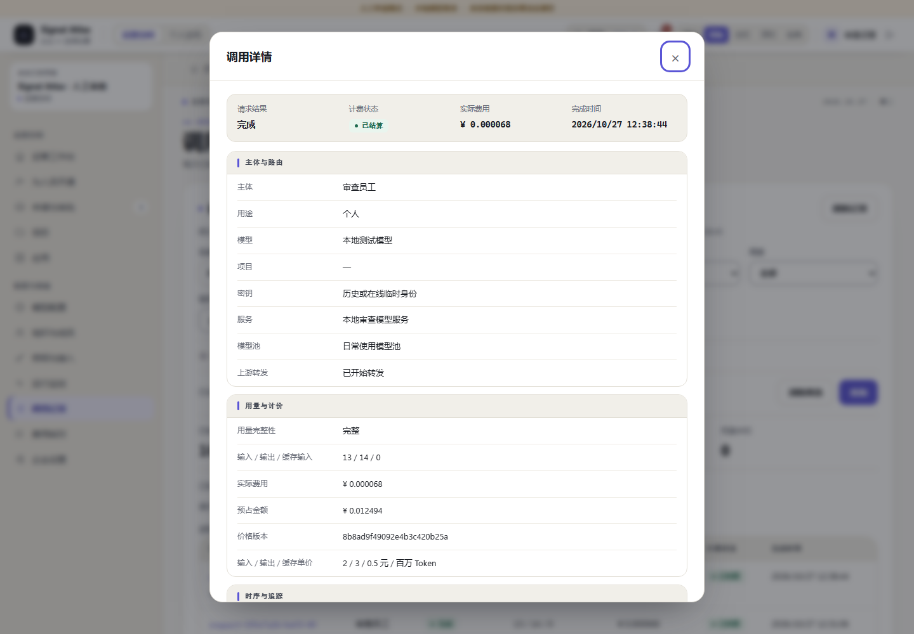

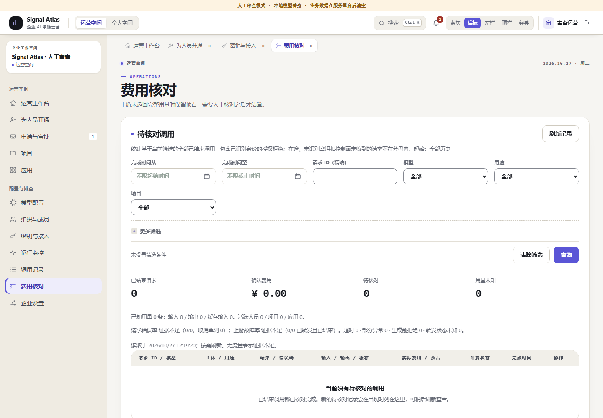

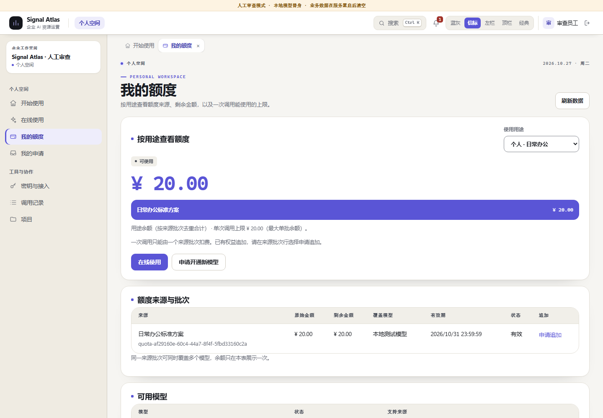

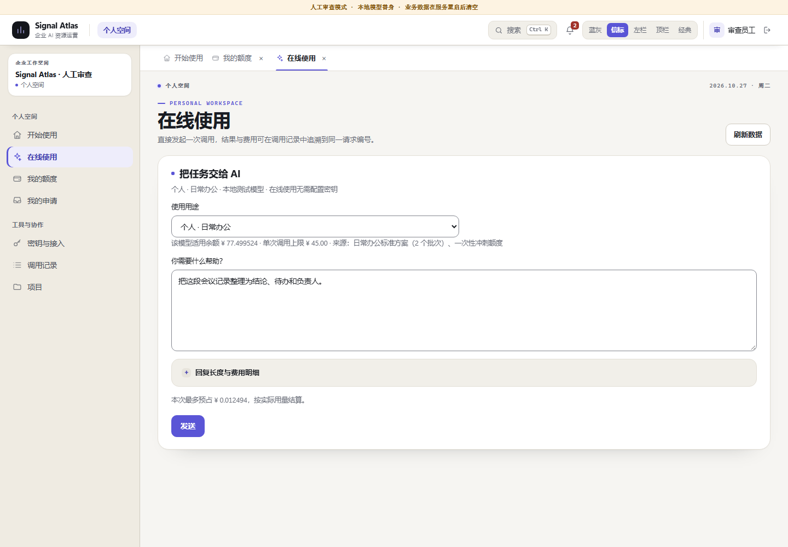

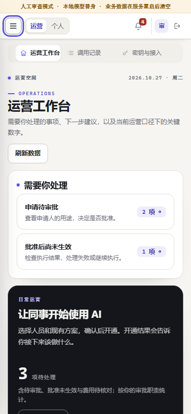

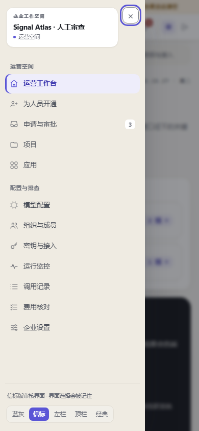

## 10. 边界与下一步

### 10.1 P2 已做的结构改造

| 结构 | 位置 | 说明 |
| --- | --- | --- |
| hero 主数值 + 右侧 KV | `TaskHome.tsx`（运营工作台 / 开始使用） | `.task-hero` 在信标版变两列 grid；`.task-hero-num` 给一个关键数字（运营：待处理合计；个人：用途余额），`.task-hero-side` 放 3 行上下文 KV。既有 `eyebrow / h2 / p / 主按钮` **仍是直接子元素**，其它四套界面的 `> p`、`> .primary` 规则不变。 |
| 额度带（QuotaRibbon） | `WorkspacePages.tsx` 的 `case 'quota'` | 按剩余额占比分段显示余额来源，纯展示（`aria-hidden`），真实金额仍由批次表格承担；单来源时横排成“余额条”，多来源时按权重分段，≤900px 纵向堆叠。 |

两处新结构在非信标界面 `display:none`（只作用于新增类名），回归断言见第 9 节。契约已登记为 3.16 / 3.17。

### 10.2 仍未做

- P3 候选：图表（`--beacon-chart-2` 已用于额度带第二段，其余 `--bb-chart-*` 尚未使用）、深色模式（参考件本身未提供深色值）。
- 参照件的 `.bb-empty` 虚线空状态容器**不采用**：本产品的空状态始终作为 `Table` 的 `empty` 落进 `<td class="empty">`（`CallExplorer.tsx:117`、`KeyManager.tsx:67`），契约 308 行明确要求它是“表格内的空状态行”、不能变成卡片，虚线卡会直接违反该条。信标版只调字阶（标题 14.5 / 说明 13px）与留白。
- 参照件 hero 的 `.bb-hero-aura`（双色柔光）只取单色紫光，未做绿光层。

### 10.3 边界

- 这一版只改呈现，不新增业务能力，不替代真实部署、认证、备份和监控验收。
- 参考件里未映射的 token：`--bb-radius-card`、`--bb-radius-hero`（hero 用同值字面量）、`--bb-font-numeral/display`、`--bb-shadow-raised`、图表与 motion 曲线（部分以字面量出现）。产品没有对应语义的位置，未强加。
- 只走查了契约要求的 16 页；模型配置的连接验证明细、组织影响预览、保留清理预览等二三级弹窗沿用同一套表单 / 表格 / 提示皮肤，未逐屏截图。
- `DateField` 浮层在弹窗内靠下时仍会被 `modal-body` 的滚动容器裁切——这是共享组件的既有几何，四套界面一致，本轮未改。
- 未改：`docs/ui-kit/signal-atlas-tokens.css`（同时服务其它界面）、`docs/design-reference/**`（只读副本）。
- 已提交（本轮收尾）：标签条与内边距、v4 作用域收紧、分段控件半径统一、空状态字阶；工作区干净。
