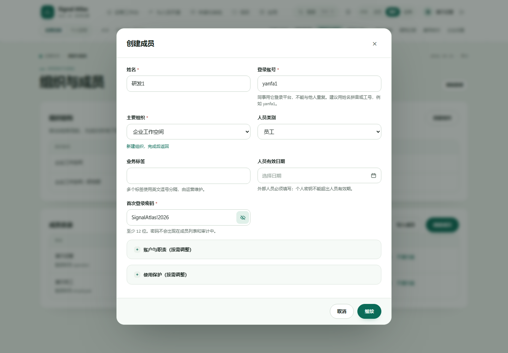
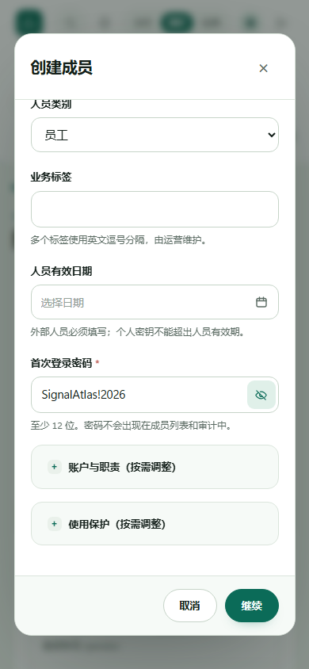
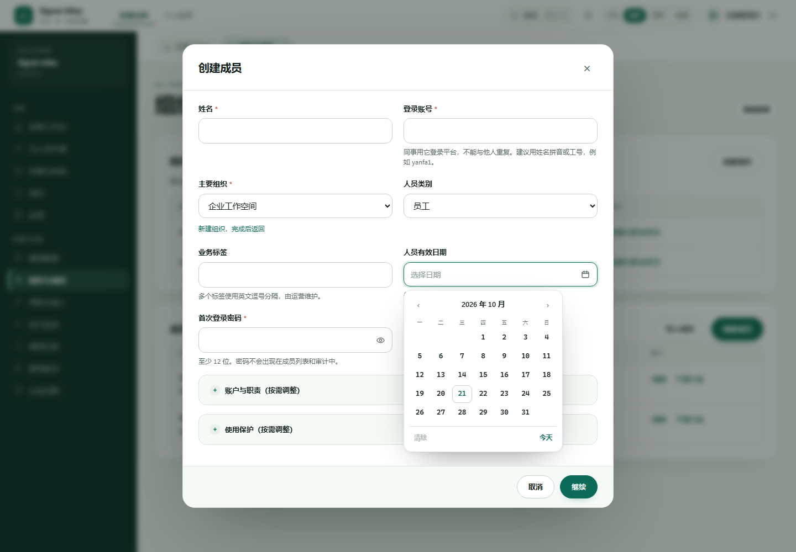
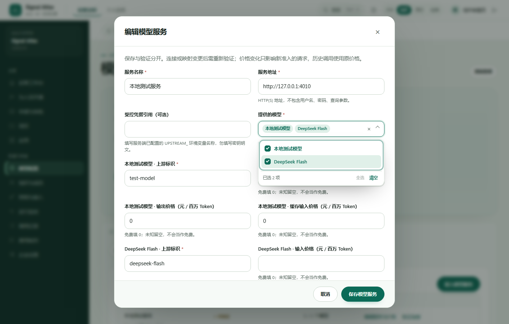
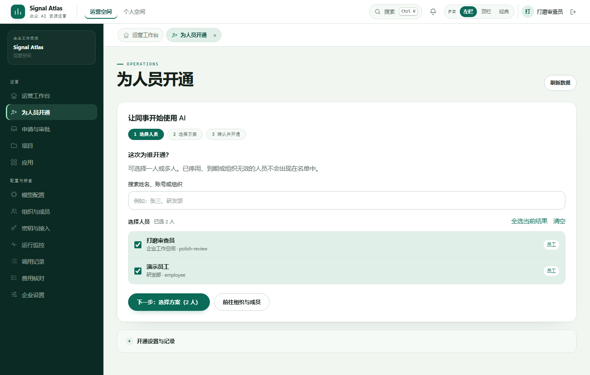
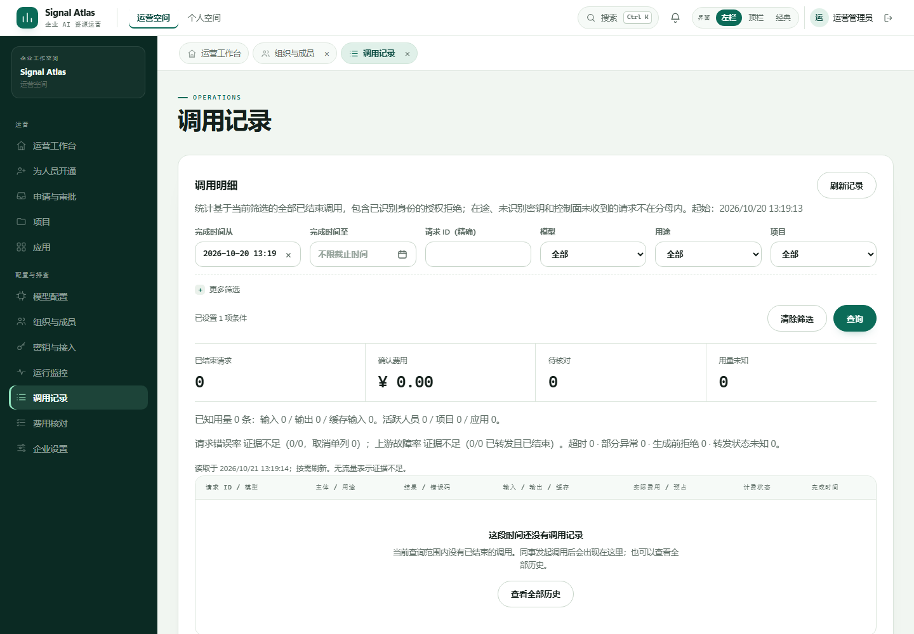

# Signal Atlas 组件选型与样式契约 v1

日期：2026-10-20。状态：生效。适用范围：`apps/web` 的所有新页面、改版和 AI 生成代码。

这份文档回答两个问题：**这个场景该用哪个组件**，以及**这个组件必须长什么样、怎么交互**。业务规则、权限和数据口径以产品文档为准；本契约只约束呈现与交互。与其它 UI 文档冲突时，以本契约为准，并在本文件追加决策记录。

一句话原则：**先选标准组件，再谈样式；没有标准组件时，先补契约，不许即兴发明。**

## 1. 强制规则

违反以下任一条，页面不能算完成：

1. **多选表单字段只能用 `Field type="multiple"`，内部渲染 `MultiSelect`。** 禁止原生 `<select multiple>`、横排复选框卡片、把多个 checkbox 平铺成“选项墙”。
2. **单选字段**：选项不超过 5 个且需要一眼对比时，用分段控件或单选组；超过 5 个、动态或远程选项，用 `Select`。禁止用一排按钮假装下拉。
3. **人员 / 成员选择**必须使用人员行列表模式：搜索、姓名与组织、类别标签、复选框、全选当前结果、清空、已选计数。禁止大卡片网格。
4. **筛选区**必须使用 `FilterBar` 模式：常用条件一行、更多筛选可展开、查询与清除放在底部动作行。禁止卡片套卡片，禁止把查询按钮塞进字段网格。
5. **统计指标**必须使用 `StatStrip` 模式：分隔线统计条，等宽数字。禁止四张带图标、渐变、阴影的大卡片。
6. **业务表单字段必须经过 `Field` / `EditorDialog`。** 页面不直接写裸 `<input>`、`<select>`、`<textarea>`；筛选条、登录页、人员搜索和命令面板等已定义组合除外。新字段类型先扩展 `FieldSpec` 和 `Field`。
7. **一个任务区域最多一个 `.primary` 主按钮。** 次动作用 `.ghost`，文字链接用 `.link-button`，危险动作使用 `.danger-button` 并二次确认。
8. **状态必须用 `Status` / `.tag`**：圆点 + 文字 + 浅底，不能只靠颜色。未知、待核对、样本不足不能显示成 0 或“健康”。
9. **空、加载、错误、无权限、禁用状态必须实现。** 空状态要给出下一步；禁用按钮要说明原因，不能只把主按钮变成半透明绿色。
10. **不新增一次性组件或页面专属视觉 CSS。** 需要新变体时，先更新本契约、补状态与截图，再使用。
11. **图标按钮必须有 `aria-label` 或可见 tooltip；** 不能只有图标没有可访问名称。
12. **尺寸、圆角、颜色、间距只使用本契约和 token。** 不自造第二套视觉语言。
13. **所有密码、口令、一次性密钥字段必须使用 `PasswordInput`（右侧小眼睛切换明文）。** 禁止裸写 `<input type="password">`，禁止只给密码输入框而不给查看方式，也禁止默认显示明文。登录页、初始化口令、成员首次密码、设置新密码一律遵守。
14. **状态修饰类必须带命名空间前缀（`is-*` / 组件前缀）。** 禁止把 `top`、`up`、`right`、`open`、`active`、`empty`、`wide` 这类通用词单独作为全局 class 挂在组件上：`styles.css` 里已有 `.top`（页面顶栏）、`.empty`、`.compact` 等全局类，会被意外命中并把布局改掉。例：浮层向上展开用 `.multi-select-popover.is-up`，不用 `.top`。
15. **所有日期与日期时间字段只能用 `DateField`（表单内为 `Field type="date"` / `type="datetime"`）。** 禁止裸 `<input type="date">` / `<input type="datetime-local">`，禁止页面自造第二套日期控件，禁止“年 / 月 / 日”三个下拉或两段文本输入。触发器尺寸、浮层布局、`清除 / 今天 / 确定` 动作行、键盘与错误态以 3.2.2 为准。

## 2. 选型决策表

| 场景 | 判断条件 | 使用 | 禁止 |
| --- | --- | --- | --- |
| 单行文本 / 数字 | 普通表单值 | `Field`（`text` / `number`） | 裸 `<input>`、无 label 的占位符 |
| 日期 / 日期时间 | 有效期、到期日、筛选时间、审计范围 | `Field type="date"` / `type="datetime"` → `DateField`（见 3.2.2） | 原生 `<input type="date">`、`<input type="datetime-local">`、自造第二套日历 |
| 密码 / 口令 / 一次性密钥 | 登录、首次密码、安装口令 | `PasswordInput`（默认遮蔽 + 小眼睛查看） | 裸 `<input type="password">`、无查看方式、默认明文 |
| 长文本 | 说明、原因、备注 | `Field type="textarea"`，跨两列 | 单行输入硬塞长文本 |
| 单选，≤5 项，需对比 | 状态、类别、频次 | 分段控件或单选组 | 下拉 + 一排按钮混用 |
| 单选，>5 项 / 动态 | 组织、人员、模型、服务 | `Field type="select"` | 自造下拉、可滚动的按钮列表 |
| 多选，表单内 | 提供服务、模型范围、成员名单、职责 | `Field type="multiple"` → `MultiSelect` | 原生 `<select multiple>`、横排卡片、选项墙 |
| 多选，表格行选择 | 批量操作 | 行首 checkbox + 批量操作条 | 每行一个开关按钮 |
| 人员 / 成员 | 开通、项目成员、审批人 | 人员行列表（搜索 + 全选 + 计数） | 大卡片、头像墙、无搜索长列表 |
| 布尔 | 表单里的启用 / 停用 | `Select`（是 / 否） | 两个按钮伪装开关、默认勾选但无说明 |
| 筛选 | 列表页、调用记录、费用核对 | `FilterBar`（常用 + 更多 + 底部动作） | 筛选卡片、查询按钮在字段网格中 |
| 统计 | 页面首屏指标、汇总 | `StatStrip`（分隔线 + 等宽数字） | 四张指标卡、渐变图标卡 |
| 状态 | 审批、调用、服务、密钥 | `Status` / `.tag` | 只用颜色、只用图标 |
| 数据列表 | 结构化记录 | `Table` + 表格内操作 | 表格里嵌套卡片、卡片列表代替表格 |
| 下钻详情 | 调用、密钥、审批等对象的只读详情 | `DetailGroup`（结论条 + 分组键值对，见 3.15） | 一列二十行键值对、分组超过四组 |
| 任务 hero | 首屏唯一主动作 + 一个关键数字 | `TaskHero`（主数值 + 右侧 KV，见 3.16） | 渐变插画 hero、一次堆四个数字 |
| 额度来源可视化 | 我的额度的余额构成 | `QuotaRibbon`（来源占比带，见 3.17） | 手绘饼图、彩色卡片墙 |
| 编辑表单 | 创建 / 修改对象 | `Modal` + `EditorDialog` | 页面内展开一大段表单、原生 prompt |
| 危险动作 | 吊销、停用、删除、清理 | `.danger-button` + 影响预览 / 确认弹窗 | 主按钮红色、直接执行无确认 |
| 高级选项 | 低频字段 | `details.disclosure` | 默认展开全部高级字段 |
| 临时反馈 | 保存成功、复制成功 | 页面内 `notice` / 状态文案 | 原生 `alert` |
| 空数据 | 列表无记录 | 空状态 + 下一步动作 | 只写“暂无数据” |

## 3. 组件规格

当前实现以 React 组合组件 + CSS class 为主，不是独立组件库。下表的“入口”就是 AI 必须复用的位置。

### 3.1 Button

- **层级**：`.primary`（一个区域最多一个）、`.ghost`（次要）、`.link-button`（行内/文字）、`.danger-button`（危险，描边陶红）、`.icon-button`（图标）。
- **尺寸**：默认最小 38px；触屏 44px；首屏主动作 46px。水平内边距 14–24px。
- **文案**：动词 + 对象，例如“保存模型服务”“确认清理 12 条”；不使用“确定”“提交”作为唯一文案。
- **状态**：hover 只做轻微底色或位移；disabled 使用中性底 + 中性文字 + `cursor: not-allowed`；busy 保持宽度并显示“处理中…”。
- **禁止**：一个区域两个 `.primary`；危险动作伪装成主按钮；禁用态仍是高饱和绿色。

入口：`apps/web/src/design-v2.css` 的 `.primary` / `.ghost` / `.danger-button` / `.link-button`。

### 3.2 Field / Input

- **结构**：可见 label → 控件 → 帮助文字。label 不允许只放在 placeholder 里。
- **尺寸**：控件最小高度 44px；筛选区 40px；圆角 12px；内边距 10 × 13px。
- **必填**：label 后显示 `*`，同时设置 `required` / `aria-required`。
- **帮助**：放在控件下方，说明格式、边界和后果；错误使用 `role="alert"`，并聚焦到需要修正的字段。
- **宽度**：普通字段两列；长文本、导入、多选跨两列。窄屏（≤760px）单列。
- **状态**：focus 使用深绿边框 + 3px 浅绿环；禁用使用中性底色；不要用红色边框表示普通必填。
- **密码类字段**：`Field type="password"` 内部固定渲染 3.2.1 的 `PasswordInput`，不要在 `FieldSpec` 之外另写密码控件。

入口：`apps/web/src/components.tsx` 的 `Field`、`FieldSpec`、`EditorDialog`。

### 3.2.1 PasswordInput（密码字段，含查看切换）

用于所有密码、安装口令和一次性口令：登录、初始化管理员、成员首次登录密码、设置新密码。

**结构**：

```text
首次登录密码 *
┌──────────────────────────────────────────────┐
│ ••••••••••••••••••••••••••              (👁) │
└──────────────────────────────────────────────┘
至少 12 位。密码不会出现在成员列表和审计中。
```

- 一个输入框 + 一个右侧图标按钮；按钮嵌在控件内，不占独立一行，不撑高控件。
- 默认**遮蔽**（`type="password"`）。点击小眼睛切换为明文，再次点击恢复遮蔽。
- 按钮图标：遮蔽时 `eye`，明文时 `eyeOff`；`aria-pressed` 反映当前是否明文，`aria-label` 在“显示密码 / 隐藏密码”之间切换，`aria-controls` 指向输入框。
- 切换只影响显示，不改值、不改光标位置、不触发校验；`required` / `minLength` / `autocomplete` 仍作用在输入框上。
- 明文状态是字段本地状态：关闭弹窗、切换页面或重新挂载后回到遮蔽。
- 图标按钮触达区域 36–38px，可键盘 Tab 聚焦、Space / Enter 切换；不使用只有图标没有名称的按钮。

**禁止**：

- 裸 `<input type="password">`：用户看不到自己输错的是哪一位。
- 默认明文显示密码。
- 用一段说明文字代替查看能力（例如“请确认输入正确”）。
- 把“显示密码”做成第二个输入框、复选框或页面级开关。
- 把切换按钮放在输入框外并破坏 44px 控件高度或两列网格对齐。

入口：`apps/web/src/password-field.tsx` 的 `PasswordInput`；`apps/web/src/components.tsx` 的 `Field type="password"`；样式在 `styles.css` 与 `design-v2.css` 的 `.password-field` / `.password-toggle`。





### 3.2.2 DateField（日期 / 日期时间字段，统一时间选择）

用于所有日期与日期时间：完成时间筛选、人员有效期、密钥到期日、操作记录日期范围。**全产品只有这一种时间选择视觉**，业务表单、筛选条、弹窗内一律使用；禁止任何页面自造第二套日期控件，也禁止退回原生输入框。

**闭合态**：

```text
人员有效日期 *
┌──────────────────────────────────────┐
│ 2026-10-21                        📅 │
└──────────────────────────────────────┘
完成时间从
┌──────────────────────────────────────┐
│ 2026-10-21 09:30                  📅 │
└──────────────────────────────────────┘
```

- 一个触发器 + 一个日历浮层；触发器与 `Select` / `Input` 同尺寸：常规 44px、筛选区（`compact`）40px，圆角 12px，白底细边框，文字 13–13.5px。
- 日期值用等宽数字显示为 `YYYY-MM-DD`；日期时间显示为 `YYYY-MM-DD HH:mm`（24 小时）。
- 无值时显示占位文案，不能显示空白；筛选区可自定义为“不限起始时间 / 不限截止时间”这类未设置语义。
- 右侧固定日历图标；有值时图标左移并出现清除 `×`，两者不重叠、不换行、不撑高控件。
- 触发器是完整表单控件：focus 为深绿边框 + 3px 浅绿环；禁用为中性底 + `cursor: not-allowed`；必填未选为陶红边框，并在触发器下方给出 `role="alert"` 文案。

**展开态**：

```text
┌────────────────────────────────┐
│  ‹        2026 年 10 月      › │
│  一 二 三 四 五 六 日          │
│  28 29 30  1  2  3  4          │
│   5  6  7  8  9 10 11          │
│  ──────────────────────────    │  ← 仅 datetime 出现
│  时间  [09] : [30]      24 小时 │
│  清除                  今天 确定 │
└────────────────────────────────┘
```

- 浮层是**下拉浮层**（288px），不是把日历内嵌在页面里；靠近视口或弹窗底部时向上展开，贴近右边界时右对齐。
- 浮层固定列布局：月份标题与翻页在上，星期行、日期网格居中，时间行与底部动作行在下。
- 日期网格 7 列：今天用描边标记，已选日期用深绿底 + 反白文字，键盘当前日期有独立焦点环。
- `datetime` 模式在网格下方显示“时间”行（小时 / 分钟两个 24 小时下拉）；`date` 模式不显示该行，不展示不可用的时间入口。
- 底部动作行横跨浮层整宽：左端“清除”，右端“今天”，`datetime` 时再加“确定”。`date` 模式点日期即选中并关闭，`datetime` 模式必须点“确定”提交。
- 展开 / 右对齐用 `.date-panel.is-up` / `.date-panel.is-right`，不占用全局 `top` / `right` 类名（见第 1 节第 14 条）。

**交互**：

- 点击触发器打开浮层，再次点击关闭；闭合态按 `↓` / `↑` 直接打开浮层。
- `date` 模式：点击日期立即提交并关闭，焦点回到触发器。
- `datetime` 模式：点击日期只更新草稿，点“确定”才提交；未点“确定”就关闭（点击外部、Tab 离开）视为放弃本次修改，原值不变。
- 点击浮层外、按 `Escape` 关闭；`Escape` 只关浮层，不能关闭外层弹窗，关闭后焦点回到触发器。
- 键盘：方向键按日移动（`↑` / `↓` 为 ±7 天），`PageUp` / `PageDown` 切换月份，`Enter` / `Space` 选中当前日期；焦点在时间下拉时方向键操作下拉本身，不移动日期。
- 浮层内点击“清除”“今天”“确定”不夺走网格焦点；清除后可用方向键重新进入网格。

**可访问性**：

- 触发器：`aria-haspopup="dialog"`、`aria-expanded`、`aria-controls`、`aria-describedby`、`aria-required`、`aria-invalid`。
- 浮层：`role="dialog"`，以月份标题作为可访问名称；日期网格 `role="grid"` / `role="row"` / `role="gridcell"`，单元内按钮携带 `aria-selected`；键盘采用 roving tabindex（只有当前日期可 Tab 到）。
- 必填通过一个视觉隐藏的 `required` 输入框保留原生表单校验；校验失败时聚焦触发器并展示可见错误文案，不能静默拦截提交。

**禁止**：

- 裸 `<input type="date">` / `<input type="datetime-local">`（各浏览器外观不一致，无法统一禁用、错误态和时间文案）。
- 页面自造第二套日期控件、第三方样式不一致的日期组件、“年 / 月 / 日”三个下拉或两段文本输入。
- `date` 模式出现时间入口；未选择就显示“今天”或默认值。
- 浮层被弹窗裁切、溢出视口，或与其它浮层重叠。

入口：`apps/web/src/date-field.tsx` 的 `DateField`（筛选条、页面内自定义布局直接引用）；`apps/web/src/components.tsx` 的 `Field type="date"` / `type="datetime"`；样式在 `design-v2.css` 的 `.date-field*` / `.date-panel*`。



### 3.3 Select（单选）

- 使用原生 `<select>`，由主题统一外观；首项为“请选择”，除非业务有明确默认值。
- 选项超过 5 个时仍用原生下拉，不改成按钮墙；需要搜索时先补“可搜索单选”契约。
- 禁止 `multiple`。多选一律使用 3.4。

### 3.4 MultiSelect（多选，重点）

用于表单里的多值字段：提供的模型、指定模型、本次人员名单、职责、项目成员等。

**闭合态**：

```text
┌────────────────────────────────────────────────────┐
│  [本地测试模型] [DeepSeek Flash] +2            ×  ⌄ │
└────────────────────────────────────────────────────┘
```

- 触发器是一个完整表单控件，高度 44px，圆角 12px，白底、细边框。
- 已选项以 chip 展示；超过 2 个显示前 2 个 + `+N`；chip 过长省略。
- 无选择时显示“请选择”，不能显示空白。
- 右侧有清除 `×`（有选择时）和展开箭头；两者不能重叠。
- 点击触发器打开面板；再次点击关闭。

**展开态**：

```text
┌────────────────────────────────────────────────────┐
│  搜索选项                                          │  ← 选项 > 5 时显示
│  ☑ 本地测试模型                                    │
│  ☐ DeepSeek Flash                                  │
│  ☐ 验收模型 1                                      │
│  ────────────────────────────────────────────────  │
│  已选 2 项                              全选   清空 │
└────────────────────────────────────────────────────┘
```

- 面板是**下拉浮层**，不是把复选框永久铺在页面上；宽度与触发器一致，最大高度约 232px，内容超出时内部滚动。
- 浮层内部是纵向列布局：搜索框 → 选项列表 → 底部操作行。**底部操作行必须是横跨浮层整宽的一行**，左端“已选 N 项”、右端“全选 / 清空”；禁止把操作行做成浮层右侧的一列，也禁止让它与选项列表左右并排。
- 选项行：复选框 + 名称；选中行有浅绿底和绿色勾选；键盘当前行有独立高亮。
- 选项数量 > 5 时显示搜索框；搜索只过滤选项，不改变已选值。
- 底部固定显示“已选 N 项”；“全选”选择当前过滤结果（有搜索词时文案为“全选结果”），“清空”清除全部。
- 空选项显示“暂无可选项”；搜索无结果显示“没有匹配的选项”。
- 浮层靠近弹窗底部时向上展开（`.multi-select-popover.is-up`），并按可用高度收缩列表，避免被弹窗裁切。

**交互**：

- 点击选项切换选中，面板保持打开，方便连续多选。
- 点击面板外、按 Escape 关闭面板；Escape 只关面板，不能关闭外层弹窗，关闭后焦点回到触发器；点击外部关闭时，焦点跟随点击目标。
- Tab 离开控件时关闭面板。
- 键盘：列表有焦点时 ↑/↓ 移动当前项，Space / Enter 切换；搜索框有焦点时 ↑/↓ 移动，Enter 切换，Space 正常输入；Escape 关闭。
- 不因快速连续点击丢失前一次选择（实现使用最新值引用）。

**可访问性**：

- 触发器：`aria-haspopup="listbox"`、`aria-expanded`、`aria-controls`、`aria-labelledby`；已选摘要在 `sr-only` 中播报。
- 面板：`role="listbox"`、`aria-multiselectable="true"`；选项 `role="option"`、`aria-selected`。
- 搜索框：`role="combobox"`、`aria-autocomplete="list"`、`aria-activedescendant`。
- 必填：`aria-required` 放在 listbox 上。

**禁止**：

- 原生 `<select multiple>`（需要 Ctrl/Cmd，移动端不可用，选项不可见）。
- 横排 checkbox 卡片网格、带边框的“选项墙”、默认全部展开的多选。
- 没有已选摘要、没有全选/清空、没有搜索的临时多选。
- 面板打开时点击选项就关闭（多选应连续操作）。

入口：`apps/web/src/components.tsx` 的 `MultiSelect`；样式在 `design-v2.css` 的 `.multi-select*`。



### 3.4.1 Field choice（单选组）

`Field type="choice"` 用于不超过五项且需对比的单选。复用纵向 `.plan-choice` 行；每项为同名原生 radio + 可见文字，外层 `role="radiogroup"` 关联字段标题与帮助。原生方向键、Tab、必填校验和焦点行为保留，不新增专属 CSS。安全围栏模式与模型范围使用此组合。

### 3.5 Checkbox / Radio

- 仅用于**单个布尔确认**和**表格行选择**。表单里的多值字段一律使用 3.4 `MultiSelect`，即使只有 2 个选项。
- 复选框 17px，label 与控件同一可点击区域；不要横排成卡片。
- 需要表单级多选、搜索或全选时，改用 3.4；不要用一排 checkbox 另起一套。
- 表格行选择必须配批量操作条，明确“已选 N 项”和可执行动作。

### 3.6 人员选择（Person List）

- 结构：标题 + 已选计数 + “全选当前结果” + “清空” + 搜索框 + 行列表。
- 每行：复选框、姓名、组织/账号、类别标签；整行可点击。
- 列表内部滚动，最大高度约 360px；不要用大卡片或头像墙。
- 空结果显示“没有匹配的人员”，并给出调整搜索或组织的下一步。
- 提交按钮在未选择时禁用，并使用中性禁用样式。
- 批量选择只作用于当前搜索结果；文案必须写“全选当前结果”，不能暗示全量。
- 当选择人员是页面主任务（开通、项目成员）时使用行列表；只是表单里的成员 ID 字段时，使用 3.4 `MultiSelect`。

入口：`apps/web/src/TaskHome.tsx` 的 `.person-list` 模式；`apps/web/src/Projects.tsx` 的项目成员候选复用同一结构；样式在 `design-v2.css`。



### 3.7 FilterBar（筛选区）

- **常用条件**：一行 5–6 个，放在 `.filter-primary`；标签 12px，控件 40px。
- **更多筛选**：主体、服务、模型池、密钥、结果、计费状态等低频条件放进 `.filter-more`，默认收起；已有高级条件时自动展开。
- **底部动作行**：左侧“已设置 N 项条件”，右侧“清除筛选”和“查询”。
- 筛选区本身不再套卡片；与页面背景同一层，用分隔线和间距组织。
- 移动端单列；查询后保留筛选值；清除只清筛选，不清页面其他状态。
- **窄屏（≤760px）折叠**：常用条件收进“筛选”开关之后，开关文案显示已设置的条件数；查询后自动收起。统计条与口径说明同时收进 disclosure，首屏先给结论再给筛选。
- 禁止：卡片套卡片；查询按钮放在字段网格里；每个字段一行；默认展开全部高级条件。

入口：`apps/web/src/CallExplorer.tsx` 的 `.call-filter-form`；样式在 `design-v2.css`。



### 3.8 StatStrip（统计条）

- 一行 4 列（窄屏 2 列），用顶/底分隔线和列间竖线组织，不使用卡片。
- 标签 11.5px 次要文字；数值 26px 等宽数字；金额保留业务精度。
- 第一列不额外缩进；最后一列不留右侧竖线。
- 指标必须有口径说明或上下文，不能只放一个巨大数字。
- 禁止：四张带图标/渐变/阴影的卡片；指标卡里放按钮；把不同口径的金额相加。

入口：`apps/web/src/design-v2.css` 的 `.metric-grid` / `.metric` / `.project-summary`。

### 3.9 Table

- 表头使用 10px 等宽大写字母，行高 14px 上下内边距，数字等宽。
- 表格外层圆角 14px、细边框；窄屏只在表格容器内横向滚动，页面本身不横向溢出。
- 状态列用 `Status`；金额、时间、计数右对齐或等宽；操作列只放有权限的动作。
- 空数据用表格内的空状态行，给出下一步；不要把空表格隐藏成一张卡片。空状态至少区分三种情况：**尚无数据**（说明何时会出现、给出查看全部历史的动作）、**筛选无结果**（给出清除筛选）、**当前没有待处理项**（说明已完成，不需动作）。禁止只写“暂无记录”。
- 禁止：表格里嵌套卡片；每个单元格一个按钮；表头用彩色背景。

### 3.10 Status / Tag

- 圆点 + 文字 + 浅底；成功、提醒、危险三档与文字同时存在。
- 颜色不是唯一信息；未知、待核对、采集中、样本不足必须用不同文案。
- 标签不要过长；长原因放帮助文字或详情，不塞进标签。

### 3.11 Modal / EditorDialog

- 宽度 `min(780px, 94vw)`；标题、正文、底部动作三段；正文单独滚动。
- 表单两列；长字段跨列；底部左侧可放状态说明，右侧取消 + 主保存。
- 危险动作先展示影响预览，再确认；取消保留草稿，不静默丢弃。
- Escape 关闭最上层弹窗；关闭后焦点回到触发按钮。
- Tab / Shift+Tab 在当前弹窗的可见、可用控件间循环；弹窗挂载时在布局阶段保存触发焦点，卸载时恢复。内层日期或多选浮层已处理的键盘事件不再由弹窗处理。
- 禁止：弹窗里再开一个不受控的浮层；原生 `alert` / `confirm`；底部两个主按钮。

### 3.11.1 移动端抽屉菜单

- 窄屏（≤900px）时左栏收进抽屉：`role="dialog"` + `aria-modal`，打开后焦点移入抽屉，Tab / Shift+Tab 在抽屉内循环，背景主内容 `inert`。
- Escape、遮罩、关闭按钮、选中任一导航项都能关闭；关闭后焦点回到打开抽屉的菜单按钮。
- 抽屉本身是导航，不承载页面动作；不要把筛选、保存等按钮放进抽屉。

### 3.12 Notice / Empty / Loading

- 表单错误用内联 `notice danger`，带 `role="alert"`，说明能否重试和需要修正的字段。
- 临时成功用页面内 notice 或状态文案，不用阻塞式弹窗。
- 空状态包含：发生了什么、为什么、下一步按钮。
- 加载状态保持页面骨架，不用全屏 spinner 遮住已加载内容；刷新失败保留旧数据并说明。

### 3.13 Tabs / Disclosure

- 页内步骤用 `.section-tabs`；打开页面用顶部页面标签。两者不能表达同一层级。
- **顶部页面标签只切显隐，不销毁页面**：已打开页面在会话内保持挂载，切换标签不重置筛选、步骤、草稿和滚动位置；关闭标签才结束该页面的临时状态。
- 跨标签仍要保持的进度（如“为人员开通”的已选人员与方案）额外写入 `sessionStorage`，重新挂载或刷新后恢复，并在页面顶部说明已恢复，提供“重新开始”。只存临时草稿，不存凭据和业务结果。
- 后台轮询页面（运行监控、调用记录）在非活动标签内暂停，回到标签时再读取。
- 高级选项用 `details.disclosure`，summary 带 `+ / −`；默认收起，错误时自动展开。
- 不用手风琴嵌套手风琴；同一区域不超过一层 disclosure。

### 3.14 表单布局

- 两列网格，字段按“必填且决定后续 → 常用 → 高级”排序。
- 相关字段成组；高级字段进 disclosure；长文本、导入、多选跨列。
- 提交前校验必填和格式；服务端错误回到对应字段；保留用户输入。
- 不使用 placeholder 代替 label；不在一个字段里塞多个不相关值。

### 3.15 DetailGroup（下钻详情分组）

用于弹窗里的对象详情：调用详情、密钥详情、审批上下文。表格无法表达对象全貌时用它，替代一次性铺开的长键值对列表。

**结构**：

```text
┌ 调用详情 ───────────────────────────────── × ┐
│ 请求结果   计费状态    实际费用    完成时间      │  ← .detail-lead，4 列结论
│ 完成       已结算      ¥0.000068   2026/10/23  │
├──────────────────────────────────────────────┤
│ ▍主体与路由   主体 / 用途 / 模型 / 项目 / 密钥…   │  ← .detail-group
│ ▍用量与计价   用量完整性 / tokens / 单价 / 预占… │
│ ▍时序与追踪   请求 ID / 错误码 / 开始 / 完成…     │
└──────────────────────────────────────────────┘
```

- **结论条**（`.detail-lead`）：3–5 个决定性的值，等宽网格；值可以用 `Status`，不要只给颜色。
- **分组**（`.detail-group`）：标题行浅底 + 左侧 3px 强调条，内部为 `dl.detail-list`；每组 3–8 行，一行一个语义。
- 分组顺序固定：**结论 → 身份与路由 → 用量与计价 → 时序与追踪**（按对象调整名称，但仍是“结论在前”）。
- 分组 2–4 组；超过 4 组应拆页面或改用标签页，不能在弹窗里继续堆。
- 枚举值必须落成中文（用途、结果、状态、计费状态），不得直接渲染数据库或接口枚举。
- 未知值写“未知 / 未采集 / 未选定”，与 0 和“长期有效”区分。
- 详情弹窗不放大段说明；口径和限制放在分组下方的 `.secondary` 一句，或回到页面说明。

**禁止**：

- 一列二十行不分组的 `<dl>`；用户需要读完才能找到结论。
- 分组里再嵌表格或卡片，导致三层容器。
- 把结论（结果、金额、状态）埋在中间某一组。

入口：`apps/web/src/CallExplorer.tsx` 的调用详情结构；样式在 `design-v4.css` 的 `.detail-lead` / `.detail-groups` / `.detail-group`（基础规则不限定主题，三套浅色界面通用）。

### 3.16 TaskHero（任务 hero）

页面首屏的唯一主动作区（运营工作台、开始使用）。结构固定：状态行 `.eyebrow` → 标题 `h2` → 一句说明 `p` → 主数值 `.task-hero-num` → 口径 `.task-hero-note` → 一个 `.primary` → 右侧 `.task-hero-side`（标题 + 3 行 `.task-hero-kv`）。

- 既有 `eyebrow` / `h2` / `p` / 主按钮必须是 `.task-hero` 的**直接子元素**：主题样式用 `> p`、`> .primary` 定位，包一层容器会让四套界面的间距与文字色同时失效。
- 新增块只能是兄弟节点（`.task-hero-num` / `.task-hero-note` / `.task-hero-side`），由主题用 grid 显式分列；非信标界面 `display:none`，不得改变既有元素外观。
- 主数值只表达“此刻最该知道的一个数”（待处理合计 / 可用余额），分项留在 `StatStrip`；同一个数不在 hero 里二次出现。
- 右侧 KV 恰好 3 行，放上下文（企业、默认池、可用模型）或口径（单次上限、本人申请数），**不得**重复统计条的分项。
- 深色 hero 内只有一个主按钮，以反白描边呈现；禁用态降为低对比线框，不出现紫色实心块。

**禁止**：hero 里放筛选器；主数值用百分比饼图；同一数字在 hero 与统计条重复；把 `p` 包进 `.task-hero-main` 之类的容器。

### 3.17 QuotaRibbon（额度带）

“我的额度”页的余额构成可视化，位于余额大数字与批次表格之间。

- 结构：`.quota-ribbon` > `.quota-ribbon-seg`（`data-tone` 1–4 轮转），段内 `.quota-ribbon-name` + `.quota-ribbon-value`。
- 段宽只表达权重（剩余额占比；全为 0 时退回原始额），**不是**可读数值；真实金额以批次表格为准，因此整块 `aria-hidden`。
- 纯展示、不可点击：筛选与追加仍在表格里完成，避免出现两套选择状态。
- ≤900px 纵向堆叠（等宽、每段 52px 高），不横向滚动；段数 > 4 时颜色循环复用，靠名称区分。

入口：结构在 `apps/web/src/WorkspacePages.tsx` 的 `case 'quota'`，样式在 `apps/web/src/design-v5.css`（仅信标版渲染）。


## 4. 页面配方

### 4.1 编辑表单弹窗（模型服务、成员、项目、方案）

1. 标题 + 一句影响说明。
2. 两列字段；第一行放名称与关键地址。
3. 多选字段使用 `MultiSelect`，跨列或占一列，按字段宽度决定。
4. 高级设置放进 `服务状态与共享容量` / `使用保护` 等 disclosure。
5. 底部：取消 + 保存；保存前展示影响预览（如业务需要）。

### 4.2 列表 + 筛选页（调用记录、费用核对）

1. 页头：标题 + 一句口径 + 一个主动作。页面自身已有刷新入口时，不再重复放全局“刷新数据”。
2. `StatStrip`。
3. `FilterBar`：常用条件一行 → 更多筛选 → 底部动作行；窄屏收进“筛选”开关。
4. 表格；空状态区分尚无数据 / 筛选无结果 / 当前无待处理项，并给出对应动作。
5. 分页/游标只在表格下方，不漂浮在页面中间。

### 4.3 人员开通

1. 步骤条：人员 → 方案 → 确认。
2. 人员选择使用行列表，显示已选计数与类别。
3. 方案选择使用紧凑可选行，不堆大卡片。
4. 下一步在未选择时禁用，并说明“请选择至少一名人员”。
5. 确认页只读展示人员、方案、金额、期限和影响。

### 4.4 设置页

- 分组标题 + 说明 + 字段；保存按钮固定在分组末尾，不同组不共用一个保存按钮。
- 布尔项使用明确的“启用 / 停用”文案；修改前说明影响范围。
- 危险设置单独分组，使用 danger 样式和二次确认。

## 5. 反模式清单

| 反模式 | 为什么不行 | 替换 |
| --- | --- | --- |
| 原生 `<select multiple>` | 需要 Ctrl/Cmd，移动端几乎不可用，选项不可见 | `MultiSelect` |
| 横排 checkbox 卡片 / 选项墙 | 像设置面板，选项多时滚动裁切，没有已选摘要 | `MultiSelect` |
| 人员大卡片列表 | 扫描慢，滚动条截断，无法快速比较 | 人员行列表 |
| 筛选区卡片套卡片 + 查询按钮在网格里 | 层级混乱，动作位置不固定 | `FilterBar` |
| 四张指标大卡片 | 占空间、像模板 dashboard、数字不突出 | `StatStrip` |
| 两个主按钮 | 用户不知道哪个是下一步 | 一个 `.primary` + `.ghost` |
| 只用颜色表示状态 | 色觉/对比度/打印都不可靠 | `Status` 圆点 + 文字 |
| 空列表只写“暂无数据” | 用户不知道是没数据、没权限还是加载失败 | 空状态 + 下一步 |
| 原生 `alert` / `confirm` | 浏览器样式割裂，不能展示影响 | `Modal` / 内联 notice |
| 自造下拉 / 日期选择器 | 键盘、移动端、边界不可控 | 标准 `Select` / `Field` |
| 原生 `<input type="date">` / `datetime-local` | 各浏览器日历外观、禁用态、错误态、时间文案都不一致，且会盖住弹窗内容 | `DateField`（3.2.2） |
| 通用词当状态类（`.top` / `.right` / `.empty`） | 命中 `styles.css` 的全局类，浮层被改成横向布局 | 命名空间修饰类（`.is-up` / `.is-right`） |
| placeholder 当 label | 输入后标签消失，读屏不可靠 | 可见 label |
| 密码框没有查看方式 | 输错无法自查，只能整段重输；移动端更明显 | `PasswordInput` 小眼睛切换 |
| 禁用按钮只降透明度 | 仍像可点击的绿色按钮，文字对比不足 | 中性底 + 中性文字 + 原因 |
| 页面级横向滚动 | 移动端整页漂移 | 表格容器内滚动 |
| 表格里嵌卡片 | 扫描和对齐失效 | 表格行 + 展开详情 |
| 下钻一次铺开二十行键值对 | 找不到结论，无法扫读，只能逐行读 | `DetailGroup`：结论条 + 2–4 组（3.15） |
| 一页多种圆角/阴影/字号 | 视觉噪音，无法形成系统 | token |

## 6. AI coding 工作流

### 开始前

1. 读本契约和 [Signal Atlas 日光界面说明](signal-atlas-v2-signal-desk.md)。
2. 确认页面的业务域、角色、入口和完成动作。
3. 按第 2 节判断每个字段的数据形态和选项数量，先选组件。
4. 在现有实现里搜索可复用项；找不到再新增。

### 实现时

1. 表单字段走 `Field` / `EditorDialog`；不要裸写控件。
2. 密码、口令、一次性密钥走 `PasswordInput`（`Field type="password"`）；不要裸写 `<input type="password">`，也不要省略查看切换。
3. 日期、日期时间走 `DateField`（表单内 `Field type="date"` / `type="datetime"`）；不要裸写 `<input type="date">` / `<input type="datetime-local">`，也不要为单个页面另做一套日历。
4. 多选走 `MultiSelect`；不要临时做 checkbox 网格。
5. 筛选走 `FilterBar`；统计走 `StatStrip`。
6. 状态、空、错误、无权限、禁用、busy 全部实现。
7. 只使用 token 和共享 class；页面 CSS 只处理布局，不重写控件外观。给组件加状态类时一律加前缀（`is-*` 或组件名），不要用 `top` / `up` / `right` / `open` / `active` / `empty` 这类通用词，避免和 `styles.css` 的全局类冲突。
8. 需要新组件时，先在本文件补“使用场景 / anatomy / 状态 / a11y / 入口”，再写代码。

### 完成后

1. `pnpm --filter @ai-gateway/web typecheck`
2. `pnpm --filter @ai-gateway/web build`
3. 1440 × 1000 和 390 × 844 截图；检查弹窗、下拉、表格、移动端。
4. 键盘走一遍：Tab、方向键、Space/Enter、Escape、焦点返回。
5. 检查无页面级横向溢出、无控制台异常。
6. 组件有变化时更新本契约和截图；只改页面时更新对应页面说明。

### 完成定义

- 使用的组件能在本契约第 2 节找到。
- 没有新增一次性组件或重复的视觉实现。
- 主要状态、键盘路径和移动端已验证。
- 文档与截图反映当前实现，不把计划写成已实现。

## 7. 新组件准入

新增组件必须同时满足：

1. 现有组件和组合模式确实无法表达该需求。
2. 在本文件新增一节，写清使用场景、anatomy、尺寸、状态、交互、a11y、禁止项和代码入口。
3. 至少提供正常、空、禁用/错误中与本组件相关的状态。
4. 有 1440 / 390 截图或可重复的浏览器检查。
5. 不引入第二套颜色、圆角、字号或间距。

否则，优先组合现有组件。

## 8. 实现位置

| 内容 | 位置 |
| --- | --- |
| 表单字段、多选、弹窗、表格、状态 | `apps/web/src/components.tsx` |
| 密码字段（遮蔽 + 查看切换） | `apps/web/src/password-field.tsx` |
| 日期 / 日期时间字段 | `apps/web/src/date-field.tsx` |
| 日光主题与共享组件样式 | `apps/web/src/design-v2.css` |
| 左栏布局、平台条、页面标签 | `apps/web/src/design-v3.css`、`apps/web/src/v3.tsx` |
| 蓝灰版主题、壳层与组件样式 | `apps/web/src/design-v4.css`、`apps/web/src/v4.tsx` |
| 下钻详情分组（DetailGroup） | `apps/web/src/CallExplorer.tsx`（结构）、`apps/web/src/design-v4.css`（样式） |
| 任务 hero 结构（主数值 + 侧栏 KV） | `apps/web/src/TaskHome.tsx`（结构）、`apps/web/src/design-v5.css`（样式，仅信标版） |
| 额度带（QuotaRibbon） | `apps/web/src/WorkspacePages.tsx`（结构）、`apps/web/src/design-v5.css`（样式，仅信标版） |
| 人员选择模式 | `apps/web/src/TaskHome.tsx` |
| 筛选区模式 | `apps/web/src/CallExplorer.tsx` |
| 页面壳层与编辑器接线 | `apps/web/src/EnterpriseApp.tsx` |
| 界面切换与布局 | `apps/web/src/ui-mode.ts` |
| 本契约 | `docs/product/ui-component-contract-v1.md` |

## 9. 变更记录

| 日期 | 变更 |
| --- | --- |
| 2026-10-20 | 首版。固化组件选型、MultiSelect 标准、人员行列表、FilterBar、StatStrip、反模式和 AI 工作流。 |
| 2026-10-21 | 补任务连续性约束：页面标签只切显隐、不销毁页面；跨标签草稿写 `sessionStorage` 并提示恢复；后台轮询在非活动标签暂停。补窄屏筛选折叠、空状态三分类、移动抽屉焦点约束；列表页不再与页面自身刷新入口重复。 |
| 2026-10-21 | 新增 3.2.1 `PasswordInput`：所有密码 / 口令 / 一次性密钥字段默认遮蔽，右侧小眼睛切换明文；`Field type="password"` 与登录页统一走该组件。补强制规则第 13 条、选型表、反模式和 AI 工作流。 |
| 2026-10-21 | 新增 3.2.2 `DateField`；补强制规则第 14 条：状态修饰类必须带命名空间前缀，禁止通用词 `top` / `up` / `right` / `empty` 当组件修饰类（会命中 `styles.css` 全局类）。MultiSelect 浮层明确为纵向列布局，底部操作行横跨整宽，不得与列表左右并排。 |
| 2026-10-21 | 统一时间选择视觉：`DateField` 补齐闭合态 / 展开态 anatomy、`date` 与 `datetime` 的提交差异、键盘与 a11y 细则；补强制规则第 15 条与选型表“日期 / 日期时间”行，明确全产品只有一套时间选择，禁止原生 `<input type="date">` / `<input type="datetime-local">` 与自造日历。密钥到期日、操作审计日期范围、调用记录完成时间、人员有效日期已全部改用该组件。 |
| 2026-10-21 | 新增 3.15 `DetailGroup`（下钻结论条 + 2–4 组）；选型表与反模式补“下钻详情”行。新增蓝灰版审核界面（`data-ui="azure"`），界面切换扩展为四项；实现与验收见 [Signal Atlas 蓝灰版审核界面](signal-atlas-v3-azure-review.md)。补两条实现约束：组件样式表自定义 `label` 时不得覆盖 `display`（人员行 / 方案行用 `<label>` 实现）；筛选区列宽需容纳 `YYYY-MM-DD HH:mm`（≥178px）。 |
| 2026-10-23 | 调用详情在 `DetailGroup` 的“时序与追踪”组增加上游请求号和原调用关联，并用现有 `Table` 展示关联调用；模型连接验证与方案版本迁移沿用 `Panel` / `Table` / `Status` / `EditorDialog` / `Modal` / `DetailGroup`，未新增页面专属视觉组件。验证截图见 [首版缺口实施验证](../VALIDATION-2026-10-23.md)。 |
| 2026-10-27 | 新增第五套界面 `beacon`（信标版）：暖白画布 `#f6f5f2` + 深墨主卡 `#14161c` + 紫强调 `#5a55d6`，大圆角（控件 10 / 面板 20 / hero 26），复用 v4 壳层（左栏 + 页面标签，侧栏 256px），样式全部限定 `html[data-ui="beacon"]`；界面切换扩展为五项，选项顺序由 `ui-mode.ts` 的 `UI_DESIGNS` 决定（`DesignSwitch` 不再硬编码）。新增 3.16 `TaskHero`（主数值 + 右侧 3 行 KV）与 3.17 `QuotaRibbon`（额度来源占比带）；二者以兄弟节点插入，在其它四套界面 `display:none`，保证零回归。实现与验收见 [Signal Atlas 信标版审核界面](signal-atlas-v5-beacon-review.md)。 |
