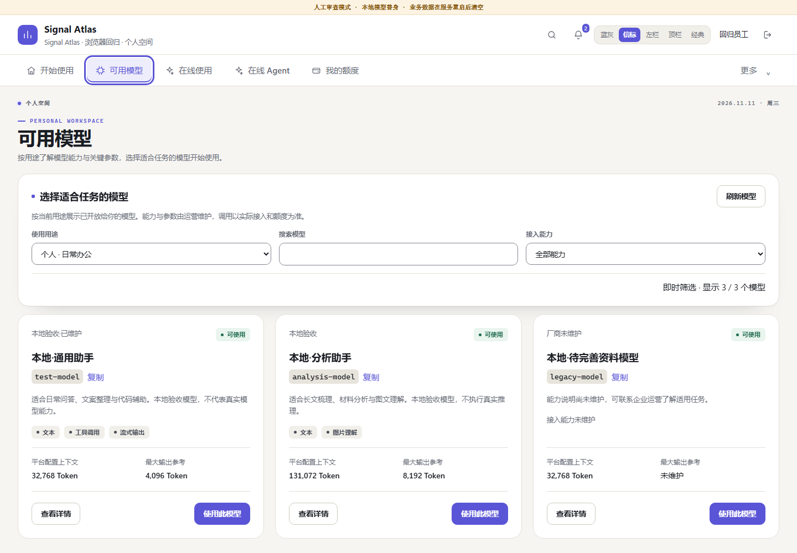
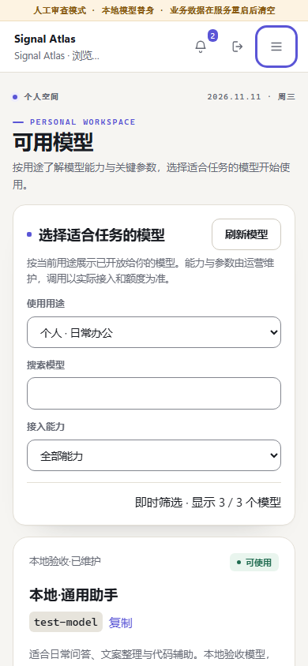
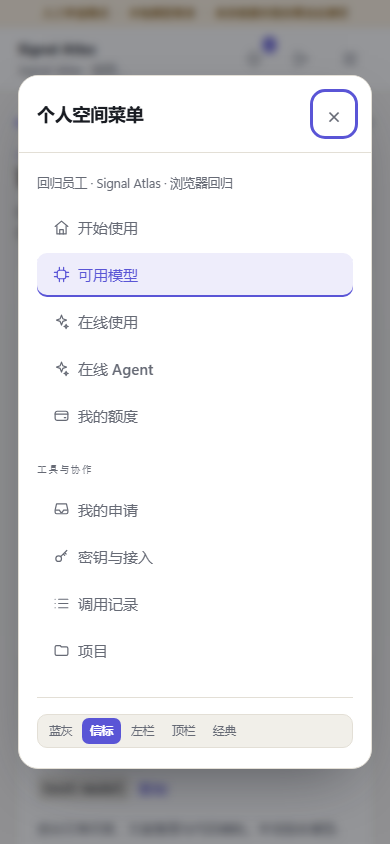
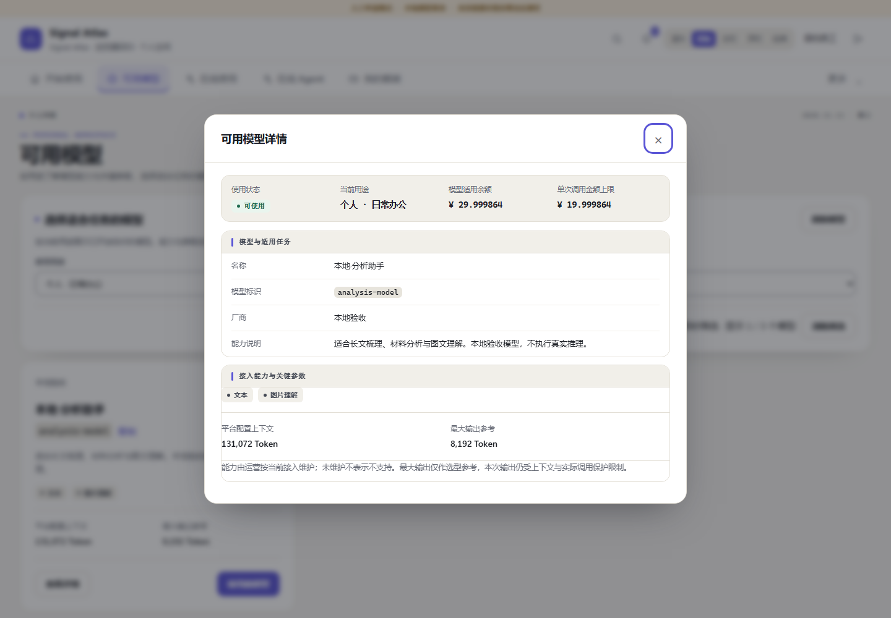
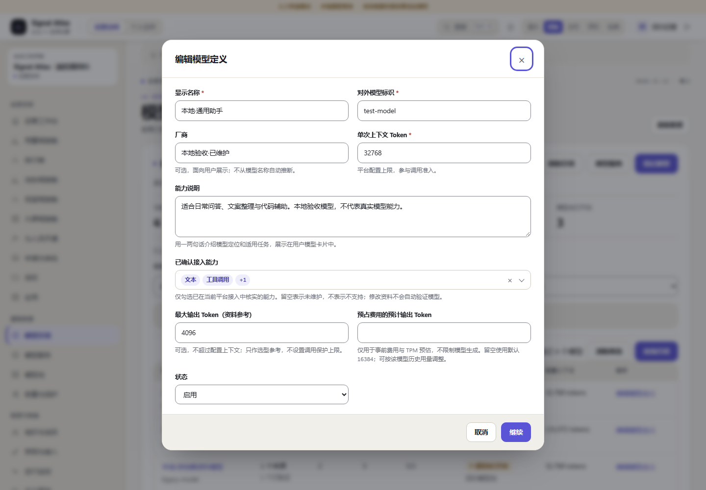

# 用户端导航与可用模型验收

日期：2026-11-11。方案：[用户端导航与可用模型 v1](../product/user-model-discovery-v1.md)。本次是在已有未提交改动上的增量实现，保留原有模型管理、审批、额度和运行配置工作。

## 实现结果

- 五套主题的用户空间统一为顶部五项常用导航与“更多”；窄屏使用共享 `Modal`，继续提供主题切换、通知、退出和运营空间返回入口。运营侧栏与页面标签保持原结构。
- 用户页面保持挂载，取消重复的页面标签栏。模型卡片支持当前个人／项目用途、搜索、能力筛选、详情、标识复制及进入在线使用；再次选择同一模型也能更新已打开的在线页面，同时保留输入草稿。
- 运营从现有模型目录编辑厂商、能力说明、已确认接入能力和最大输出参考；复用 `Field`／`MultiSelect`、预览、确认和审计。上下文、预计费用输出和最大输出参考三者明确区分。
- 模型资料写入现有 workspace JSON；旧模型无需迁移。历史客户端省略新增字段时保留值，显式空值可清除；服务端校验枚举、文本和数值范围。
- `purposes[].catalogModels` 只读补充当前授权、开放范围内来源暂不可用的模型；不改变原 `models`、余额和准入结果，不向用户返回服务或未授权模型。无额度模型保留卡片并引导到同一用途额度页。
- 刷新失败保留卡片，重试成功清除局部及工作区连接错误；复制成功与失败均给出反馈。

## 验证结果

| 检查 | 结果 |
| --- | --- |
| `pnpm --filter @ai-gateway/contracts build` | 通过 |
| `pnpm --filter @ai-gateway/web typecheck` | 通过 |
| `pnpm --filter @ai-gateway/web build` | 通过；106 modules，CSS 194.02 kB，JS 658.20 kB。仍有单块超过 500 kB 的构建提示，本次未改构建拆分策略 |
| `pnpm --filter @ai-gateway/control-plane typecheck` | 通过 |
| `pnpm --filter @ai-gateway/control-plane test` | 41 文件、260 项通过，包含新增 4 项资料／权限／授权范围／停用来源投影测试 |
| `pnpm --filter @ai-gateway/contracts test` | 8 文件、46 项通过 |
| `node scripts/check-web.mjs --model-discovery-only --postgres` | **117 项浏览器断言通过**；另有隔离 PostgreSQL 的 59 项用量 SQL 一致性与权限断言通过 |
| `node scripts/check-web.mjs --model-management-only` | **166 项通过**，运营四个模型管理页面、五主题桌面／窄屏、编辑取消回退、验证、容量配置与用户权限回归 |
| `node scripts/check-web.mjs` | **129 项通过**，开通、调用、用量、五主题与用户移动菜单等基础回归 |
| 视觉与键盘 | 已查看信标桌面／窄屏、经典深色、运营编辑与手机菜单截图；五主题 1440／390 截图齐全。真实 CDP 键盘验证 Enter 打开、Tab 限制、Escape 关闭回焦及桌面“更多” |
| 横向溢出 | 五主题 1440／390，以及用户模型页 320／360／736／1024／1440 均无页面级横向溢出 |

浏览器报告：[browser.json](screenshots-2026-11-11-model-discovery/browser.json)。检查使用独立端口、私有 Chrome profile、本地模型替身与独立 PostgreSQL schema；测试服务与 schema 已回收，不写入日常工作区。复制成功／拒绝与刷新故障采用可恢复的浏览器 fixture，不覆盖用户剪贴板。运营资料保存、用途与模型状态使用真实隔离控制面 API。

验收脚本同时修正了既有 CDP 辅助工具的 Enter 字符事件与私有浏览器关闭清理，避免把模拟按键缺失误判为菜单不可用。未使用进程名批量停止浏览器。

## 截图

## 日常开发与边界

- 使用根目录 `pnpm dev` 恢复原 `.runtime/review-postgres.json` 工作区，未删除状态文件、schema 或重建业务数据；上游 opt-in 沿用原配置。本次开发服务因任务中断退出后仍通过同一命令恢复。
- 恢复后控制面健康、`http://localhost:5176/` 与新页面源码入口均返回 HTTP 200；原审查员工实际工作区的 3 个用途均含发现投影，普通员工可见服务配置数为 0。该检查未发起上游模型调用。
- 既有模型没有新增资料时显示“未维护”，由运营按实际接入能力补齐。本次未自动填充厂商参数或发起真实上游模型验证。
- 本地测试和截图不代表生产部署、客户验收或真实模型能力承诺。未覆盖 Safari、Firefox、真实读屏软件和生产多来源能力差异。
- 最大输出字段仅为选型资料；调用保护继续使用原企业、主体、用途、池、服务和上下文限制。本版不增加价格比较或未授权模型广场。
- 一次失败检查的临时 profile `.runtime/web-check-85af792a-5e71-46ec-bdc1-eecf84d5d746` 与旧 `failure.png` 尚保留。已确认 profile 无运行 Chrome 使用；自动审批审核拒绝删除命令，仅返回 `blocked by policy`，未提供详细原因。未绕过该限制。
